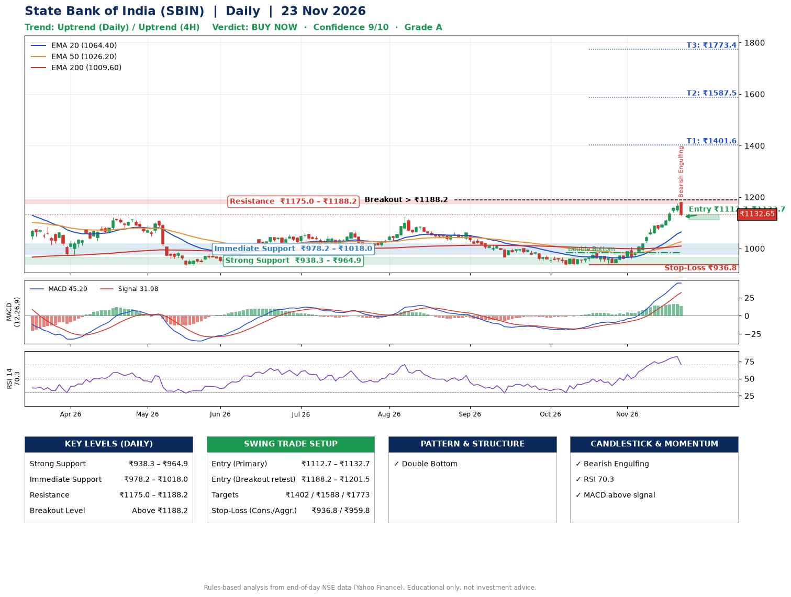

📌 **State Bank of India (SBIN) – Multi-Timeframe Technical Analysis (Daily + 4H Combined)**
_Data up to 23 Nov 2026 · Close ₹1132.65_

**📍 Daily Timeframe Trend**
- Trend: **Uptrend** (price above rising EMAs)
- Recent swing highs: ₹1124.5, ₹1062.3, ₹983.8 · swing lows: ₹968.0, ₹937.5, ₹943.4
- EMAs: EMA20 ₹1064.4, EMA50 ₹1026.2, EMA200 ₹1009.6; bullish stack (EMA20 > EMA50 > EMA200); price above EMA20, EMA50, EMA200
- MACD 45.29 above signal 31.98 (above zero); histogram falling
- RSI(14) 70.3; no divergence on the last two swings

**📍 4-Hour Timeframe Trend**
- Structure: **Uptrend** (higher highs and higher lows)
- Pullback/support area: recent 4H swing lows ₹944.7, ₹961.5; EMA20 ₹1103.2
- EMA20/50: bullish stack (EMA20 > EMA50); price above EMA20, EMA50
- MACD 37.48 above signal 37.16 (above zero); histogram falling
- RSI(14) 67.6; no divergence

**📍 Pattern Detection (Both Timeframes)**
- Daily: **Double Bottom** – bottoms near ₹937.5/₹943.4, neckline ₹983.8, confirmed (closed above neckline)
- 4H: **Bull Flag** – 15% pole then a tight 7% flag; trigger above ₹1181.3

**📍 Candlestick Patterns (last 3 daily candles)**
- **Bearish Engulfing** – 23 Nov: sellers fully reversed the prior green candle

**📍 Price Action Key Levels (Daily Structure)**

| Zone | Price Level (₹) | Context |
|------|-----------------|---------|
| Strong Support | ₹938.3 – ₹964.9 | Cluster of earlier swing lows (demand) |
| Immediate Support | ₹978.2 – ₹1018.0 | Nearest swing-low / wick area |
| Resistance | ₹1175.0 – ₹1188.2 | Nearest swing-high supply |
| Breakout Level | Above ₹1188.2 | Swing continuation trigger (52-week high ₹1234.7) |

**📍 Swing Trade Setup**

🟢 **Entry Zone**
- Primary: ₹1112.7 – ₹1132.7 (daily support / EMA20 area; enter on a bullish 4H candle)
- Alternate: ₹1188.2 – ₹1201.5 (breakout retest)

🎯 **Profit Targets**
- T1: ₹1401.6
- T2: ₹1587.5
- T3: ₹1773.4

🛑 **Stop-Loss**
- Conservative: below daily swing low (₹936.8)
- Aggressive: below 4H structure (₹959.8)
- Risk per share ≈ ₹185.9; reward:risk to T1 ≈ 1.5
- Time to T1: about 43 trading days (it rose this much within 60 trading days 6% of the time in the last 2 years)
- Time to T2: it never rose this much within 60 trading days in the price history

**📌 Strategy Notes**
- Higher timeframe: daily trend is uptrend; only take longs while price holds above ₹938.3.
- Entry timing: wait for a bullish 4H candle (engulfing/hammer) inside ₹1112.7 – ₹1132.7 rather than buying mid-range.
- EMA stacking: bullish stack (EMA20 > EMA50 > EMA200); price above EMA20, EMA50, EMA200.
- Breakout rule: a daily close above ₹1188.2 with volume above its 20-day average (≈17,825,955) opens T2/T3.
- Momentum: RSI 70 – elevated, prefer dips; no divergence on the last two swings.
- Exit discipline: move the stop to entry once T1 is hit; book partial profits at each target.

**STEP 2 — Marked Up Chart**

**✅ Trade Validation Checklist**
- Trend + momentum aligned: Yes · Price at entry zone: Yes
- Stop defined (₹936.8) · Reward:risk ≥ 1.5 to T1: Yes

## 📌 Final Verdict

Recommendation: **🟢 BUY NOW**

Confidence: **9/10**

Trade Quality: **A**

Reason:
• Daily uptrend (price above rising EMAs)
• EMAs stacked bullishly

Next Action:
• Buy now within the entry zone, with the stop-loss in place

_Rules-based analysis from end-of-day data. Educational only, not investment advice. Never place orders without your own confirmation._