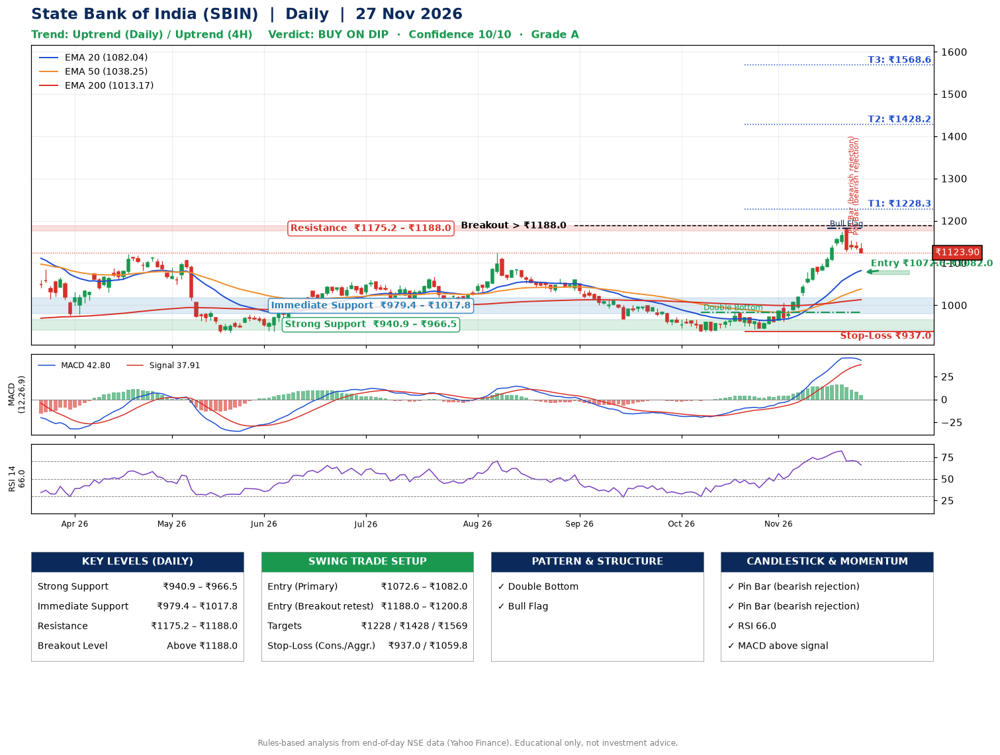

📌 **State Bank of India (SBIN) – Multi-Timeframe Technical Analysis (Daily + 4H Combined)**
_Data up to 27 Nov 2026 · Close ₹1123.90_

**📍 Daily Timeframe Trend**
- Trend: **Uptrend** (price above rising EMAs)
- Recent swing highs: ₹1124.5, ₹1062.3, ₹983.8 · swing lows: ₹968.0, ₹937.5, ₹943.4
- EMAs: EMA20 ₹1082.0, EMA50 ₹1038.2, EMA200 ₹1013.2; bullish stack (EMA20 > EMA50 > EMA200); price above EMA20, EMA50, EMA200
- MACD 42.80 above signal 37.91 (above zero); histogram falling
- RSI(14) 66.0; no divergence on the last two swings

**📍 4-Hour Timeframe Trend**
- Structure: **Uptrend** (higher highs and higher lows)
- Pullback/support area: recent 4H swing lows ₹961.5, ₹1128.9; EMA20 ₹1117.1
- EMA20/50: bullish stack (EMA20 > EMA50); price above EMA20, EMA50
- MACD 25.32 below signal 31.61 (above zero); histogram falling
- RSI(14) 59.0; no divergence

**📍 Pattern Detection (Both Timeframes)**
- Daily: **Double Bottom** – bottoms near ₹937.5/₹943.4, neckline ₹983.8, confirmed (closed above neckline)
- Daily: **Bull Flag** – 15% pole then a tight 8% flag; trigger above ₹1181.6
- 4H: **Bull Flag** – 16% pole then a tight 5% flag; trigger above ₹1181.3

**📍 Candlestick Patterns (last 3 daily candles)**
- **Pin Bar (bearish rejection)** – 25 Nov: long upper wick shows selling near ₹1153.8
- **Pin Bar (bearish rejection)** – 26 Nov: long upper wick shows selling near ₹1150.1

**📍 Price Action Key Levels (Daily Structure)**

| Zone | Price Level (₹) | Context |
|------|-----------------|---------|
| Strong Support | ₹940.9 – ₹966.5 | Cluster of earlier swing lows (demand) |
| Immediate Support | ₹979.4 – ₹1017.8 | Nearest swing-low / wick area |
| Resistance | ₹1175.2 – ₹1188.0 | Nearest swing-high supply |
| Breakout Level | Above ₹1188.0 | Swing continuation trigger (52-week high ₹1234.7) |

**📍 Swing Trade Setup**

🟢 **Entry Zone**
- Primary: ₹1072.6 – ₹1082.0 (daily support / EMA20 area; enter on a bullish 4H candle)
- Alternate: ₹1188.0 – ₹1200.8 (breakout retest)

🎯 **Profit Targets**
- T1: ₹1228.3
- T2: ₹1428.2
- T3: ₹1568.6

🛑 **Stop-Loss**
- Conservative: below daily swing low (₹937.0)
- Aggressive: below 4H structure (₹1059.8)
- Risk per share ≈ ₹140.3; reward:risk to T1 ≈ 1.1
- Time to T1: about 39 trading days (it rose this much within 60 trading days 38% of the time in the last 2 years)
- Time to T2: it never rose this much within 60 trading days in the price history

**📌 Strategy Notes**
- Higher timeframe: daily trend is uptrend; only take longs while price holds above ₹940.9.
- Entry timing: wait for a bullish 4H candle (engulfing/hammer) inside ₹1072.6 – ₹1082.0 rather than buying mid-range.
- EMA stacking: bullish stack (EMA20 > EMA50 > EMA200); price above EMA20, EMA50, EMA200.
- Breakout rule: a daily close above ₹1188.0 with volume above its 20-day average (≈17,816,074) opens T2/T3.
- Momentum: RSI 66 – elevated, prefer dips; no divergence on the last two swings.
- Exit discipline: move the stop to entry once T1 is hit; book partial profits at each target.

**STEP 2 — Marked Up Chart**

**✅ Trade Validation Checklist**
- Trend + momentum aligned: Yes · Price at entry zone: No
- Stop defined (₹937.0) · Reward:risk ≥ 1.5 to T1: No

## 📌 Final Verdict

Recommendation: **🟡 BUY ON DIP**

Confidence: **10/10**

Trade Quality: **A**

Reason:
• Daily uptrend (price above rising EMAs)
• EMAs stacked bullishly

Next Action:
• Wait for a pullback to ₹1072.6–₹1082.0

_Rules-based analysis from end-of-day data. Educational only, not investment advice. Never place orders without your own confirmation._