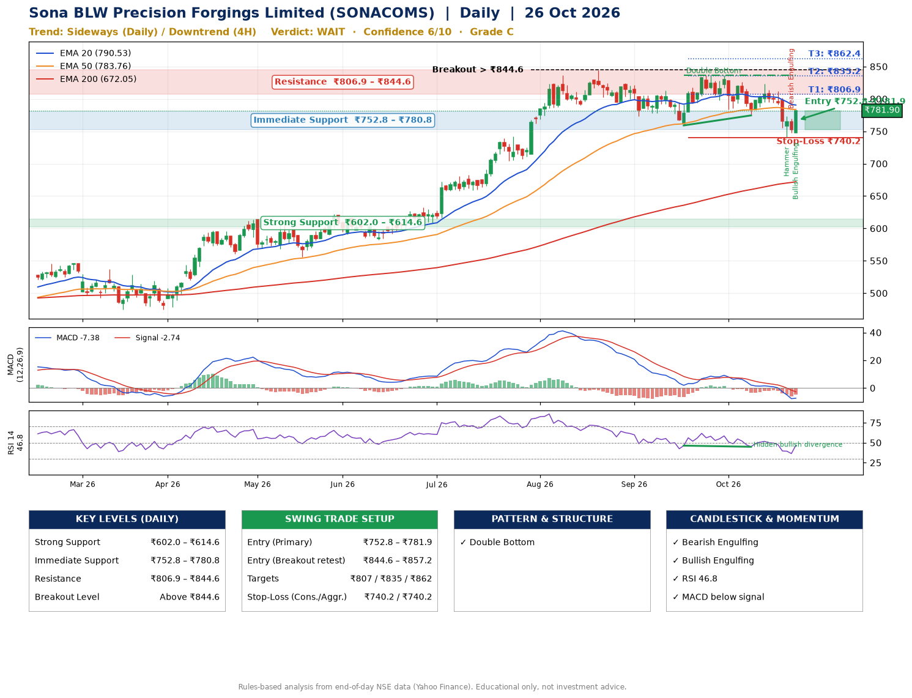

📌 **Sona BLW Precision Forgings Limited (SONACOMS) – Multi-Timeframe Technical Analysis (Daily + 4H Combined)**
_Data up to 26 Oct 2026 · Close ₹781.90_

**📍 Daily Timeframe Trend**
- Trend: **Sideways** (mixed swing structure)
- Recent swing highs: ₹813.2, ₹837.0, ₹837.0 · swing lows: ₹773.4, ₹759.0, ₹774.5
- EMAs: EMA20 ₹790.5, EMA50 ₹783.8, EMA200 ₹672.0; bullish stack (EMA20 > EMA50 > EMA200); price above EMA200
- MACD -7.38 below signal -2.74 (below zero); histogram rising
- RSI(14) 46.8; Hidden bullish divergence

**📍 4-Hour Timeframe Trend**
- Structure: **Downtrend** (lower highs and lower lows)
- Pullback/support area: recent 4H swing lows ₹774.6, ₹741.3; EMA20 ₹780.8
- EMA20/50: bearish stack (EMA20 < EMA50); price above EMA20
- MACD -10.10 below signal -8.48 (below zero); histogram rising
- RSI(14) 48.6; no divergence

**📍 Pattern Detection (Both Timeframes)**
- Daily: **Double Bottom** – bottoms near ₹759.0/₹774.5, neckline ₹837.0, forming

**📍 Candlestick Patterns (last 3 daily candles)**
- **Hammer** – 22 Oct: long lower wick shows dip-buying near ₹741.3
- **Bearish Engulfing** – 23 Oct: sellers fully reversed the prior green candle
- **Bullish Engulfing** – 26 Oct: buyers fully reversed the prior red candle

**📍 Price Action Key Levels (Daily Structure)**

| Zone | Price Level (₹) | Context |
|------|-----------------|---------|
| Strong Support | ₹602.0 – ₹614.6 | Cluster of earlier swing lows (demand) |
| Immediate Support | ₹752.8 – ₹780.8 | Nearest swing-low / wick area |
| Resistance | ₹806.9 – ₹844.6 | Nearest swing-high supply |
| Breakout Level | Above ₹844.6 | Swing continuation trigger (52-week high ₹844.0) |

**📍 Swing Trade Setup**

🟢 **Entry Zone**
- Primary: ₹752.8 – ₹781.9 (daily support / EMA20 area; enter on a bullish 4H candle)
- Alternate: ₹844.6 – ₹857.2 (breakout retest)

🎯 **Profit Targets**
- T1: ₹806.9
- T2: ₹835.2
- T3: ₹862.4

🛑 **Stop-Loss**
- Conservative: below daily swing low (₹740.2)
- Aggressive: below 4H structure (₹740.2)
- Risk per share ≈ ₹27.2; reward:risk to T1 ≈ 1.5

**📌 Strategy Notes**
- Higher timeframe: daily trend is sideways; only take longs while price holds above ₹602.0.
- Entry timing: wait for a bullish 4H candle (engulfing/hammer) inside ₹752.8 – ₹781.9 rather than buying mid-range.
- EMA stacking: bullish stack (EMA20 > EMA50 > EMA200); price above EMA200.
- Breakout rule: a daily close above ₹844.6 with volume above its 20-day average (≈2,362,093) opens T2/T3.
- Momentum: RSI 47 – room to run; Hidden bullish divergence.
- Exit discipline: move the stop to entry once T1 is hit; book partial profits at each target.

**STEP 2 — Marked Up Chart**

**✅ Trade Validation Checklist**
- Trend + momentum aligned: No · Price at entry zone: Yes
- Stop defined (₹740.2) · Reward:risk ≥ 1.5 to T1: No

## 📌 Final Verdict

Recommendation: **🟠 WAIT**

Confidence: **6/10**

Trade Quality: **C**

Reason:
• EMAs stacked bullishly
• Double Bottom: bottoms near ₹759.0/₹774.5, neckline ₹837.0, forming

Next Action:
• Wait for a breakout above ₹844.6

_Rules-based analysis from end-of-day data. Educational only, not investment advice. Never place orders without your own confirmation._