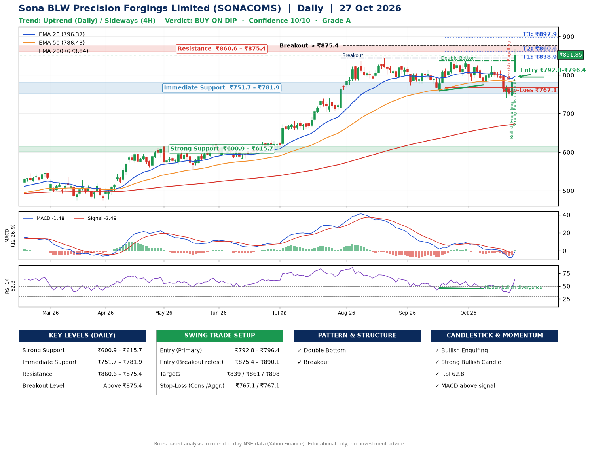

📌 **Sona BLW Precision Forgings Limited (SONACOMS) – Multi-Timeframe Technical Analysis (Daily + 4H Combined)**
_Data up to 27 Oct 2026 · Close ₹851.85_

**📍 Daily Timeframe Trend**
- Trend: **Uptrend** (price above rising EMAs)
- Recent swing highs: ₹813.2, ₹837.0, ₹837.0 · swing lows: ₹773.4, ₹759.0, ₹774.5
- EMAs: EMA20 ₹796.4, EMA50 ₹786.4, EMA200 ₹673.8; bullish stack (EMA20 > EMA50 > EMA200); price above EMA20, EMA50, EMA200
- MACD -1.48 above signal -2.49 (below zero), fresh bullish crossover; histogram rising
- RSI(14) 62.8; Hidden bullish divergence

**📍 4-Hour Timeframe Trend**
- Structure: **Sideways** (mixed swing structure)
- Pullback/support area: recent 4H swing lows ₹774.6, ₹741.3; EMA20 ₹794.2
- EMA20/50: bearish stack (EMA20 < EMA50); price above EMA20, EMA50
- MACD 2.67 above signal -5.33 (above zero), fresh bullish crossover; histogram rising
- RSI(14) 68.0; no divergence

**📍 Pattern Detection (Both Timeframes)**
- Daily: **Double Bottom** – bottoms near ₹759.0/₹774.5, neckline ₹837.0, confirmed (closed above neckline)
- Daily: **Breakout** – closed above the 60-session high ₹844.0 on strong volume

**📍 Candlestick Patterns (last 3 daily candles)**
- **Bearish Engulfing** – 23 Oct: sellers fully reversed the prior green candle
- **Bullish Engulfing** – 26 Oct: buyers fully reversed the prior red candle
- **Strong Bullish Candle** – 27 Oct: wide-range green candle, buyers in control

**📍 Price Action Key Levels (Daily Structure)**

| Zone | Price Level (₹) | Context |
|------|-----------------|---------|
| Strong Support | ₹600.9 – ₹615.7 | Cluster of earlier swing lows (demand) |
| Immediate Support | ₹751.7 – ₹781.9 | Nearest swing-low / wick area |
| Resistance | ₹860.6 – ₹875.4 | Nearest swing-high supply |
| Breakout Level | Above ₹875.4 | Swing continuation trigger (52-week high ₹868.0) |

**📍 Swing Trade Setup**

🟢 **Entry Zone**
- Primary: ₹792.8 – ₹796.4 (daily support / EMA20 area; enter on a bullish 4H candle)
- Alternate: ₹875.4 – ₹890.1 (breakout retest)

🎯 **Profit Targets**
- T1: ₹838.9
- T2: ₹860.6
- T3: ₹897.9

🛑 **Stop-Loss**
- Conservative: below daily swing low (₹767.1)
- Aggressive: below 4H structure (₹767.1)
- Risk per share ≈ ₹29.5; reward:risk to T1 ≈ 1.5

**📌 Strategy Notes**
- Higher timeframe: daily trend is uptrend; only take longs while price holds above ₹600.9.
- Entry timing: wait for a bullish 4H candle (engulfing/hammer) inside ₹792.8 – ₹796.4 rather than buying mid-range.
- EMA stacking: bullish stack (EMA20 > EMA50 > EMA200); price above EMA20, EMA50, EMA200.
- Breakout rule: a daily close above ₹875.4 with volume above its 20-day average (≈3,160,942) opens T2/T3.
- Momentum: RSI 63 – room to run; Hidden bullish divergence.
- Exit discipline: move the stop to entry once T1 is hit; book partial profits at each target.

**STEP 2 — Marked Up Chart**

**✅ Trade Validation Checklist**
- Trend + momentum aligned: Yes · Price at entry zone: No
- Stop defined (₹767.1) · Reward:risk ≥ 1.5 to T1: Yes

## 📌 Final Verdict

Recommendation: **🟡 BUY ON DIP**

Confidence: **10/10**

Trade Quality: **A**

Reason:
• Daily uptrend (price above rising EMAs)
• EMAs stacked bullishly

Next Action:
• Wait for a pullback to ₹792.8–₹796.4

_Rules-based analysis from end-of-day data. Educational only, not investment advice. Never place orders without your own confirmation._