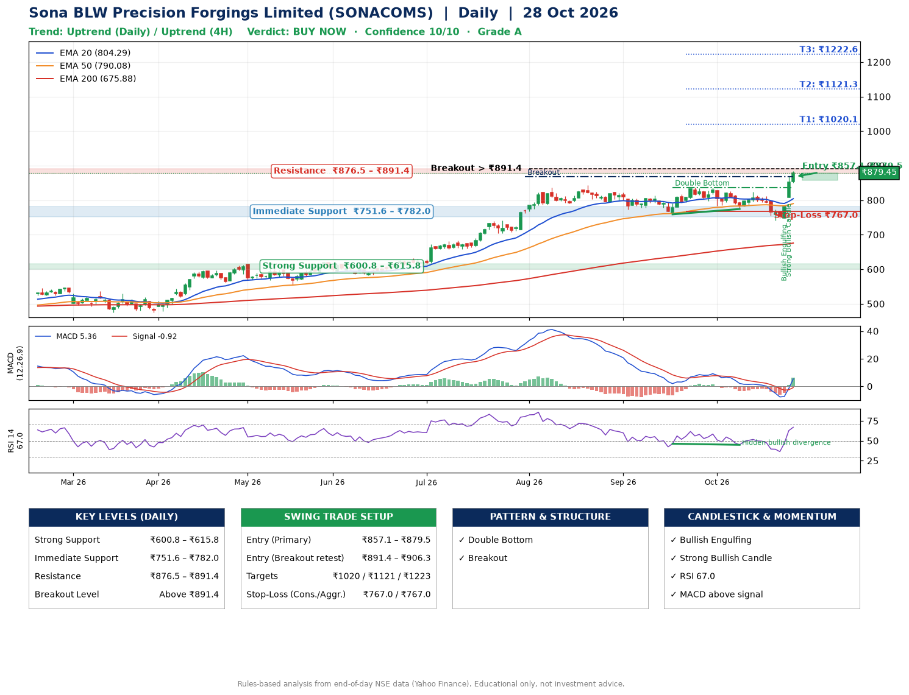

📌 **Sona BLW Precision Forgings Limited (SONACOMS) – Multi-Timeframe Technical Analysis (Daily + 4H Combined)**
_Data up to 28 Oct 2026 · Close ₹879.45_

**📍 Daily Timeframe Trend**
- Trend: **Uptrend** (price above rising EMAs)
- Recent swing highs: ₹813.2, ₹837.0, ₹837.0 · swing lows: ₹773.4, ₹759.0, ₹774.5
- EMAs: EMA20 ₹804.3, EMA50 ₹790.1, EMA200 ₹675.9; bullish stack (EMA20 > EMA50 > EMA200); price above EMA20, EMA50, EMA200
- MACD 5.36 above signal -0.92 (above zero), fresh bullish crossover; histogram rising
- RSI(14) 67.0; Hidden bullish divergence

**📍 4-Hour Timeframe Trend**
- Structure: **Uptrend** (price above rising EMAs)
- Pullback/support area: recent 4H swing lows ₹774.6, ₹741.3; EMA20 ₹809.8
- EMA20/50: bullish stack (EMA20 > EMA50); price above EMA20, EMA50
- MACD 14.02 above signal 0.86 (above zero), fresh bullish crossover; histogram rising
- RSI(14) 72.3; no divergence

**📍 Pattern Detection (Both Timeframes)**
- Daily: **Double Bottom** – bottoms near ₹759.0/₹774.5, neckline ₹837.0, confirmed (closed above neckline)
- Daily: **Breakout** – closed above the 60-session high ₹868.0 on strong volume

**📍 Candlestick Patterns (last 3 daily candles)**
- **Bullish Engulfing** – 26 Oct: buyers fully reversed the prior red candle
- **Strong Bullish Candle** – 27 Oct: wide-range green candle, buyers in control

**📍 Price Action Key Levels (Daily Structure)**

| Zone | Price Level (₹) | Context |
|------|-----------------|---------|
| Strong Support | ₹600.8 – ₹615.8 | Cluster of earlier swing lows (demand) |
| Immediate Support | ₹751.6 – ₹782.0 | Nearest swing-low / wick area |
| Resistance | ₹876.5 – ₹891.4 | Nearest swing-high supply |
| Breakout Level | Above ₹891.4 | Swing continuation trigger (52-week high ₹884.0) |

**📍 Swing Trade Setup**

🟢 **Entry Zone**
- Primary: ₹857.1 – ₹879.5 (daily support / EMA20 area; enter on a bullish 4H candle)
- Alternate: ₹891.4 – ₹906.3 (breakout retest)

🎯 **Profit Targets**
- T1: ₹1020.1
- T2: ₹1121.3
- T3: ₹1222.6

🛑 **Stop-Loss**
- Conservative: below daily swing low (₹767.0)
- Aggressive: below 4H structure (₹767.0)
- Risk per share ≈ ₹101.2; reward:risk to T1 ≈ 1.5

**📌 Strategy Notes**
- Higher timeframe: daily trend is uptrend; only take longs while price holds above ₹600.8.
- Entry timing: wait for a bullish 4H candle (engulfing/hammer) inside ₹857.1 – ₹879.5 rather than buying mid-range.
- EMA stacking: bullish stack (EMA20 > EMA50 > EMA200); price above EMA20, EMA50, EMA200.
- Breakout rule: a daily close above ₹891.4 with volume above its 20-day average (≈3,293,362) opens T2/T3.
- Momentum: RSI 67 – elevated, prefer dips; Hidden bullish divergence.
- Exit discipline: move the stop to entry once T1 is hit; book partial profits at each target.

**STEP 2 — Marked Up Chart**

**✅ Trade Validation Checklist**
- Trend + momentum aligned: Yes · Price at entry zone: Yes
- Stop defined (₹767.0) · Reward:risk ≥ 1.5 to T1: No

## 📌 Final Verdict

Recommendation: **🟢 BUY NOW**

Confidence: **10/10**

Trade Quality: **A**

Reason:
• Daily uptrend (price above rising EMAs)
• EMAs stacked bullishly

Next Action:
• Buy now within the entry zone, with the stop-loss in place

_Rules-based analysis from end-of-day data. Educational only, not investment advice. Never place orders without your own confirmation._