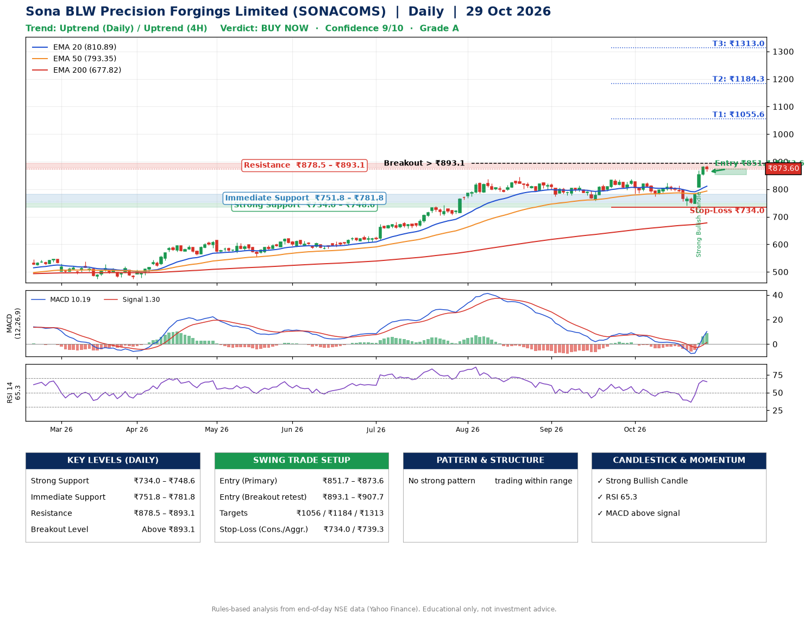

📌 **Sona BLW Precision Forgings Limited (SONACOMS) – Multi-Timeframe Technical Analysis (Daily + 4H Combined)**
_Data up to 29 Oct 2026 · Close ₹873.60_

**📍 Daily Timeframe Trend**
- Trend: **Uptrend** (price above rising EMAs)
- Recent swing highs: ₹813.2, ₹837.0, ₹837.0 · swing lows: ₹759.0, ₹774.5, ₹741.3
- EMAs: EMA20 ₹810.9, EMA50 ₹793.4, EMA200 ₹677.8; bullish stack (EMA20 > EMA50 > EMA200); price above EMA20, EMA50, EMA200
- MACD 10.19 above signal 1.30 (above zero), fresh bullish crossover; histogram rising
- RSI(14) 65.3; no divergence on the last two swings

**📍 4-Hour Timeframe Trend**
- Structure: **Uptrend** (price above rising EMAs)
- Pullback/support area: recent 4H swing lows ₹774.6, ₹741.3; EMA20 ₹821.4
- EMA20/50: bullish stack (EMA20 > EMA50); price above EMA20, EMA50
- MACD 19.52 above signal 7.21 (above zero); histogram falling
- RSI(14) 69.8; no divergence

**📍 Pattern Detection (Both Timeframes)**
- No strong pattern detected. Trading within range.

**📍 Candlestick Patterns (last 3 daily candles)**
- **Strong Bullish Candle** – 27 Oct: wide-range green candle, buyers in control

**📍 Price Action Key Levels (Daily Structure)**

| Zone | Price Level (₹) | Context |
|------|-----------------|---------|
| Strong Support | ₹734.0 – ₹748.6 | Cluster of earlier swing lows (demand) |
| Immediate Support | ₹751.8 – ₹781.8 | Nearest swing-low / wick area |
| Resistance | ₹878.5 – ₹893.1 | Nearest swing-high supply |
| Breakout Level | Above ₹893.1 | Swing continuation trigger (52-week high ₹885.8) |

**📍 Swing Trade Setup**

🟢 **Entry Zone**
- Primary: ₹851.7 – ₹873.6 (daily support / EMA20 area; enter on a bullish 4H candle)
- Alternate: ₹893.1 – ₹907.7 (breakout retest)

🎯 **Profit Targets**
- T1: ₹1055.6
- T2: ₹1184.3
- T3: ₹1313.0

🛑 **Stop-Loss**
- Conservative: below daily swing low (₹734.0)
- Aggressive: below 4H structure (₹739.3)
- Risk per share ≈ ₹128.7; reward:risk to T1 ≈ 1.5

**📌 Strategy Notes**
- Higher timeframe: daily trend is uptrend; only take longs while price holds above ₹734.0.
- Entry timing: wait for a bullish 4H candle (engulfing/hammer) inside ₹851.7 – ₹873.6 rather than buying mid-range.
- EMA stacking: bullish stack (EMA20 > EMA50 > EMA200); price above EMA20, EMA50, EMA200.
- Breakout rule: a daily close above ₹893.1 with volume above its 20-day average (≈3,194,846) opens T2/T3.
- Momentum: RSI 65 – elevated, prefer dips; no divergence on the last two swings.
- Exit discipline: move the stop to entry once T1 is hit; book partial profits at each target.

**STEP 2 — Marked Up Chart**

**✅ Trade Validation Checklist**
- Trend + momentum aligned: Yes · Price at entry zone: Yes
- Stop defined (₹734.0) · Reward:risk ≥ 1.5 to T1: No

## 📌 Final Verdict

Recommendation: **🟢 BUY NOW**

Confidence: **9/10**

Trade Quality: **A**

Reason:
• Daily uptrend (price above rising EMAs)
• EMAs stacked bullishly

Next Action:
• Buy now within the entry zone, with the stop-loss in place

_Rules-based analysis from end-of-day data. Educational only, not investment advice. Never place orders without your own confirmation._