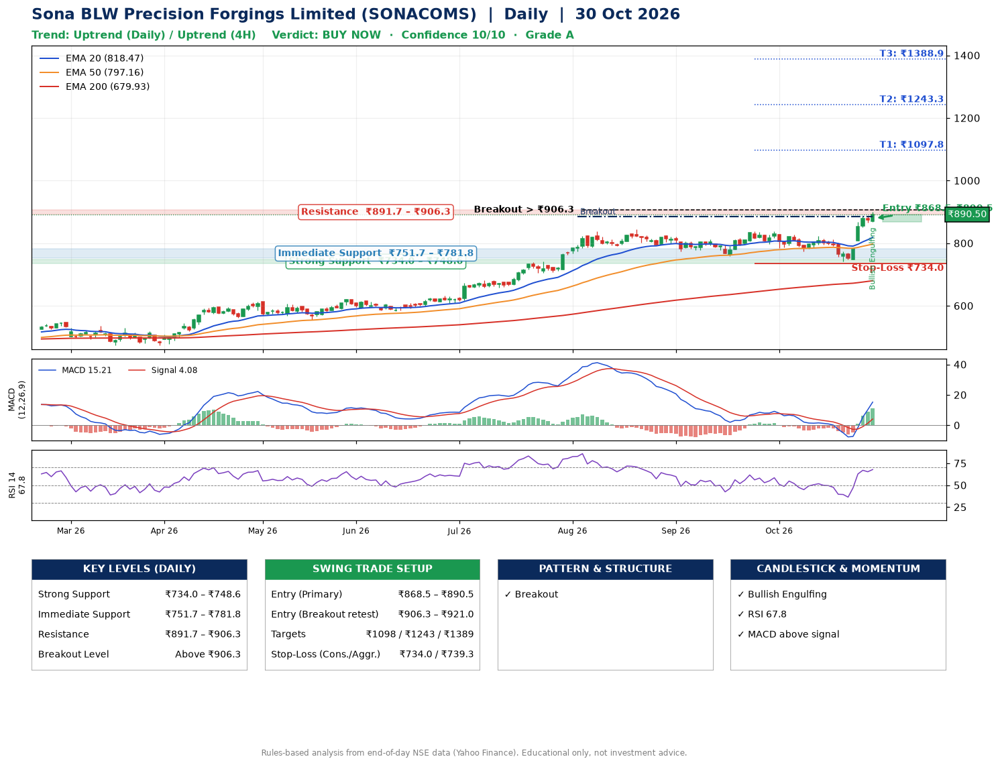

📌 **Sona BLW Precision Forgings Limited (SONACOMS) – Multi-Timeframe Technical Analysis (Daily + 4H Combined)**
_Data up to 30 Oct 2026 · Close ₹890.50_

**📍 Daily Timeframe Trend**
- Trend: **Uptrend** (price above rising EMAs)
- Recent swing highs: ₹813.2, ₹837.0, ₹837.0 · swing lows: ₹759.0, ₹774.5, ₹741.3
- EMAs: EMA20 ₹818.5, EMA50 ₹797.2, EMA200 ₹679.9; bullish stack (EMA20 > EMA50 > EMA200); price above EMA20, EMA50, EMA200
- MACD 15.21 above signal 4.08 (above zero), fresh bullish crossover; histogram rising
- RSI(14) 67.8; no divergence on the last two swings

**📍 4-Hour Timeframe Trend**
- Structure: **Uptrend** (price above rising EMAs)
- Pullback/support area: recent 4H swing lows ₹774.6, ₹741.3; EMA20 ₹834.6
- EMA20/50: bullish stack (EMA20 > EMA50); price above EMA20, EMA50
- MACD 24.94 above signal 13.29 (above zero); histogram falling
- RSI(14) 70.8; no divergence

**📍 Pattern Detection (Both Timeframes)**
- Daily: **Breakout** – closed above the 60-session high ₹885.8 (volume not confirming yet)

**📍 Candlestick Patterns (last 3 daily candles)**
- **Bullish Engulfing** – 30 Oct: buyers fully reversed the prior red candle

**📍 Price Action Key Levels (Daily Structure)**

| Zone | Price Level (₹) | Context |
|------|-----------------|---------|
| Strong Support | ₹734.0 – ₹748.6 | Cluster of earlier swing lows (demand) |
| Immediate Support | ₹751.7 – ₹781.8 | Nearest swing-low / wick area |
| Resistance | ₹891.7 – ₹906.3 | Nearest swing-high supply |
| Breakout Level | Above ₹906.3 | Swing continuation trigger (52-week high ₹899.0) |

**📍 Swing Trade Setup**

🟢 **Entry Zone**
- Primary: ₹868.5 – ₹890.5 (daily support / EMA20 area; enter on a bullish 4H candle)
- Alternate: ₹906.3 – ₹921.0 (breakout retest)

🎯 **Profit Targets**
- T1: ₹1097.8
- T2: ₹1243.3
- T3: ₹1388.9

🛑 **Stop-Loss**
- Conservative: below daily swing low (₹734.0)
- Aggressive: below 4H structure (₹739.3)
- Risk per share ≈ ₹145.5; reward:risk to T1 ≈ 1.5

**📌 Strategy Notes**
- Higher timeframe: daily trend is uptrend; only take longs while price holds above ₹734.0.
- Entry timing: wait for a bullish 4H candle (engulfing/hammer) inside ₹868.5 – ₹890.5 rather than buying mid-range.
- EMA stacking: bullish stack (EMA20 > EMA50 > EMA200); price above EMA20, EMA50, EMA200.
- Breakout rule: a daily close above ₹906.3 with volume above its 20-day average (≈3,229,917) opens T2/T3.
- Momentum: RSI 68 – elevated, prefer dips; no divergence on the last two swings.
- Exit discipline: move the stop to entry once T1 is hit; book partial profits at each target.

**STEP 2 — Marked Up Chart**

**✅ Trade Validation Checklist**
- Trend + momentum aligned: Yes · Price at entry zone: Yes
- Stop defined (₹734.0) · Reward:risk ≥ 1.5 to T1: Yes

## 📌 Final Verdict

Recommendation: **🟢 BUY NOW**

Confidence: **10/10**

Trade Quality: **A**

Reason:
• Daily uptrend (price above rising EMAs)
• EMAs stacked bullishly

Next Action:
• Buy now within the entry zone, with the stop-loss in place

_Rules-based analysis from end-of-day data. Educational only, not investment advice. Never place orders without your own confirmation._