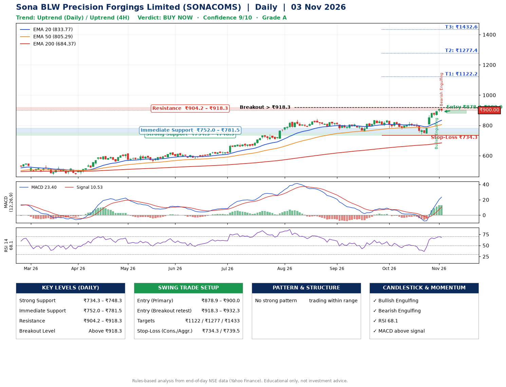

📌 **Sona BLW Precision Forgings Limited (SONACOMS) – Multi-Timeframe Technical Analysis (Daily + 4H Combined)**
_Data up to 03 Nov 2026 · Close ₹900.00_

**📍 Daily Timeframe Trend**
- Trend: **Uptrend** (price above rising EMAs)
- Recent swing highs: ₹813.2, ₹837.0, ₹837.0 · swing lows: ₹759.0, ₹774.5, ₹741.3
- EMAs: EMA20 ₹833.8, EMA50 ₹805.3, EMA200 ₹684.4; bullish stack (EMA20 > EMA50 > EMA200); price above EMA20, EMA50, EMA200
- MACD 23.40 above signal 10.53 (above zero); histogram falling
- RSI(14) 68.1; no divergence on the last two swings

**📍 4-Hour Timeframe Trend**
- Structure: **Uptrend** (price above rising EMAs)
- Pullback/support area: recent 4H swing lows ₹774.6, ₹741.3; EMA20 ₹856.6
- EMA20/50: bullish stack (EMA20 > EMA50); price above EMA20, EMA50
- MACD 29.19 above signal 22.35 (above zero); histogram falling
- RSI(14) 70.5; no divergence

**📍 Pattern Detection (Both Timeframes)**
- 4H: **Bull Flag** – 15% pole then a tight 5% flag; trigger above ₹911.2

**📍 Candlestick Patterns (last 3 daily candles)**
- **Bullish Engulfing** – 30 Oct: buyers fully reversed the prior red candle
- **Bearish Engulfing** – 03 Nov: sellers fully reversed the prior green candle

**📍 Price Action Key Levels (Daily Structure)**

| Zone | Price Level (₹) | Context |
|------|-----------------|---------|
| Strong Support | ₹734.3 – ₹748.3 | Cluster of earlier swing lows (demand) |
| Immediate Support | ₹752.0 – ₹781.5 | Nearest swing-low / wick area |
| Resistance | ₹904.2 – ₹918.3 | Nearest swing-high supply |
| Breakout Level | Above ₹918.3 | Swing continuation trigger (52-week high ₹911.2) |

**📍 Swing Trade Setup**

🟢 **Entry Zone**
- Primary: ₹878.9 – ₹900.0 (daily support / EMA20 area; enter on a bullish 4H candle)
- Alternate: ₹918.3 – ₹932.3 (breakout retest)

🎯 **Profit Targets**
- T1: ₹1122.2
- T2: ₹1277.4
- T3: ₹1432.6

🛑 **Stop-Loss**
- Conservative: below daily swing low (₹734.3)
- Aggressive: below 4H structure (₹739.5)
- Risk per share ≈ ₹155.2; reward:risk to T1 ≈ 1.5

**📌 Strategy Notes**
- Higher timeframe: daily trend is uptrend; only take longs while price holds above ₹734.3.
- Entry timing: wait for a bullish 4H candle (engulfing/hammer) inside ₹878.9 – ₹900.0 rather than buying mid-range.
- EMA stacking: bullish stack (EMA20 > EMA50 > EMA200); price above EMA20, EMA50, EMA200.
- Breakout rule: a daily close above ₹918.3 with volume above its 20-day average (≈3,212,451) opens T2/T3.
- Momentum: RSI 68 – elevated, prefer dips; no divergence on the last two swings.
- Exit discipline: move the stop to entry once T1 is hit; book partial profits at each target.

**STEP 2 — Marked Up Chart**

**✅ Trade Validation Checklist**
- Trend + momentum aligned: Yes · Price at entry zone: Yes
- Stop defined (₹734.3) · Reward:risk ≥ 1.5 to T1: No

## 📌 Final Verdict

Recommendation: **🟢 BUY NOW**

Confidence: **9/10**

Trade Quality: **A**

Reason:
• Daily uptrend (price above rising EMAs)
• EMAs stacked bullishly

Next Action:
• Buy now within the entry zone, with the stop-loss in place

_Rules-based analysis from end-of-day data. Educational only, not investment advice. Never place orders without your own confirmation._