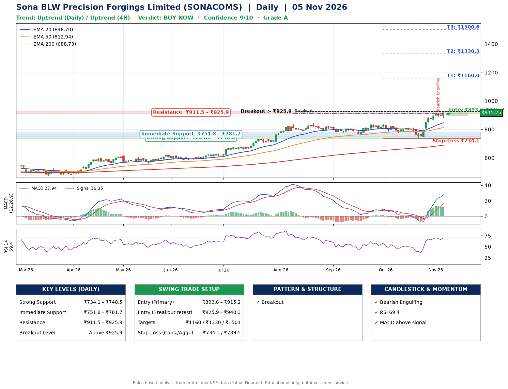

📌 **Sona BLW Precision Forgings Limited (SONACOMS) – Multi-Timeframe Technical Analysis (Daily + 4H Combined)**
_Data up to 05 Nov 2026 · Close ₹915.25_

**📍 Daily Timeframe Trend**
- Trend: **Uptrend** (price above rising EMAs)
- Recent swing highs: ₹813.2, ₹837.0, ₹837.0 · swing lows: ₹759.0, ₹774.5, ₹741.3
- EMAs: EMA20 ₹846.7, EMA50 ₹812.9, EMA200 ₹688.7; bullish stack (EMA20 > EMA50 > EMA200); price above EMA20, EMA50, EMA200
- MACD 27.94 above signal 16.35 (above zero); histogram falling
- RSI(14) 69.4; no divergence on the last two swings

**📍 4-Hour Timeframe Trend**
- Structure: **Uptrend** (price above rising EMAs)
- Pullback/support area: recent 4H swing lows ₹774.6, ₹741.3; EMA20 ₹872.0
- EMA20/50: bullish stack (EMA20 > EMA50); price above EMA20, EMA50
- MACD 27.89 above signal 25.54 (above zero); histogram falling
- RSI(14) 72.0; no divergence

**📍 Pattern Detection (Both Timeframes)**
- Daily: **Breakout** – closed above the 60-session high ₹912.6 on strong volume
- 4H: **Bull Flag** – 16% pole then a tight 4% flag; trigger above ₹918.6

**📍 Candlestick Patterns (last 3 daily candles)**
- **Bearish Engulfing** – 03 Nov: sellers fully reversed the prior green candle

**📍 Price Action Key Levels (Daily Structure)**

| Zone | Price Level (₹) | Context |
|------|-----------------|---------|
| Strong Support | ₹734.1 – ₹748.5 | Cluster of earlier swing lows (demand) |
| Immediate Support | ₹751.8 – ₹781.7 | Nearest swing-low / wick area |
| Resistance | ₹911.5 – ₹925.9 | Nearest swing-high supply |
| Breakout Level | Above ₹925.9 | Swing continuation trigger (52-week high ₹918.7) |

**📍 Swing Trade Setup**

🟢 **Entry Zone**
- Primary: ₹893.6 – ₹915.2 (daily support / EMA20 area; enter on a bullish 4H candle)
- Alternate: ₹925.9 – ₹940.3 (breakout retest)

🎯 **Profit Targets**
- T1: ₹1160.0
- T2: ₹1330.3
- T3: ₹1500.6

🛑 **Stop-Loss**
- Conservative: below daily swing low (₹734.1)
- Aggressive: below 4H structure (₹739.5)
- Risk per share ≈ ₹170.3; reward:risk to T1 ≈ 1.5

**📌 Strategy Notes**
- Higher timeframe: daily trend is uptrend; only take longs while price holds above ₹734.1.
- Entry timing: wait for a bullish 4H candle (engulfing/hammer) inside ₹893.6 – ₹915.2 rather than buying mid-range.
- EMA stacking: bullish stack (EMA20 > EMA50 > EMA200); price above EMA20, EMA50, EMA200.
- Breakout rule: a daily close above ₹925.9 with volume above its 20-day average (≈3,450,453) opens T2/T3.
- Momentum: RSI 69 – elevated, prefer dips; no divergence on the last two swings.
- Exit discipline: move the stop to entry once T1 is hit; book partial profits at each target.

**STEP 2 — Marked Up Chart**

**✅ Trade Validation Checklist**
- Trend + momentum aligned: Yes · Price at entry zone: Yes
- Stop defined (₹734.1) · Reward:risk ≥ 1.5 to T1: Yes

## 📌 Final Verdict

Recommendation: **🟢 BUY NOW**

Confidence: **9/10**

Trade Quality: **A**

Reason:
• Daily uptrend (price above rising EMAs)
• EMAs stacked bullishly

Next Action:
• Buy now within the entry zone, with the stop-loss in place

_Rules-based analysis from end-of-day data. Educational only, not investment advice. Never place orders without your own confirmation._