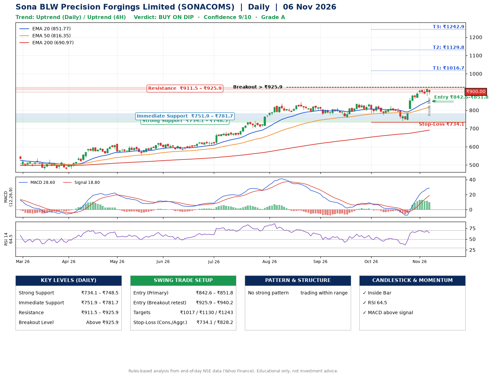

📌 **Sona BLW Precision Forgings Limited (SONACOMS) – Multi-Timeframe Technical Analysis (Daily + 4H Combined)**
_Data up to 06 Nov 2026 · Close ₹900.00_

**📍 Daily Timeframe Trend**
- Trend: **Uptrend** (price above rising EMAs)
- Recent swing highs: ₹813.2, ₹837.0, ₹837.0 · swing lows: ₹759.0, ₹774.5, ₹741.3
- EMAs: EMA20 ₹851.8, EMA50 ₹816.4, EMA200 ₹691.0; bullish stack (EMA20 > EMA50 > EMA200); price above EMA20, EMA50, EMA200
- MACD 28.60 above signal 18.80 (above zero); histogram falling
- RSI(14) 64.5; no divergence on the last two swings

**📍 4-Hour Timeframe Trend**
- Structure: **Uptrend** (higher highs and higher lows)
- Pullback/support area: recent 4H swing lows ₹741.3, ₹878.7; EMA20 ₹876.7
- EMA20/50: bullish stack (EMA20 > EMA50); price above EMA20, EMA50
- MACD 25.14 below signal 25.59 (above zero), fresh bearish crossover; histogram falling
- RSI(14) 63.5; no divergence

**📍 Pattern Detection (Both Timeframes)**
- 4H: **Bull Flag** – 16% pole then a tight 4% flag; trigger above ₹918.6

**📍 Candlestick Patterns (last 3 daily candles)**
- **Inside Bar** – 06 Nov: compression inside the prior range ₹878.0–₹918.7

**📍 Price Action Key Levels (Daily Structure)**

| Zone | Price Level (₹) | Context |
|------|-----------------|---------|
| Strong Support | ₹734.1 – ₹748.5 | Cluster of earlier swing lows (demand) |
| Immediate Support | ₹751.9 – ₹781.7 | Nearest swing-low / wick area |
| Resistance | ₹911.5 – ₹925.9 | Nearest swing-high supply |
| Breakout Level | Above ₹925.9 | Swing continuation trigger (52-week high ₹918.7) |

**📍 Swing Trade Setup**

🟢 **Entry Zone**
- Primary: ₹842.6 – ₹851.8 (daily support / EMA20 area; enter on a bullish 4H candle)
- Alternate: ₹925.9 – ₹940.2 (breakout retest)

🎯 **Profit Targets**
- T1: ₹1016.7
- T2: ₹1129.8
- T3: ₹1242.9

🛑 **Stop-Loss**
- Conservative: below daily swing low (₹734.1)
- Aggressive: below 4H structure (₹828.2)
- Risk per share ≈ ₹113.1; reward:risk to T1 ≈ 1.5

**📌 Strategy Notes**
- Higher timeframe: daily trend is uptrend; only take longs while price holds above ₹734.1.
- Entry timing: wait for a bullish 4H candle (engulfing/hammer) inside ₹842.6 – ₹851.8 rather than buying mid-range.
- EMA stacking: bullish stack (EMA20 > EMA50 > EMA200); price above EMA20, EMA50, EMA200.
- Breakout rule: a daily close above ₹925.9 with volume above its 20-day average (≈3,427,463) opens T2/T3.
- Momentum: RSI 65 – room to run; no divergence on the last two swings.
- Exit discipline: move the stop to entry once T1 is hit; book partial profits at each target.

**STEP 2 — Marked Up Chart**

**✅ Trade Validation Checklist**
- Trend + momentum aligned: Yes · Price at entry zone: No
- Stop defined (₹734.1) · Reward:risk ≥ 1.5 to T1: No

## 📌 Final Verdict

Recommendation: **🟡 BUY ON DIP**

Confidence: **9/10**

Trade Quality: **A**

Reason:
• Daily uptrend (price above rising EMAs)
• EMAs stacked bullishly

Next Action:
• Wait for a pullback to ₹842.6–₹851.8

_Rules-based analysis from end-of-day data. Educational only, not investment advice. Never place orders without your own confirmation._