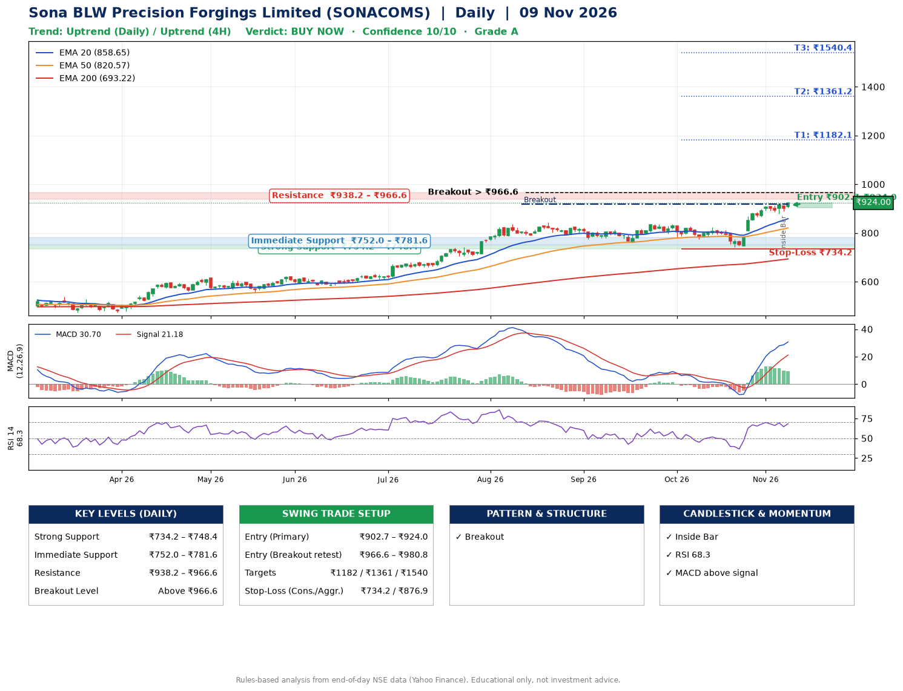

📌 **Sona BLW Precision Forgings Limited (SONACOMS) – Multi-Timeframe Technical Analysis (Daily + 4H Combined)**
_Data up to 09 Nov 2026 · Close ₹924.00_

**📍 Daily Timeframe Trend**
- Trend: **Uptrend** (price above rising EMAs)
- Recent swing highs: ₹813.2, ₹837.0, ₹837.0 · swing lows: ₹759.0, ₹774.5, ₹741.3
- EMAs: EMA20 ₹858.7, EMA50 ₹820.6, EMA200 ₹693.2; bullish stack (EMA20 > EMA50 > EMA200); price above EMA20, EMA50, EMA200
- MACD 30.70 above signal 21.18 (above zero); histogram falling
- RSI(14) 68.3; no divergence on the last two swings

**📍 4-Hour Timeframe Trend**
- Structure: **Uptrend** (higher highs and higher lows)
- Pullback/support area: recent 4H swing lows ₹741.3, ₹878.7; EMA20 ₹884.4
- EMA20/50: bullish stack (EMA20 > EMA50); price above EMA20, EMA50
- MACD 25.44 below signal 25.47 (above zero), fresh bearish crossover; histogram rising
- RSI(14) 69.4; no divergence

**📍 Pattern Detection (Both Timeframes)**
- Daily: **Breakout** – closed above the 60-session high ₹918.7 (volume not confirming yet)
- 4H: **Bull Flag** – 15% pole then a tight 5% flag; trigger above ₹924.0

**📍 Candlestick Patterns (last 3 daily candles)**
- **Inside Bar** – 06 Nov: compression inside the prior range ₹878.0–₹918.7

**📍 Price Action Key Levels (Daily Structure)**

| Zone | Price Level (₹) | Context |
|------|-----------------|---------|
| Strong Support | ₹734.2 – ₹748.4 | Cluster of earlier swing lows (demand) |
| Immediate Support | ₹752.0 – ₹781.6 | Nearest swing-low / wick area |
| Resistance | ₹938.2 – ₹966.6 | Nearest swing-high supply |
| Breakout Level | Above ₹966.6 | Swing continuation trigger (52-week high ₹924.0) |

**📍 Swing Trade Setup**

🟢 **Entry Zone**
- Primary: ₹902.7 – ₹924.0 (daily support / EMA20 area; enter on a bullish 4H candle)
- Alternate: ₹966.6 – ₹980.8 (breakout retest)

🎯 **Profit Targets**
- T1: ₹1182.1
- T2: ₹1361.2
- T3: ₹1540.4

🛑 **Stop-Loss**
- Conservative: below daily swing low (₹734.2)
- Aggressive: below 4H structure (₹876.9)
- Risk per share ≈ ₹179.2; reward:risk to T1 ≈ 1.5

**📌 Strategy Notes**
- Higher timeframe: daily trend is uptrend; only take longs while price holds above ₹734.2.
- Entry timing: wait for a bullish 4H candle (engulfing/hammer) inside ₹902.7 – ₹924.0 rather than buying mid-range.
- EMA stacking: bullish stack (EMA20 > EMA50 > EMA200); price above EMA20, EMA50, EMA200.
- Breakout rule: a daily close above ₹966.6 with volume above its 20-day average (≈3,384,607) opens T2/T3.
- Momentum: RSI 68 – elevated, prefer dips; no divergence on the last two swings.
- Exit discipline: move the stop to entry once T1 is hit; book partial profits at each target.

**STEP 2 — Marked Up Chart**

**✅ Trade Validation Checklist**
- Trend + momentum aligned: Yes · Price at entry zone: Yes
- Stop defined (₹734.2) · Reward:risk ≥ 1.5 to T1: Yes

## 📌 Final Verdict

Recommendation: **🟢 BUY NOW**

Confidence: **10/10**

Trade Quality: **A**

Reason:
• Daily uptrend (price above rising EMAs)
• EMAs stacked bullishly

Next Action:
• Buy now within the entry zone, with the stop-loss in place

_Rules-based analysis from end-of-day data. Educational only, not investment advice. Never place orders without your own confirmation._