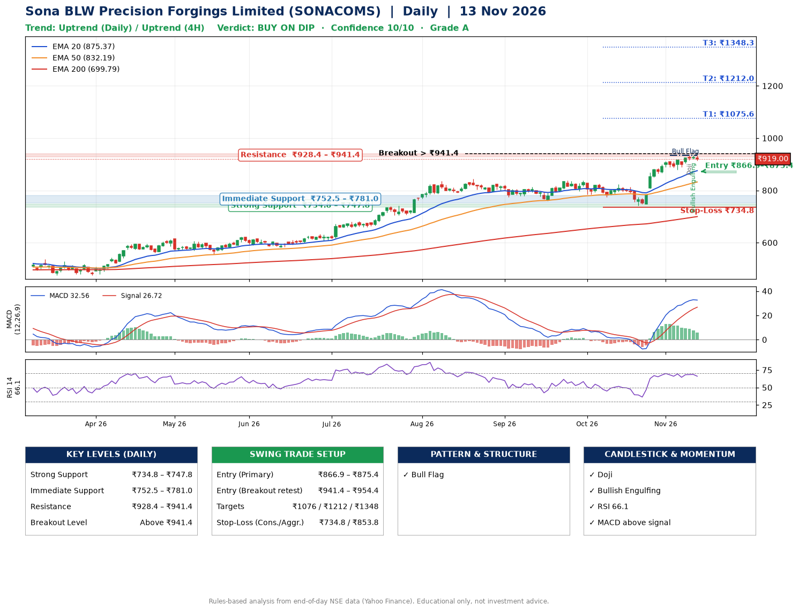

📌 **Sona BLW Precision Forgings Limited (SONACOMS) – Multi-Timeframe Technical Analysis (Daily + 4H Combined)**
_Data up to 13 Nov 2026 · Close ₹919.00_

**📍 Daily Timeframe Trend**
- Trend: **Uptrend** (price above rising EMAs)
- Recent swing highs: ₹813.2, ₹837.0, ₹837.0 · swing lows: ₹759.0, ₹774.5, ₹741.3
- EMAs: EMA20 ₹875.4, EMA50 ₹832.2, EMA200 ₹699.8; bullish stack (EMA20 > EMA50 > EMA200); price above EMA20, EMA50, EMA200
- MACD 32.56 above signal 26.72 (above zero); histogram falling
- RSI(14) 66.1; no divergence on the last two swings

**📍 4-Hour Timeframe Trend**
- Structure: **Uptrend** (higher highs and higher lows)
- Pullback/support area: recent 4H swing lows ₹741.3, ₹878.7; EMA20 ₹902.4
- EMA20/50: bullish stack (EMA20 > EMA50); price above EMA20, EMA50
- MACD 22.17 below signal 24.44 (above zero), fresh bearish crossover; histogram falling
- RSI(14) 63.7; no divergence

**📍 Pattern Detection (Both Timeframes)**
- Daily: **Bull Flag** – 16% pole then a tight 6% flag; trigger above ₹934.9
- 4H: **Bull Flag** – 15% pole then a tight 3% flag; trigger above ₹934.8

**📍 Candlestick Patterns (last 3 daily candles)**
- **Doji** – 11 Nov: indecision; wait for the next candle to confirm direction
- **Bullish Engulfing** – 12 Nov: buyers fully reversed the prior red candle

**📍 Price Action Key Levels (Daily Structure)**

| Zone | Price Level (₹) | Context |
|------|-----------------|---------|
| Strong Support | ₹734.8 – ₹747.8 | Cluster of earlier swing lows (demand) |
| Immediate Support | ₹752.5 – ₹781.0 | Nearest swing-low / wick area |
| Resistance | ₹928.4 – ₹941.4 | Nearest swing-high supply |
| Breakout Level | Above ₹941.4 | Swing continuation trigger (52-week high ₹934.9) |

**📍 Swing Trade Setup**

🟢 **Entry Zone**
- Primary: ₹866.9 – ₹875.4 (daily support / EMA20 area; enter on a bullish 4H candle)
- Alternate: ₹941.4 – ₹954.4 (breakout retest)

🎯 **Profit Targets**
- T1: ₹1075.6
- T2: ₹1212.0
- T3: ₹1348.3

🛑 **Stop-Loss**
- Conservative: below daily swing low (₹734.8)
- Aggressive: below 4H structure (₹853.8)
- Risk per share ≈ ₹136.3; reward:risk to T1 ≈ 1.5
- Time to T1: about 37 trading days (it rose this much within 60 trading days 25% of the time in the last 2 years)
- Time to T2: about 52 trading days (it rose this much within 60 trading days 5% of the time in the last 2 years)

**📌 Strategy Notes**
- Higher timeframe: daily trend is uptrend; only take longs while price holds above ₹734.8.
- Entry timing: wait for a bullish 4H candle (engulfing/hammer) inside ₹866.9 – ₹875.4 rather than buying mid-range.
- EMA stacking: bullish stack (EMA20 > EMA50 > EMA200); price above EMA20, EMA50, EMA200.
- Breakout rule: a daily close above ₹941.4 with volume above its 20-day average (≈3,227,162) opens T2/T3.
- Momentum: RSI 66 – elevated, prefer dips; no divergence on the last two swings.
- Exit discipline: move the stop to entry once T1 is hit; book partial profits at each target.

**STEP 2 — Marked Up Chart**

**✅ Trade Validation Checklist**
- Trend + momentum aligned: Yes · Price at entry zone: No
- Stop defined (₹734.8) · Reward:risk ≥ 1.5 to T1: No

## 📌 Final Verdict

Recommendation: **🟡 BUY ON DIP**

Confidence: **10/10**

Trade Quality: **A**

Reason:
• Daily uptrend (price above rising EMAs)
• EMAs stacked bullishly

Next Action:
• Wait for a pullback to ₹866.9–₹875.4

_Rules-based analysis from end-of-day data. Educational only, not investment advice. Never place orders without your own confirmation._