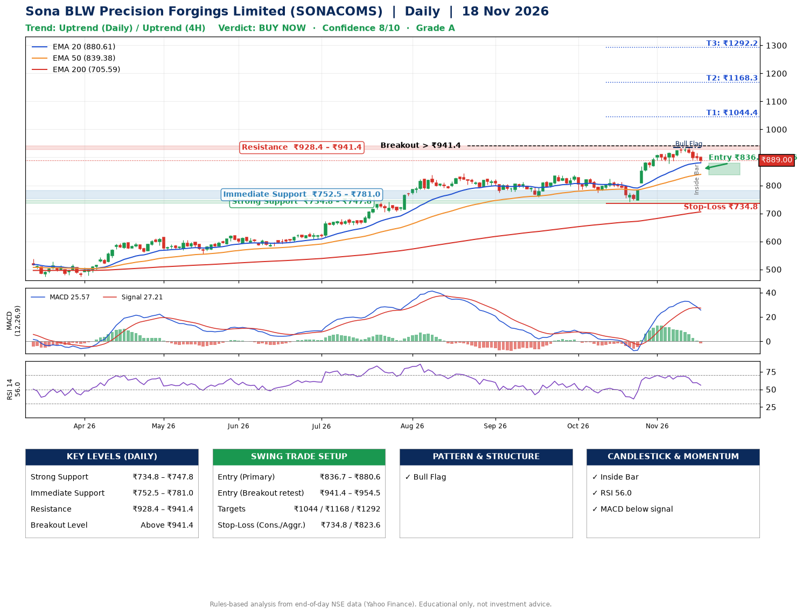

📌 **Sona BLW Precision Forgings Limited (SONACOMS) – Multi-Timeframe Technical Analysis (Daily + 4H Combined)**
_Data up to 18 Nov 2026 · Close ₹889.00_

**📍 Daily Timeframe Trend**
- Trend: **Uptrend** (price above rising EMAs)
- Recent swing highs: ₹813.2, ₹837.0, ₹837.0 · swing lows: ₹759.0, ₹774.5, ₹741.3
- EMAs: EMA20 ₹880.6, EMA50 ₹839.4, EMA200 ₹705.6; bullish stack (EMA20 > EMA50 > EMA200); price above EMA20, EMA50, EMA200
- MACD 25.57 below signal 27.21 (above zero), fresh bearish crossover; histogram falling
- RSI(14) 56.0; no divergence on the last two swings

**📍 4-Hour Timeframe Trend**
- Structure: **Uptrend** (higher highs and higher lows)
- Pullback/support area: recent 4H swing lows ₹741.3, ₹878.7; EMA20 ₹898.4
- EMA20/50: bullish stack (EMA20 > EMA50); price above EMA50
- MACD 7.95 below signal 15.22 (above zero); histogram falling
- RSI(14) 48.5; Regular bearish divergence

**📍 Pattern Detection (Both Timeframes)**
- Daily: **Bull Flag** – 22% pole then a tight 6% flag; trigger above ₹934.9
- 4H: **Double Top** – tops near ₹911.2/₹934.8, neckline ₹878.7, forming
- 4H: **Bull Flag** – 18% pole then a tight 6% flag; trigger above ₹934.8

**📍 Candlestick Patterns (last 3 daily candles)**
- **Inside Bar** – 17 Nov: compression inside the prior range ₹890.5–₹925.0

**📍 Price Action Key Levels (Daily Structure)**

| Zone | Price Level (₹) | Context |
|------|-----------------|---------|
| Strong Support | ₹734.8 – ₹747.8 | Cluster of earlier swing lows (demand) |
| Immediate Support | ₹752.5 – ₹781.0 | Nearest swing-low / wick area |
| Resistance | ₹928.4 – ₹941.4 | Nearest swing-high supply |
| Breakout Level | Above ₹941.4 | Swing continuation trigger (52-week high ₹934.9) |

**📍 Swing Trade Setup**

🟢 **Entry Zone**
- Primary: ₹836.7 – ₹880.6 (daily support / EMA20 area; enter on a bullish 4H candle)
- Alternate: ₹941.4 – ₹954.5 (breakout retest)

🎯 **Profit Targets**
- T1: ₹1044.4
- T2: ₹1168.3
- T3: ₹1292.2

🛑 **Stop-Loss**
- Conservative: below daily swing low (₹734.8)
- Aggressive: below 4H structure (₹823.6)
- Risk per share ≈ ₹123.9; reward:risk to T1 ≈ 1.5
- Time to T1: about 30 trading days (it rose this much within 60 trading days 28% of the time in the last 2 years)
- Time to T2: about 43 trading days (it rose this much within 60 trading days 8% of the time in the last 2 years)

**📌 Strategy Notes**
- Higher timeframe: daily trend is uptrend; only take longs while price holds above ₹734.8.
- Entry timing: wait for a bullish 4H candle (engulfing/hammer) inside ₹836.7 – ₹880.6 rather than buying mid-range.
- EMA stacking: bullish stack (EMA20 > EMA50 > EMA200); price above EMA20, EMA50, EMA200.
- Breakout rule: a daily close above ₹941.4 with volume above its 20-day average (≈3,252,658) opens T2/T3.
- Momentum: RSI 56 – room to run; no divergence on the last two swings.
- Exit discipline: move the stop to entry once T1 is hit; book partial profits at each target.

**STEP 2 — Marked Up Chart**

**✅ Trade Validation Checklist**
- Trend + momentum aligned: No · Price at entry zone: No
- Stop defined (₹734.8) · Reward:risk ≥ 1.5 to T1: No

## 📌 Final Verdict

Recommendation: **🟢 BUY NOW**

Confidence: **8/10**

Trade Quality: **A**

Reason:
• Daily uptrend (price above rising EMAs)
• EMAs stacked bullishly

Next Action:
• Buy now within the entry zone, with the stop-loss in place

_Rules-based analysis from end-of-day data. Educational only, not investment advice. Never place orders without your own confirmation._