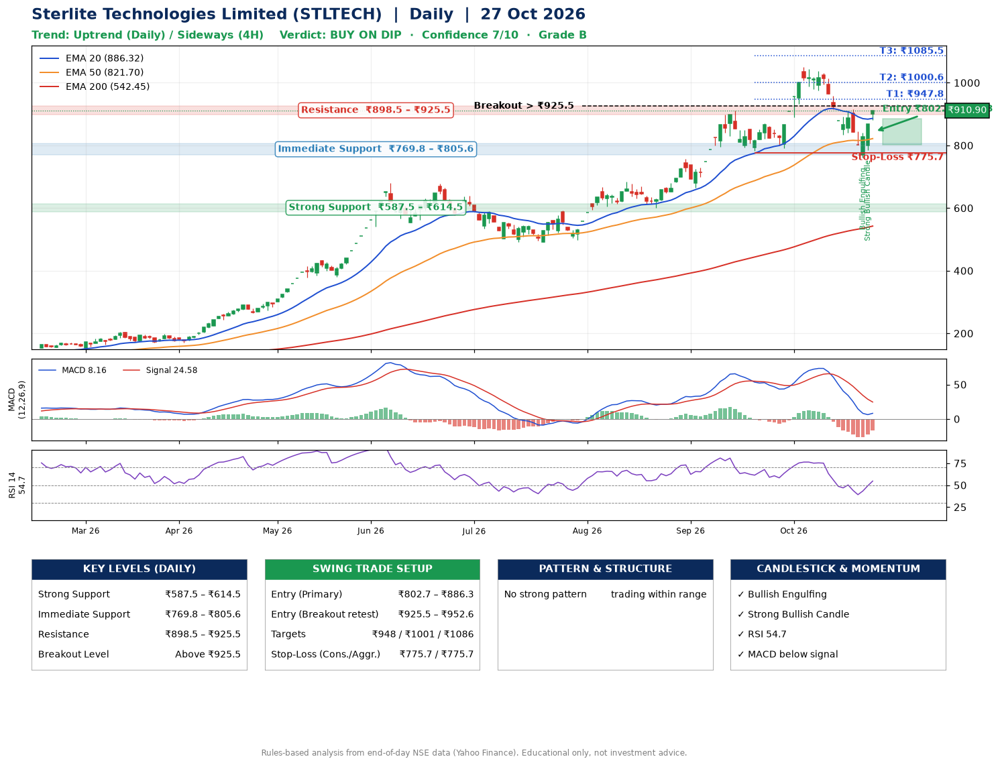

📌 **Sterlite Technologies Limited (STLTECH) – Multi-Timeframe Technical Analysis (Daily + 4H Combined)**
_Data up to 27 Oct 2026 · Close ₹910.90_

**📍 Daily Timeframe Trend**
- Trend: **Uptrend** (higher highs and higher lows)
- Recent swing highs: ₹683.5, ₹912.0, ₹1051.1 · swing lows: ₹601.0, ₹783.3, ₹792.1
- EMAs: EMA20 ₹886.3, EMA50 ₹821.7, EMA200 ₹542.4; bullish stack (EMA20 > EMA50 > EMA200); price above EMA20, EMA50, EMA200
- MACD 8.16 below signal 24.58 (above zero); histogram rising
- RSI(14) 54.7; no divergence on the last two swings

**📍 4-Hour Timeframe Trend**
- Structure: **Sideways** (mixed swing structure)
- Pullback/support area: recent 4H swing lows ₹834.5, ₹760.8; EMA20 ₹879.9
- EMA20/50: bullish stack (EMA20 > EMA50); price above EMA20, EMA50
- MACD -13.71 above signal -18.62 (below zero), fresh bullish crossover; histogram rising
- RSI(14) 55.3; no divergence

**📍 Pattern Detection (Both Timeframes)**
- No strong pattern detected. Trading within range.

**📍 Candlestick Patterns (last 3 daily candles)**
- **Bullish Engulfing** – 23 Oct: buyers fully reversed the prior red candle
- **Strong Bullish Candle** – 26 Oct: wide-range green candle, buyers in control

**📍 Price Action Key Levels (Daily Structure)**

| Zone | Price Level (₹) | Context |
|------|-----------------|---------|
| Strong Support | ₹587.5 – ₹614.5 | Cluster of earlier swing lows (demand) |
| Immediate Support | ₹769.8 – ₹805.6 | Nearest swing-low / wick area |
| Resistance | ₹898.5 – ₹925.5 | Nearest swing-high supply |
| Breakout Level | Above ₹925.5 | Swing continuation trigger (52-week high ₹1051.1) |

**📍 Swing Trade Setup**

🟢 **Entry Zone**
- Primary: ₹802.7 – ₹886.3 (daily support / EMA20 area; enter on a bullish 4H candle)
- Alternate: ₹925.5 – ₹952.6 (breakout retest)

🎯 **Profit Targets**
- T1: ₹947.8
- T2: ₹1000.6
- T3: ₹1085.5

🛑 **Stop-Loss**
- Conservative: below daily swing low (₹775.7)
- Aggressive: below 4H structure (₹775.7)
- Risk per share ≈ ₹68.8; reward:risk to T1 ≈ 1.5

**📌 Strategy Notes**
- Higher timeframe: daily trend is uptrend; only take longs while price holds above ₹587.5.
- Entry timing: wait for a bullish 4H candle (engulfing/hammer) inside ₹802.7 – ₹886.3 rather than buying mid-range.
- EMA stacking: bullish stack (EMA20 > EMA50 > EMA200); price above EMA20, EMA50, EMA200.
- Breakout rule: a daily close above ₹925.5 with volume above its 20-day average (≈2,476,173) opens T2/T3.
- Momentum: RSI 55 – room to run; no divergence on the last two swings.
- Exit discipline: move the stop to entry once T1 is hit; book partial profits at each target.

**STEP 2 — Marked Up Chart**

**✅ Trade Validation Checklist**
- Trend + momentum aligned: No · Price at entry zone: No
- Stop defined (₹775.7) · Reward:risk ≥ 1.5 to T1: Yes

## 📌 Final Verdict

Recommendation: **🟡 BUY ON DIP**

Confidence: **7/10**

Trade Quality: **B**

Reason:
• Sharp pullback: 10% below the recent ₹1014.2 high
• Daily uptrend (higher highs and higher lows)

Next Action:
• Wait for a pullback to ₹802.7–₹886.3, or a breakout above ₹925.5

_Rules-based analysis from end-of-day data. Educational only, not investment advice. Never place orders without your own confirmation._