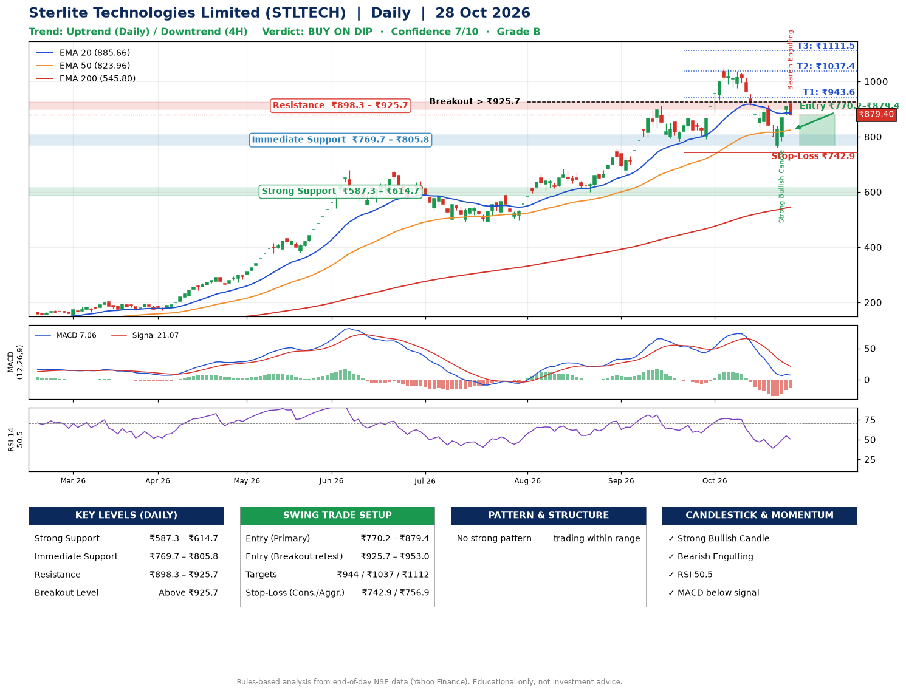

📌 **Sterlite Technologies Limited (STLTECH) – Multi-Timeframe Technical Analysis (Daily + 4H Combined)**
_Data up to 28 Oct 2026 · Close ₹879.40_

**📍 Daily Timeframe Trend**
- Trend: **Uptrend** (higher highs and higher lows)
- Recent swing highs: ₹683.5, ₹912.0, ₹1051.1 · swing lows: ₹601.0, ₹783.3, ₹792.1
- EMAs: EMA20 ₹885.7, EMA50 ₹824.0, EMA200 ₹545.8; bullish stack (EMA20 > EMA50 > EMA200); price above EMA50, EMA200
- MACD 7.06 below signal 21.07 (above zero); histogram rising
- RSI(14) 50.5; no divergence on the last two swings

**📍 4-Hour Timeframe Trend**
- Structure: **Downtrend** (lower highs and lower lows)
- Pullback/support area: recent 4H swing lows ₹834.5, ₹760.8; EMA20 ₹881.7
- EMA20/50: bullish stack (EMA20 > EMA50); price below all EMAs
- MACD -9.22 above signal -15.38 (below zero), fresh bullish crossover; histogram falling
- RSI(14) 48.4; no divergence

**📍 Pattern Detection (Both Timeframes)**
- No strong pattern detected. Trading within range.

**📍 Candlestick Patterns (last 3 daily candles)**
- **Strong Bullish Candle** – 26 Oct: wide-range green candle, buyers in control
- **Bearish Engulfing** – 28 Oct: sellers fully reversed the prior green candle

**📍 Price Action Key Levels (Daily Structure)**

| Zone | Price Level (₹) | Context |
|------|-----------------|---------|
| Strong Support | ₹587.3 – ₹614.7 | Cluster of earlier swing lows (demand) |
| Immediate Support | ₹769.7 – ₹805.8 | Nearest swing-low / wick area |
| Resistance | ₹898.3 – ₹925.7 | Nearest swing-high supply |
| Breakout Level | Above ₹925.7 | Swing continuation trigger (52-week high ₹1051.1) |

**📍 Swing Trade Setup**

🟢 **Entry Zone**
- Primary: ₹770.2 – ₹879.4 (daily support / EMA20 area; enter on a bullish 4H candle)
- Alternate: ₹925.7 – ₹953.0 (breakout retest)

🎯 **Profit Targets**
- T1: ₹943.6
- T2: ₹1037.4
- T3: ₹1111.5

🛑 **Stop-Loss**
- Conservative: below daily swing low (₹742.9)
- Aggressive: below 4H structure (₹756.9)
- Risk per share ≈ ₹81.9; reward:risk to T1 ≈ 1.5

**📌 Strategy Notes**
- Higher timeframe: daily trend is uptrend; only take longs while price holds above ₹587.3.
- Entry timing: wait for a bullish 4H candle (engulfing/hammer) inside ₹770.2 – ₹879.4 rather than buying mid-range.
- EMA stacking: bullish stack (EMA20 > EMA50 > EMA200); price above EMA50, EMA200.
- Breakout rule: a daily close above ₹925.7 with volume above its 20-day average (≈2,496,406) opens T2/T3.
- Momentum: RSI 50 – room to run; no divergence on the last two swings.
- Exit discipline: move the stop to entry once T1 is hit; book partial profits at each target.

**STEP 2 — Marked Up Chart**

**✅ Trade Validation Checklist**
- Trend + momentum aligned: No · Price at entry zone: Yes
- Stop defined (₹742.9) · Reward:risk ≥ 1.5 to T1: No

## 📌 Final Verdict

Recommendation: **🟡 BUY ON DIP**

Confidence: **7/10**

Trade Quality: **B**

Reason:
• Daily uptrend (higher highs and higher lows)
• EMAs stacked bullishly

Next Action:
• Wait for a pullback to ₹770.2–₹879.4, or a breakout above ₹925.7

_Rules-based analysis from end-of-day data. Educational only, not investment advice. Never place orders without your own confirmation._