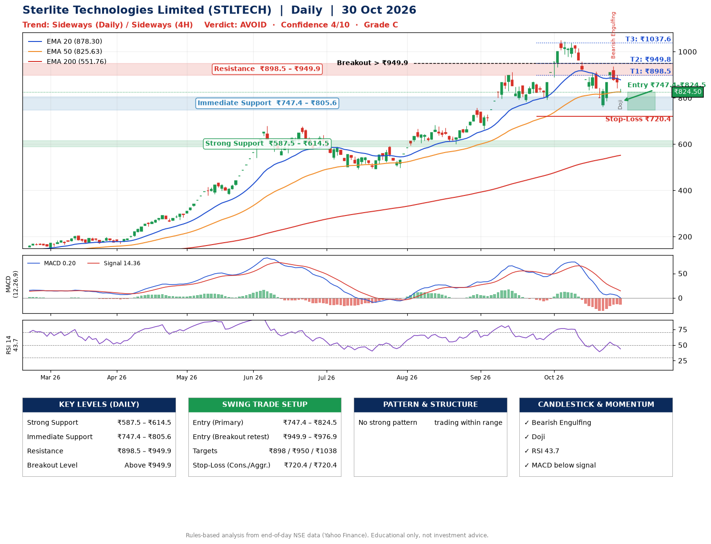

📌 **Sterlite Technologies Limited (STLTECH) – Multi-Timeframe Technical Analysis (Daily + 4H Combined)**
_Data up to 30 Oct 2026 · Close ₹824.50_

**📍 Daily Timeframe Trend**
- Trend: **Sideways** (mixed swing structure)
- Recent swing highs: ₹683.5, ₹912.0, ₹1051.1 · swing lows: ₹783.3, ₹792.1, ₹760.8
- EMAs: EMA20 ₹878.3, EMA50 ₹825.6, EMA200 ₹551.8; bullish stack (EMA20 > EMA50 > EMA200); price above EMA200
- MACD 0.20 below signal 14.36 (above zero); histogram falling
- RSI(14) 43.7; no divergence on the last two swings

**📍 4-Hour Timeframe Trend**
- Structure: **Sideways** (mixed swing structure)
- Pullback/support area: recent 4H swing lows ₹834.5, ₹760.8; EMA20 ₹869.3
- EMA20/50: bearish stack (EMA20 < EMA50); price below all EMAs
- MACD -14.75 below signal -13.32 (below zero), fresh bearish crossover; histogram falling
- RSI(14) 38.6; no divergence

**📍 Pattern Detection (Both Timeframes)**
- 4H: **Double Top** – tops near ₹914.8/₹934.4, neckline ₹760.8, forming

**📍 Candlestick Patterns (last 3 daily candles)**
- **Bearish Engulfing** – 28 Oct: sellers fully reversed the prior green candle
- **Doji** – 30 Oct: indecision; wait for the next candle to confirm direction

**📍 Price Action Key Levels (Daily Structure)**

| Zone | Price Level (₹) | Context |
|------|-----------------|---------|
| Strong Support | ₹587.5 – ₹614.5 | Cluster of earlier swing lows (demand) |
| Immediate Support | ₹747.4 – ₹805.6 | Nearest swing-low / wick area |
| Resistance | ₹898.5 – ₹949.9 | Nearest swing-high supply |
| Breakout Level | Above ₹949.9 | Swing continuation trigger (52-week high ₹1051.1) |

**📍 Swing Trade Setup**

🟢 **Entry Zone**
- Primary: ₹747.4 – ₹824.5 (daily support / EMA20 area; enter on a bullish 4H candle)
- Alternate: ₹949.9 – ₹976.9 (breakout retest)

🎯 **Profit Targets**
- T1: ₹898.5
- T2: ₹949.8
- T3: ₹1037.6

🛑 **Stop-Loss**
- Conservative: below daily swing low (₹720.4)
- Aggressive: below 4H structure (₹720.4)
- Risk per share ≈ ₹65.6; reward:risk to T1 ≈ 1.7

**📌 Strategy Notes**
- Higher timeframe: daily trend is sideways; only take longs while price holds above ₹587.5.
- Entry timing: wait for a bullish 4H candle (engulfing/hammer) inside ₹747.4 – ₹824.5 rather than buying mid-range.
- EMA stacking: bullish stack (EMA20 > EMA50 > EMA200); price above EMA200.
- Breakout rule: a daily close above ₹949.9 with volume above its 20-day average (≈2,343,821) opens T2/T3.
- Momentum: RSI 44 – room to run; no divergence on the last two swings.
- Exit discipline: move the stop to entry once T1 is hit; book partial profits at each target.

**STEP 2 — Marked Up Chart**

**✅ Trade Validation Checklist**
- Trend + momentum aligned: No · Price at entry zone: Yes
- Stop defined (₹720.4) · Reward:risk ≥ 1.5 to T1: Yes

## 📌 Final Verdict

Recommendation: **🔴 AVOID**

Confidence: **4/10**

Trade Quality: **C**

Reason:
• Sharp pullback: 12% below the recent ₹936.4 high
• EMAs stacked bullishly

Next Action:
• Avoid until the trend changes (reclaim EMA50 and a higher low)

_Rules-based analysis from end-of-day data. Educational only, not investment advice. Never place orders without your own confirmation._