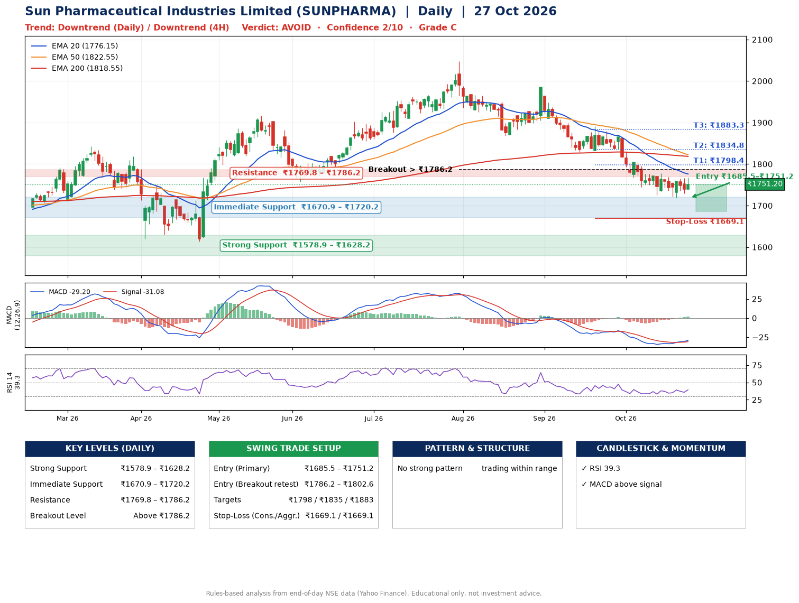

📌 **Sun Pharmaceutical Industries Limited (SUNPHARMA) – Multi-Timeframe Technical Analysis (Daily + 4H Combined)**
_Data up to 27 Oct 2026 · Close ₹1751.20_

**📍 Daily Timeframe Trend**
- Trend: **Downtrend** (lower highs and lower lows)
- Recent swing highs: ₹2046.9, ₹1984.8, ₹1891.5 · swing lows: ₹1756.8, ₹1868.3, ₹1828.0
- EMAs: EMA20 ₹1776.1, EMA50 ₹1822.5, EMA200 ₹1818.5; mixed / crossing; price below all EMAs
- MACD -29.20 above signal -31.08 (below zero), fresh bullish crossover; histogram rising
- RSI(14) 39.3; no divergence on the last two swings

**📍 4-Hour Timeframe Trend**
- Structure: **Downtrend** (lower highs and lower lows)
- Pullback/support area: recent 4H swing lows ₹1725.5, ₹1719.6; EMA20 ₹1754.6
- EMA20/50: bearish stack (EMA20 < EMA50); price below all EMAs
- MACD -10.32 above signal -14.03 (below zero); histogram rising
- RSI(14) 46.6; Regular bullish divergence; Hidden bearish divergence

**📍 Pattern Detection (Both Timeframes)**
- 4H: **Double Top** – tops near ₹1804.1/₹1777.4, neckline ₹1725.5, forming
- 4H: **Double Bottom** – bottoms near ₹1725.5/₹1719.6, neckline ₹1777.4, forming

**📍 Candlestick Patterns (last 3 daily candles)**
- No notable candlestick signal in the last 3 sessions.

**📍 Price Action Key Levels (Daily Structure)**

| Zone | Price Level (₹) | Context |
|------|-----------------|---------|
| Strong Support | ₹1578.9 – ₹1628.2 | Cluster of earlier swing lows (demand) |
| Immediate Support | ₹1670.9 – ₹1720.2 | Nearest swing-low / wick area |
| Resistance | ₹1769.8 – ₹1786.2 | Nearest swing-high supply |
| Breakout Level | Above ₹1786.2 | Swing continuation trigger (52-week high ₹2046.9) |

**📍 Swing Trade Setup**

🟢 **Entry Zone**
- Primary: ₹1685.5 – ₹1751.2 (daily support / EMA20 area; enter on a bullish 4H candle)
- Alternate: ₹1786.2 – ₹1802.6 (breakout retest)

🎯 **Profit Targets**
- T1: ₹1798.4
- T2: ₹1834.8
- T3: ₹1883.3

🛑 **Stop-Loss**
- Conservative: below daily swing low (₹1669.1)
- Aggressive: below 4H structure (₹1669.1)
- Risk per share ≈ ₹49.3; reward:risk to T1 ≈ 1.6

**📌 Strategy Notes**
- Higher timeframe: daily trend is downtrend; only take longs while price holds above ₹1578.9.
- Entry timing: wait for a bullish 4H candle (engulfing/hammer) inside ₹1685.5 – ₹1751.2 rather than buying mid-range.
- EMA stacking: mixed / crossing; price below all EMAs.
- Breakout rule: a daily close above ₹1786.2 with volume above its 20-day average (≈1,590,890) opens T2/T3.
- Momentum: RSI 39 – room to run; no divergence on the last two swings.
- Exit discipline: move the stop to entry once T1 is hit; book partial profits at each target.

**STEP 2 — Marked Up Chart**

**✅ Trade Validation Checklist**
- Trend + momentum aligned: No · Price at entry zone: Yes
- Stop defined (₹1669.1) · Reward:risk ≥ 1.5 to T1: Yes

## 📌 Final Verdict

Recommendation: **🔴 AVOID**

Confidence: **2/10**

Trade Quality: **C**

Reason:
• Daily downtrend (lower highs and lower lows)

Next Action:
• Avoid until the trend changes (reclaim EMA50 and a higher low)

_Rules-based analysis from end-of-day data. Educational only, not investment advice. Never place orders without your own confirmation._