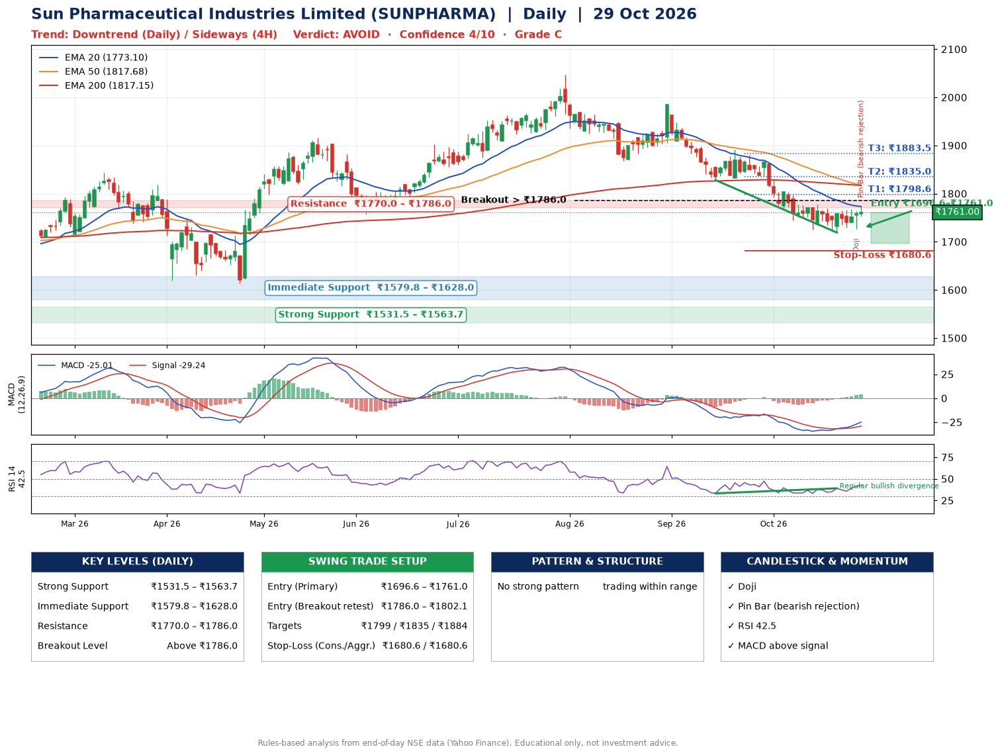

📌 **Sun Pharmaceutical Industries Limited (SUNPHARMA) – Multi-Timeframe Technical Analysis (Daily + 4H Combined)**
_Data up to 29 Oct 2026 · Close ₹1761.00_

**📍 Daily Timeframe Trend**
- Trend: **Downtrend** (lower highs and lower lows)
- Recent swing highs: ₹2046.9, ₹1984.8, ₹1891.5 · swing lows: ₹1868.3, ₹1828.0, ₹1719.1
- EMAs: EMA20 ₹1773.1, EMA50 ₹1817.7, EMA200 ₹1817.2; mixed / crossing; price below all EMAs
- MACD -25.01 above signal -29.24 (below zero); histogram rising
- RSI(14) 42.5; Regular bullish divergence

**📍 4-Hour Timeframe Trend**
- Structure: **Sideways** (mixed swing structure)
- Pullback/support area: recent 4H swing lows ₹1719.6, ₹1726.4; EMA20 ₹1755.8
- EMA20/50: bearish stack (EMA20 < EMA50); price above EMA20
- MACD -5.64 above signal -9.87 (below zero); histogram rising
- RSI(14) 50.3; Hidden bearish divergence

**📍 Pattern Detection (Both Timeframes)**
- 4H: **Double Top** – tops near ₹1777.4/₹1767.3, neckline ₹1719.6, forming
- 4H: **Descending Triangle** – converging swing highs and lows over the last ~60 sessions

**📍 Candlestick Patterns (last 3 daily candles)**
- **Doji** – 28 Oct: indecision; wait for the next candle to confirm direction
- **Pin Bar (bearish rejection)** – 29 Oct: long upper wick shows selling near ₹1771.5

**📍 Price Action Key Levels (Daily Structure)**

| Zone | Price Level (₹) | Context |
|------|-----------------|---------|
| Strong Support | ₹1531.5 – ₹1563.7 | Cluster of earlier swing lows (demand) |
| Immediate Support | ₹1579.8 – ₹1628.0 | Nearest swing-low / wick area |
| Resistance | ₹1770.0 – ₹1786.0 | Nearest swing-high supply |
| Breakout Level | Above ₹1786.0 | Swing continuation trigger (52-week high ₹2046.9) |

**📍 Swing Trade Setup**

🟢 **Entry Zone**
- Primary: ₹1696.6 – ₹1761.0 (daily support / EMA20 area; enter on a bullish 4H candle)
- Alternate: ₹1786.0 – ₹1802.1 (breakout retest)

🎯 **Profit Targets**
- T1: ₹1798.6
- T2: ₹1835.0
- T3: ₹1883.5

🛑 **Stop-Loss**
- Conservative: below daily swing low (₹1680.6)
- Aggressive: below 4H structure (₹1680.6)
- Risk per share ≈ ₹48.3; reward:risk to T1 ≈ 1.4

**📌 Strategy Notes**
- Higher timeframe: daily trend is downtrend; only take longs while price holds above ₹1531.5.
- Entry timing: wait for a bullish 4H candle (engulfing/hammer) inside ₹1696.6 – ₹1761.0 rather than buying mid-range.
- EMA stacking: mixed / crossing; price below all EMAs.
- Breakout rule: a daily close above ₹1786.0 with volume above its 20-day average (≈1,497,587) opens T2/T3.
- Momentum: RSI 42 – room to run; Regular bullish divergence.
- Exit discipline: move the stop to entry once T1 is hit; book partial profits at each target.

**STEP 2 — Marked Up Chart**

**✅ Trade Validation Checklist**
- Trend + momentum aligned: No · Price at entry zone: Yes
- Stop defined (₹1680.6) · Reward:risk ≥ 1.5 to T1: No

## 📌 Final Verdict

Recommendation: **🔴 AVOID**

Confidence: **4/10**

Trade Quality: **C**

Reason:
• Daily downtrend (lower highs and lower lows)

Next Action:
• Avoid until the trend changes (reclaim EMA50 and a higher low)

_Rules-based analysis from end-of-day data. Educational only, not investment advice. Never place orders without your own confirmation._