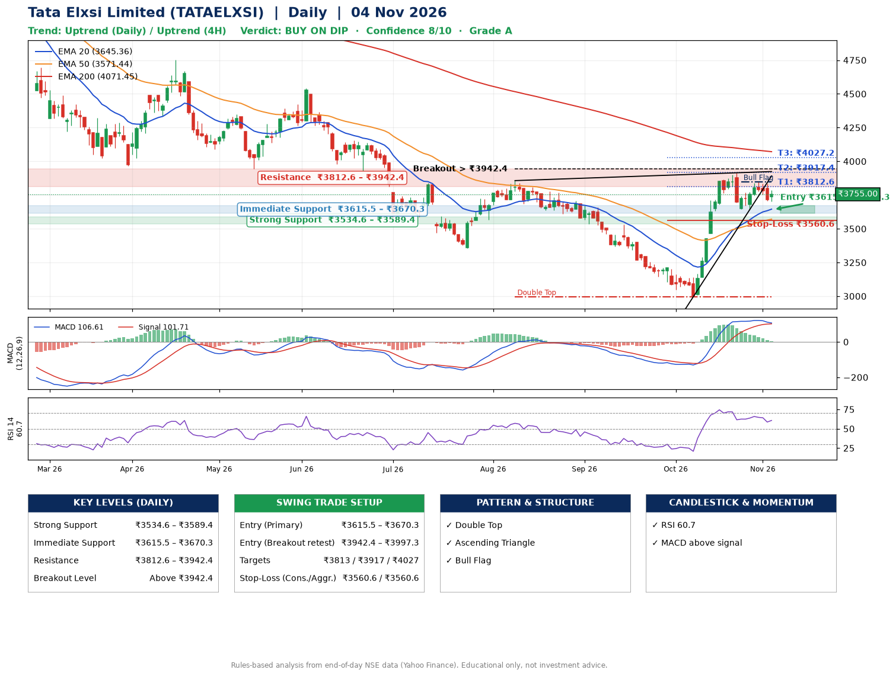

📌 **Tata Elxsi Limited (TATAELXSI) – Multi-Timeframe Technical Analysis (Daily + 4H Combined)**
_Data up to 04 Nov 2026 · Close ₹3755.00_

**📍 Daily Timeframe Trend**
- Trend: **Uptrend** (higher highs and higher lows)
- Recent swing highs: ₹3840.0, ₹3857.0, ₹3915.0 · swing lows: ₹3353.9, ₹2996.0, ₹3642.9
- EMAs: EMA20 ₹3645.4, EMA50 ₹3571.4, EMA200 ₹4071.4; mixed / crossing; price above EMA20, EMA50
- MACD 106.61 above signal 101.71 (above zero); histogram falling
- RSI(14) 60.7; no divergence on the last two swings

**📍 4-Hour Timeframe Trend**
- Structure: **Uptrend** (price above rising EMAs)
- Pullback/support area: recent 4H swing lows ₹3656.4, ₹3647.8; EMA20 ₹3730.5
- EMA20/50: bullish stack (EMA20 > EMA50); price above EMA20, EMA50
- MACD 46.87 below signal 70.00 (above zero); histogram rising
- RSI(14) 56.9; Regular bullish divergence; Hidden bearish divergence

**📍 Pattern Detection (Both Timeframes)**
- Daily: **Double Top** – tops near ₹3857.0/₹3915.0, neckline ₹2996.0, forming
- Daily: **Ascending Triangle** – converging swing highs and lows over the last ~60 sessions
- Daily: **Bull Flag** – 18% pole then a tight 5% flag; trigger above ₹3848.4
- 4H: **Double Top** – tops near ₹3915.0/₹3844.1, neckline ₹3647.8, forming
- 4H: **Bull Flag** – 17% pole then a tight 4% flag; trigger above ₹3844.1

**📍 Candlestick Patterns (last 3 daily candles)**
- No notable candlestick signal in the last 3 sessions.

**📍 Price Action Key Levels (Daily Structure)**

| Zone | Price Level (₹) | Context |
|------|-----------------|---------|
| Strong Support | ₹3534.6 – ₹3589.4 | Cluster of earlier swing lows (demand) |
| Immediate Support | ₹3615.5 – ₹3670.3 | Nearest swing-low / wick area |
| Resistance | ₹3812.6 – ₹3942.4 | Nearest swing-high supply |
| Breakout Level | Above ₹3942.4 | Swing continuation trigger (52-week high ₹5950.0) |

**📍 Swing Trade Setup**

🟢 **Entry Zone**
- Primary: ₹3615.5 – ₹3670.3 (daily support / EMA20 area; enter on a bullish 4H candle)
- Alternate: ₹3942.4 – ₹3997.3 (breakout retest)

🎯 **Profit Targets**
- T1: ₹3812.6
- T2: ₹3917.4
- T3: ₹4027.2

🛑 **Stop-Loss**
- Conservative: below daily swing low (₹3560.6)
- Aggressive: below 4H structure (₹3560.6)
- Risk per share ≈ ₹109.8; reward:risk to T1 ≈ 1.5

**📌 Strategy Notes**
- Higher timeframe: daily trend is uptrend; only take longs while price holds above ₹3534.6.
- Entry timing: wait for a bullish 4H candle (engulfing/hammer) inside ₹3615.5 – ₹3670.3 rather than buying mid-range.
- EMA stacking: mixed / crossing; price above EMA20, EMA50.
- Breakout rule: a daily close above ₹3942.4 with volume above its 20-day average (≈634,293) opens T2/T3.
- Momentum: RSI 61 – room to run; no divergence on the last two swings.
- Exit discipline: move the stop to entry once T1 is hit; book partial profits at each target.

**STEP 2 — Marked Up Chart**

**✅ Trade Validation Checklist**
- Trend + momentum aligned: Yes · Price at entry zone: No
- Stop defined (₹3560.6) · Reward:risk ≥ 1.5 to T1: Yes

## 📌 Final Verdict

Recommendation: **🟡 BUY ON DIP**

Confidence: **8/10**

Trade Quality: **A**

Reason:
• Daily uptrend (higher highs and higher lows)
• Double Top: tops near ₹3857.0/₹3915.0, neckline ₹2996.0, forming

Next Action:
• Wait for a pullback to ₹3615.5–₹3670.3, or a breakout above ₹3942.4

_Rules-based analysis from end-of-day data. Educational only, not investment advice. Never place orders without your own confirmation._