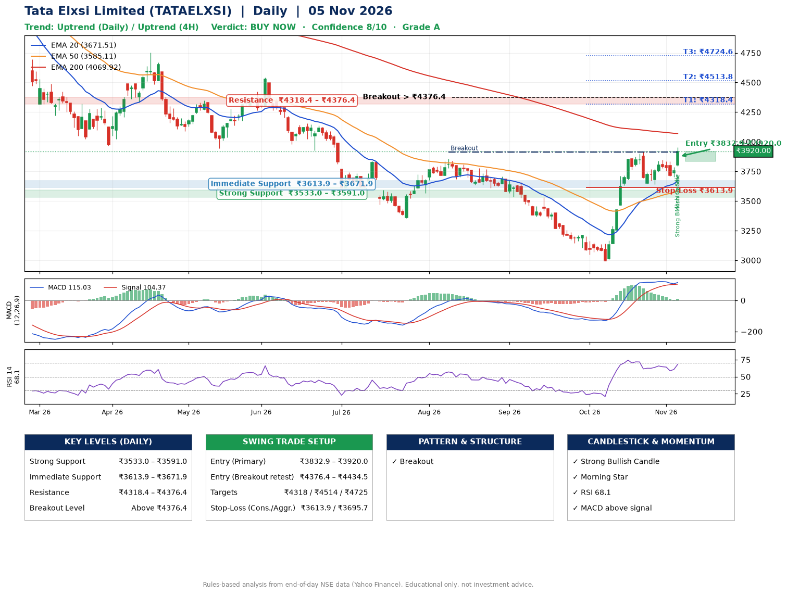

📌 **Tata Elxsi Limited (TATAELXSI) – Multi-Timeframe Technical Analysis (Daily + 4H Combined)**
_Data up to 05 Nov 2026 · Close ₹3920.00_

**📍 Daily Timeframe Trend**
- Trend: **Uptrend** (higher highs and higher lows)
- Recent swing highs: ₹3840.0, ₹3857.0, ₹3915.0 · swing lows: ₹3353.9, ₹2996.0, ₹3642.9
- EMAs: EMA20 ₹3671.5, EMA50 ₹3585.1, EMA200 ₹4069.9; mixed / crossing; price above EMA20, EMA50
- MACD 115.03 above signal 104.37 (above zero); histogram rising
- RSI(14) 68.1; no divergence on the last two swings

**📍 4-Hour Timeframe Trend**
- Structure: **Uptrend** (price above rising EMAs)
- Pullback/support area: recent 4H swing lows ₹3647.8, ₹3702.8; EMA20 ₹3761.0
- EMA20/50: bullish stack (EMA20 > EMA50); price above EMA20, EMA50
- MACD 61.32 below signal 65.59 (above zero); histogram rising
- RSI(14) 69.6; Hidden bullish divergence; Hidden bearish divergence

**📍 Pattern Detection (Both Timeframes)**
- Daily: **Breakout** – closed above the 60-session high ₹3915.0 (volume not confirming yet)
- 4H: **Double Bottom** – bottoms near ₹3647.8/₹3702.8, neckline ₹3844.1, confirmed (closed above neckline)

**📍 Candlestick Patterns (last 3 daily candles)**
- **Strong Bullish Candle** – 05 Nov: wide-range green candle, buyers in control
- **Morning Star** – 05 Nov: three-candle bullish reversal

**📍 Price Action Key Levels (Daily Structure)**

| Zone | Price Level (₹) | Context |
|------|-----------------|---------|
| Strong Support | ₹3533.0 – ₹3591.0 | Cluster of earlier swing lows (demand) |
| Immediate Support | ₹3613.9 – ₹3671.9 | Nearest swing-low / wick area |
| Resistance | ₹4318.4 – ₹4376.4 | Nearest swing-high supply |
| Breakout Level | Above ₹4376.4 | Swing continuation trigger (52-week high ₹5950.0) |

**📍 Swing Trade Setup**

🟢 **Entry Zone**
- Primary: ₹3832.9 – ₹3920.0 (daily support / EMA20 area; enter on a bullish 4H candle)
- Alternate: ₹4376.4 – ₹4434.5 (breakout retest)

🎯 **Profit Targets**
- T1: ₹4318.4
- T2: ₹4513.8
- T3: ₹4724.6

🛑 **Stop-Loss**
- Conservative: below daily swing low (₹3613.9)
- Aggressive: below 4H structure (₹3695.7)
- Risk per share ≈ ₹262.6; reward:risk to T1 ≈ 1.7

**📌 Strategy Notes**
- Higher timeframe: daily trend is uptrend; only take longs while price holds above ₹3533.0.
- Entry timing: wait for a bullish 4H candle (engulfing/hammer) inside ₹3832.9 – ₹3920.0 rather than buying mid-range.
- EMA stacking: mixed / crossing; price above EMA20, EMA50.
- Breakout rule: a daily close above ₹4376.4 with volume above its 20-day average (≈647,781) opens T2/T3.
- Momentum: RSI 68 – elevated, prefer dips; no divergence on the last two swings.
- Exit discipline: move the stop to entry once T1 is hit; book partial profits at each target.

**STEP 2 — Marked Up Chart**

**✅ Trade Validation Checklist**
- Trend + momentum aligned: Yes · Price at entry zone: Yes
- Stop defined (₹3613.9) · Reward:risk ≥ 1.5 to T1: Yes

## 📌 Final Verdict

Recommendation: **🟢 BUY NOW**

Confidence: **8/10**

Trade Quality: **A**

Reason:
• Daily uptrend (higher highs and higher lows)
• Breakout: closed above the 60-session high ₹3915.0 (volume not confirming yet)

Next Action:
• Buy now within the entry zone, with the stop-loss in place

_Rules-based analysis from end-of-day data. Educational only, not investment advice. Never place orders without your own confirmation._