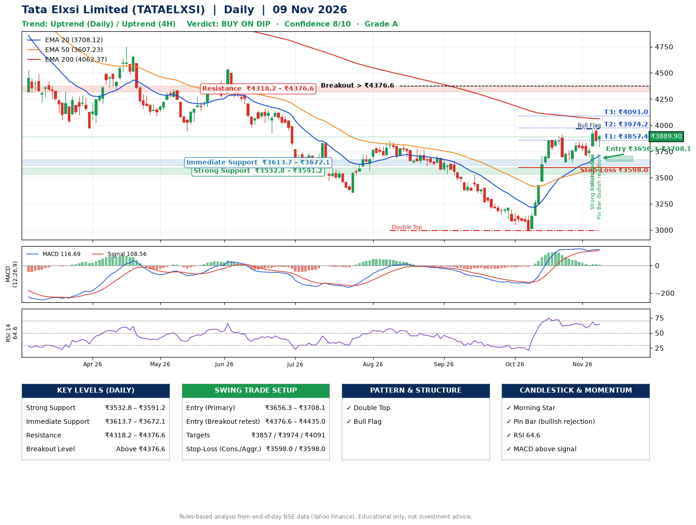

📌 **Tata Elxsi Limited (TATAELXSI) – Multi-Timeframe Technical Analysis (Daily + 4H Combined)**
_Data up to 09 Nov 2026 · Close ₹3889.90_

**📍 Daily Timeframe Trend**
- Trend: **Uptrend** (higher highs and higher lows)
- Recent swing highs: ₹3840.0, ₹3857.0, ₹3915.0 · swing lows: ₹3353.9, ₹2996.0, ₹3642.9
- EMAs: EMA20 ₹3708.1, EMA50 ₹3607.2, EMA200 ₹4062.4; mixed / crossing; price above EMA20, EMA50
- MACD 116.69 above signal 108.56 (above zero); histogram falling
- RSI(14) 64.6; no divergence on the last two swings

**📍 4-Hour Timeframe Trend**
- Structure: **Uptrend** (higher highs and higher lows)
- Pullback/support area: recent 4H swing lows ₹3647.8, ₹3702.8; EMA20 ₹3797.2
- EMA20/50: bullish stack (EMA20 > EMA50); price above EMA20, EMA50
- MACD 62.83 below signal 63.64 (above zero); histogram rising
- RSI(14) 64.1; Hidden bullish divergence; Regular bearish divergence

**📍 Pattern Detection (Both Timeframes)**
- Daily: **Double Top** – tops near ₹3857.0/₹3915.0, neckline ₹2996.0, forming
- Daily: **Bull Flag** – 15% pole then a tight 7% flag; trigger above ₹3967.9
- 4H: **Double Top** – tops near ₹3844.1/₹3956.9, neckline ₹3702.8, forming
- 4H: **Double Bottom** – bottoms near ₹3647.8/₹3702.8, neckline ₹3844.1, confirmed (closed above neckline)
- 4H: **Ascending Triangle** – converging swing highs and lows over the last ~60 sessions

**📍 Candlestick Patterns (last 3 daily candles)**
- **Strong Bullish Candle** – 05 Nov: wide-range green candle, buyers in control
- **Morning Star** – 05 Nov: three-candle bullish reversal
- **Pin Bar (bullish rejection)** – 09 Nov: long lower wick shows dip-buying near ₹3794.0

**📍 Price Action Key Levels (Daily Structure)**

| Zone | Price Level (₹) | Context |
|------|-----------------|---------|
| Strong Support | ₹3532.8 – ₹3591.2 | Cluster of earlier swing lows (demand) |
| Immediate Support | ₹3613.7 – ₹3672.1 | Nearest swing-low / wick area |
| Resistance | ₹4318.2 – ₹4376.6 | Nearest swing-high supply |
| Breakout Level | Above ₹4376.6 | Swing continuation trigger (52-week high ₹5950.0) |

**📍 Swing Trade Setup**

🟢 **Entry Zone**
- Primary: ₹3656.3 – ₹3708.1 (daily support / EMA20 area; enter on a bullish 4H candle)
- Alternate: ₹4376.6 – ₹4435.0 (breakout retest)

🎯 **Profit Targets**
- T1: ₹3857.4
- T2: ₹3974.2
- T3: ₹4091.0

🛑 **Stop-Loss**
- Conservative: below daily swing low (₹3598.0)
- Aggressive: below 4H structure (₹3598.0)
- Risk per share ≈ ₹116.8; reward:risk to T1 ≈ 1.5

**📌 Strategy Notes**
- Higher timeframe: daily trend is uptrend; only take longs while price holds above ₹3532.8.
- Entry timing: wait for a bullish 4H candle (engulfing/hammer) inside ₹3656.3 – ₹3708.1 rather than buying mid-range.
- EMA stacking: mixed / crossing; price above EMA20, EMA50.
- Breakout rule: a daily close above ₹4376.6 with volume above its 20-day average (≈630,887) opens T2/T3.
- Momentum: RSI 65 – room to run; no divergence on the last two swings.
- Exit discipline: move the stop to entry once T1 is hit; book partial profits at each target.

**STEP 2 — Marked Up Chart**

**✅ Trade Validation Checklist**
- Trend + momentum aligned: Yes · Price at entry zone: No
- Stop defined (₹3598.0) · Reward:risk ≥ 1.5 to T1: No

## 📌 Final Verdict

Recommendation: **🟡 BUY ON DIP**

Confidence: **8/10**

Trade Quality: **A**

Reason:
• Daily uptrend (higher highs and higher lows)
• Double Top: tops near ₹3857.0/₹3915.0, neckline ₹2996.0, forming

Next Action:
• Wait for a pullback to ₹3656.3–₹3708.1

_Rules-based analysis from end-of-day data. Educational only, not investment advice. Never place orders without your own confirmation._