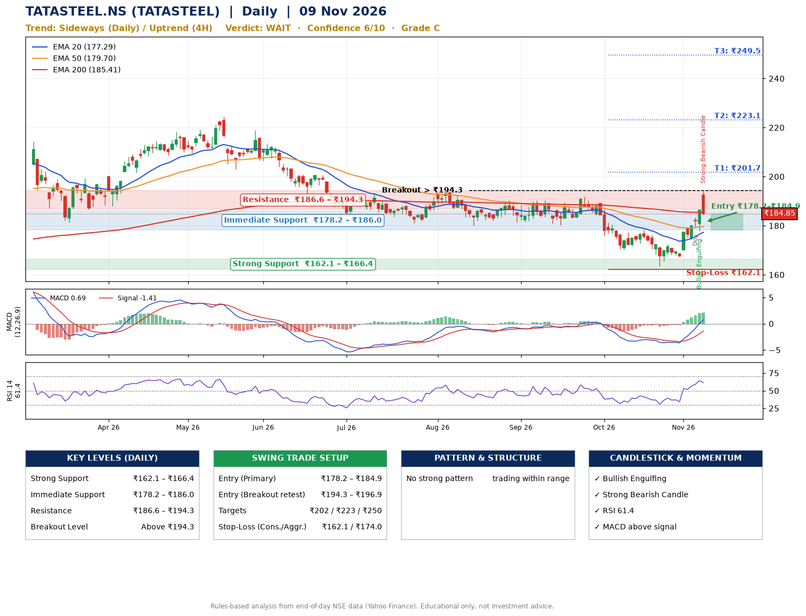

📌 **TATASTEEL.NS (TATASTEEL) – Multi-Timeframe Technical Analysis (Daily + 4H Combined)**
_Data up to 09 Nov 2026 · Close ₹184.85_

**📍 Daily Timeframe Trend**
- Trend: **Sideways** (mixed swing structure)
- Recent swing highs: ₹190.3, ₹191.8, ₹178.2 · swing lows: ₹180.3, ₹170.2, ₹163.4
- EMAs: EMA20 ₹177.3, EMA50 ₹179.7, EMA200 ₹185.4; bearish stack (EMA20 < EMA50 < EMA200); price above EMA20, EMA50
- MACD 0.69 above signal -1.41 (above zero); histogram rising
- RSI(14) 61.4; no divergence on the last two swings

**📍 4-Hour Timeframe Trend**
- Structure: **Uptrend** (higher highs and higher lows)
- Pullback/support area: recent 4H swing lows ₹167.3, ₹174.3; EMA20 ₹180.2
- EMA20/50: bullish stack (EMA20 > EMA50); price above EMA20, EMA50
- MACD 3.93 above signal 2.50 (above zero); histogram falling
- RSI(14) 74.2; no divergence

**📍 Pattern Detection (Both Timeframes)**
- No strong pattern detected. Trading within range.

**📍 Candlestick Patterns (last 3 daily candles)**
- **Doji** – 05 Nov: indecision; wait for the next candle to confirm direction
- **Bullish Engulfing** – 06 Nov: buyers fully reversed the prior red candle
- **Strong Bearish Candle** – 09 Nov: wide-range red candle, sellers in control

**📍 Price Action Key Levels (Daily Structure)**

| Zone | Price Level (₹) | Context |
|------|-----------------|---------|
| Strong Support | ₹162.1 – ₹166.4 | Cluster of earlier swing lows (demand) |
| Immediate Support | ₹178.2 – ₹186.0 | Nearest swing-low / wick area |
| Resistance | ₹186.6 – ₹194.3 | Nearest swing-high supply |
| Breakout Level | Above ₹194.3 | Swing continuation trigger (52-week high ₹224.4) |

**📍 Swing Trade Setup**

🟢 **Entry Zone**
- Primary: ₹178.2 – ₹184.9 (daily support / EMA20 area; enter on a bullish 4H candle)
- Alternate: ₹194.3 – ₹196.9 (breakout retest)

🎯 **Profit Targets**
- T1: ₹201.7
- T2: ₹223.1
- T3: ₹249.5

🛑 **Stop-Loss**
- Conservative: below daily swing low (₹162.1)
- Aggressive: below 4H structure (₹174.0)
- Risk per share ≈ ₹19.4; reward:risk to T1 ≈ 1.0

**📌 Strategy Notes**
- Higher timeframe: daily trend is sideways; only take longs while price holds above ₹162.1.
- Entry timing: wait for a bullish 4H candle (engulfing/hammer) inside ₹178.2 – ₹184.9 rather than buying mid-range.
- EMA stacking: bearish stack (EMA20 < EMA50 < EMA200); price above EMA20, EMA50.
- Breakout rule: a daily close above ₹194.3 with volume above its 20-day average (≈24,164,962) opens T2/T3.
- Momentum: RSI 61 – room to run; no divergence on the last two swings.
- Exit discipline: move the stop to entry once T1 is hit; book partial profits at each target.

**STEP 2 — Marked Up Chart**

**✅ Trade Validation Checklist**
- Trend + momentum aligned: No · Price at entry zone: Yes
- Stop defined (₹162.1) · Reward:risk ≥ 1.5 to T1: No

## 📌 Final Verdict

Recommendation: **🟠 WAIT**

Confidence: **6/10**

Trade Quality: **C**

Reason:
• No strong edge from trend, momentum or patterns

Next Action:
• Wait for a breakout above ₹194.3

_Rules-based analysis from end-of-day data. Educational only, not investment advice. Never place orders without your own confirmation._