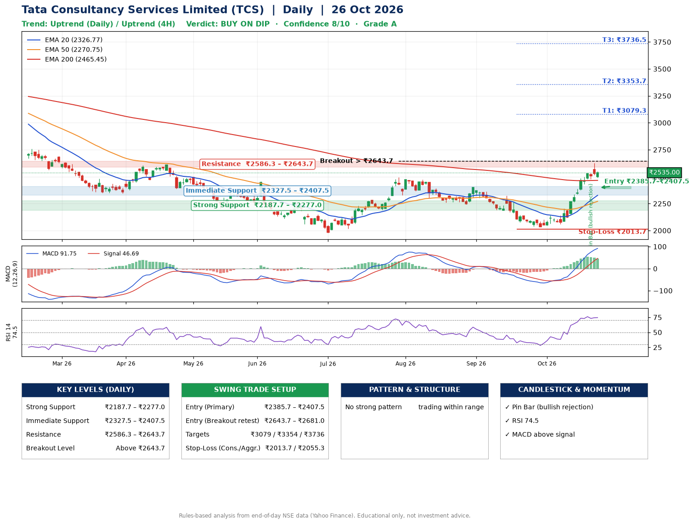

📌 **Tata Consultancy Services Limited (TCS) – Multi-Timeframe Technical Analysis (Daily + 4H Combined)**
_Data up to 26 Oct 2026 · Close ₹2535.00_

**📍 Daily Timeframe Trend**
- Trend: **Uptrend** (price above rising EMAs)
- Recent swing highs: ₹2495.0, ₹2399.3, ₹2323.0 · swing lows: ₹2258.3, ₹2243.9, ₹2032.4
- EMAs: EMA20 ₹2326.8, EMA50 ₹2270.7, EMA200 ₹2465.5; mixed / crossing; price above EMA20, EMA50, EMA200
- MACD 91.75 above signal 46.69 (above zero); histogram falling
- RSI(14) 74.5; no divergence on the last two swings

**📍 4-Hour Timeframe Trend**
- Structure: **Uptrend** (higher highs and higher lows)
- Pullback/support area: recent 4H swing lows ₹2045.1, ₹2060.0; EMA20 ₹2416.3
- EMA20/50: bullish stack (EMA20 > EMA50); price above EMA20, EMA50
- MACD 97.03 above signal 92.69 (above zero); histogram falling
- RSI(14) 76.8; Regular bearish divergence

**📍 Pattern Detection (Both Timeframes)**
- 4H: **Bull Flag** – 16% pole then a tight 6% flag; trigger above ₹2623.2

**📍 Candlestick Patterns (last 3 daily candles)**
- **Pin Bar (bullish rejection)** – 22 Oct: long lower wick shows dip-buying near ₹2479.0

**📍 Price Action Key Levels (Daily Structure)**

| Zone | Price Level (₹) | Context |
|------|-----------------|---------|
| Strong Support | ₹2187.7 – ₹2277.0 | Cluster of earlier swing lows (demand) |
| Immediate Support | ₹2327.5 – ₹2407.5 | Nearest swing-low / wick area |
| Resistance | ₹2586.3 – ₹2643.7 | Nearest swing-high supply |
| Breakout Level | Above ₹2643.7 | Swing continuation trigger (52-week high ₹3350.0) |

**📍 Swing Trade Setup**

🟢 **Entry Zone**
- Primary: ₹2385.7 – ₹2407.5 (daily support / EMA20 area; enter on a bullish 4H candle)
- Alternate: ₹2643.7 – ₹2681.0 (breakout retest)

🎯 **Profit Targets**
- T1: ₹3079.3
- T2: ₹3353.7
- T3: ₹3736.5

🛑 **Stop-Loss**
- Conservative: below daily swing low (₹2013.7)
- Aggressive: below 4H structure (₹2055.3)
- Risk per share ≈ ₹382.8; reward:risk to T1 ≈ 1.8

**📌 Strategy Notes**
- Higher timeframe: daily trend is uptrend; only take longs while price holds above ₹2187.7.
- Entry timing: wait for a bullish 4H candle (engulfing/hammer) inside ₹2385.7 – ₹2407.5 rather than buying mid-range.
- EMA stacking: mixed / crossing; price above EMA20, EMA50, EMA200.
- Breakout rule: a daily close above ₹2643.7 with volume above its 20-day average (≈6,004,939) opens T2/T3.
- Momentum: RSI 75 – elevated, prefer dips; no divergence on the last two swings.
- Exit discipline: move the stop to entry once T1 is hit; book partial profits at each target.

**STEP 2 — Marked Up Chart**

**✅ Trade Validation Checklist**
- Trend + momentum aligned: Yes · Price at entry zone: No
- Stop defined (₹2013.7) · Reward:risk ≥ 1.5 to T1: Yes

## 📌 Final Verdict

Recommendation: **🟡 BUY ON DIP**

Confidence: **8/10**

Trade Quality: **A**

Reason:
• Daily uptrend (price above rising EMAs)

Next Action:
• Wait for a pullback to ₹2385.7–₹2407.5

_Rules-based analysis from end-of-day data. Educational only, not investment advice. Never place orders without your own confirmation._