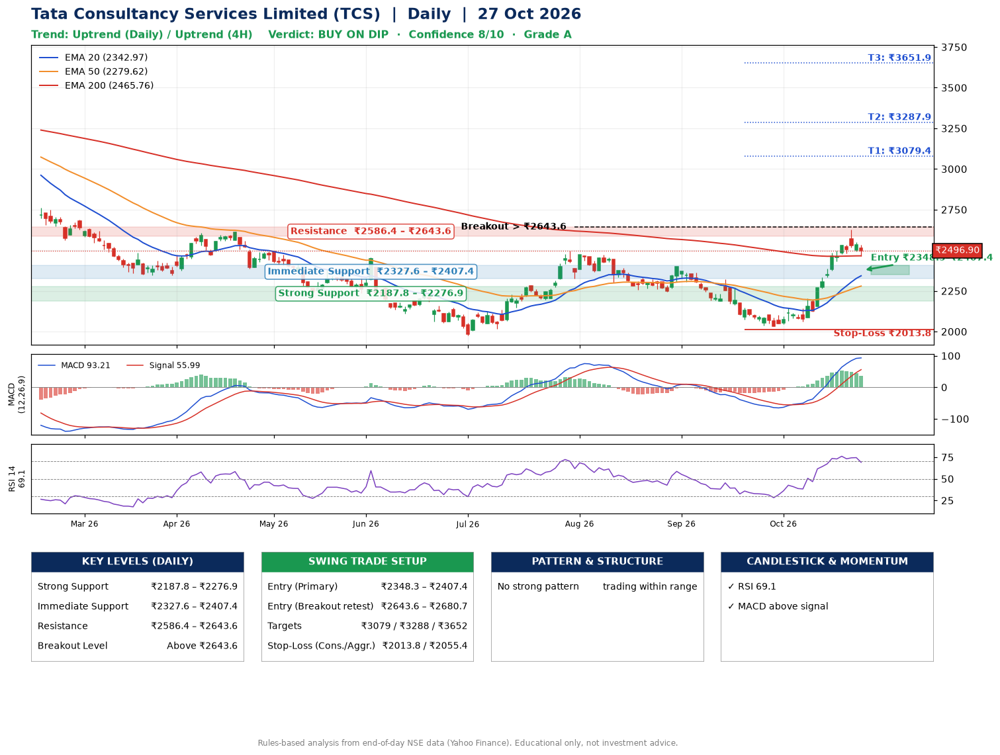

📌 **Tata Consultancy Services Limited (TCS) – Multi-Timeframe Technical Analysis (Daily + 4H Combined)**
_Data up to 27 Oct 2026 · Close ₹2496.90_

**📍 Daily Timeframe Trend**
- Trend: **Uptrend** (price above rising EMAs)
- Recent swing highs: ₹2495.0, ₹2399.3, ₹2323.0 · swing lows: ₹2258.3, ₹2243.9, ₹2032.4
- EMAs: EMA20 ₹2343.0, EMA50 ₹2279.6, EMA200 ₹2465.8; mixed / crossing; price above EMA20, EMA50, EMA200
- MACD 93.21 above signal 55.99 (above zero); histogram falling
- RSI(14) 69.1; no divergence on the last two swings

**📍 4-Hour Timeframe Trend**
- Structure: **Uptrend** (higher highs and higher lows)
- Pullback/support area: recent 4H swing lows ₹2045.1, ₹2060.0; EMA20 ₹2430.9
- EMA20/50: bullish stack (EMA20 > EMA50); price above EMA20, EMA50
- MACD 86.04 below signal 91.17 (above zero), fresh bearish crossover; histogram falling
- RSI(14) 68.1; Regular bearish divergence

**📍 Pattern Detection (Both Timeframes)**
- 4H: **Bull Flag** – 19% pole then a tight 6% flag; trigger above ₹2623.2

**📍 Candlestick Patterns (last 3 daily candles)**
- No notable candlestick signal in the last 3 sessions.

**📍 Price Action Key Levels (Daily Structure)**

| Zone | Price Level (₹) | Context |
|------|-----------------|---------|
| Strong Support | ₹2187.8 – ₹2276.9 | Cluster of earlier swing lows (demand) |
| Immediate Support | ₹2327.6 – ₹2407.4 | Nearest swing-low / wick area |
| Resistance | ₹2586.4 – ₹2643.6 | Nearest swing-high supply |
| Breakout Level | Above ₹2643.6 | Swing continuation trigger (52-week high ₹3350.0) |

**📍 Swing Trade Setup**

🟢 **Entry Zone**
- Primary: ₹2348.3 – ₹2407.4 (daily support / EMA20 area; enter on a bullish 4H candle)
- Alternate: ₹2643.6 – ₹2680.7 (breakout retest)

🎯 **Profit Targets**
- T1: ₹3079.4
- T2: ₹3287.9
- T3: ₹3651.9

🛑 **Stop-Loss**
- Conservative: below daily swing low (₹2013.8)
- Aggressive: below 4H structure (₹2055.4)
- Risk per share ≈ ₹364.0; reward:risk to T1 ≈ 1.9

**📌 Strategy Notes**
- Higher timeframe: daily trend is uptrend; only take longs while price holds above ₹2187.8.
- Entry timing: wait for a bullish 4H candle (engulfing/hammer) inside ₹2348.3 – ₹2407.4 rather than buying mid-range.
- EMA stacking: mixed / crossing; price above EMA20, EMA50, EMA200.
- Breakout rule: a daily close above ₹2643.6 with volume above its 20-day average (≈6,054,683) opens T2/T3.
- Momentum: RSI 69 – elevated, prefer dips; no divergence on the last two swings.
- Exit discipline: move the stop to entry once T1 is hit; book partial profits at each target.

**STEP 2 — Marked Up Chart**

**✅ Trade Validation Checklist**
- Trend + momentum aligned: Yes · Price at entry zone: No
- Stop defined (₹2013.8) · Reward:risk ≥ 1.5 to T1: Yes

## 📌 Final Verdict

Recommendation: **🟡 BUY ON DIP**

Confidence: **8/10**

Trade Quality: **A**

Reason:
• Daily uptrend (price above rising EMAs)

Next Action:
• Wait for a pullback to ₹2348.3–₹2407.4

_Rules-based analysis from end-of-day data. Educational only, not investment advice. Never place orders without your own confirmation._