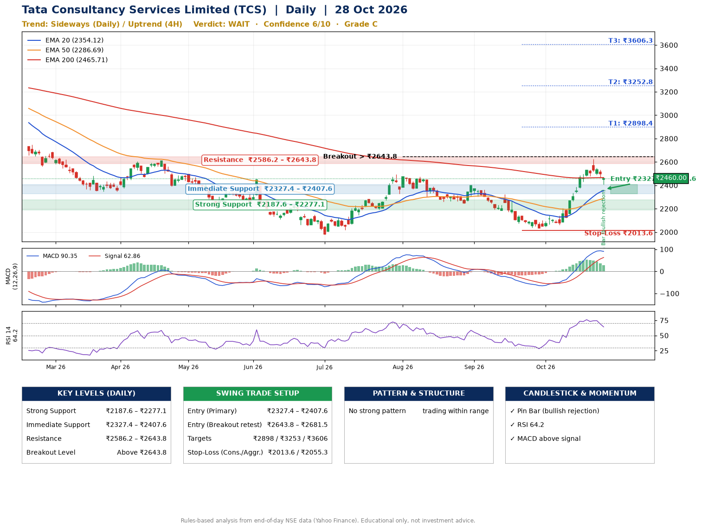

📌 **Tata Consultancy Services Limited (TCS) – Multi-Timeframe Technical Analysis (Daily + 4H Combined)**
_Data up to 28 Oct 2026 · Close ₹2460.00_

**📍 Daily Timeframe Trend**
- Trend: **Sideways** (mixed swing structure)
- Recent swing highs: ₹2495.0, ₹2399.3, ₹2323.0 · swing lows: ₹2258.3, ₹2243.9, ₹2032.4
- EMAs: EMA20 ₹2354.1, EMA50 ₹2286.7, EMA200 ₹2465.7; mixed / crossing; price above EMA20, EMA50
- MACD 90.35 above signal 62.86 (above zero); histogram falling
- RSI(14) 64.2; no divergence on the last two swings

**📍 4-Hour Timeframe Trend**
- Structure: **Uptrend** (higher highs and higher lows)
- Pullback/support area: recent 4H swing lows ₹2045.1, ₹2060.0; EMA20 ₹2435.7
- EMA20/50: bullish stack (EMA20 > EMA50); price above EMA20, EMA50
- MACD 70.19 below signal 84.76 (above zero), fresh bearish crossover; histogram falling
- RSI(14) 60.1; Regular bearish divergence

**📍 Pattern Detection (Both Timeframes)**
- No strong pattern detected. Trading within range.

**📍 Candlestick Patterns (last 3 daily candles)**
- **Pin Bar (bullish rejection)** – 28 Oct: long lower wick shows dip-buying near ₹2408.2

**📍 Price Action Key Levels (Daily Structure)**

| Zone | Price Level (₹) | Context |
|------|-----------------|---------|
| Strong Support | ₹2187.6 – ₹2277.1 | Cluster of earlier swing lows (demand) |
| Immediate Support | ₹2327.4 – ₹2407.6 | Nearest swing-low / wick area |
| Resistance | ₹2586.2 – ₹2643.8 | Nearest swing-high supply |
| Breakout Level | Above ₹2643.8 | Swing continuation trigger (52-week high ₹3350.0) |

**📍 Swing Trade Setup**

🟢 **Entry Zone**
- Primary: ₹2327.4 – ₹2407.6 (daily support / EMA20 area; enter on a bullish 4H candle)
- Alternate: ₹2643.8 – ₹2681.5 (breakout retest)

🎯 **Profit Targets**
- T1: ₹2898.4
- T2: ₹3252.8
- T3: ₹3606.3

🛑 **Stop-Loss**
- Conservative: below daily swing low (₹2013.6)
- Aggressive: below 4H structure (₹2055.3)
- Risk per share ≈ ₹353.9; reward:risk to T1 ≈ 1.5

**📌 Strategy Notes**
- Higher timeframe: daily trend is sideways; only take longs while price holds above ₹2187.6.
- Entry timing: wait for a bullish 4H candle (engulfing/hammer) inside ₹2327.4 – ₹2407.6 rather than buying mid-range.
- EMA stacking: mixed / crossing; price above EMA20, EMA50.
- Breakout rule: a daily close above ₹2643.8 with volume above its 20-day average (≈6,058,855) opens T2/T3.
- Momentum: RSI 64 – room to run; no divergence on the last two swings.
- Exit discipline: move the stop to entry once T1 is hit; book partial profits at each target.

**STEP 2 — Marked Up Chart**

**✅ Trade Validation Checklist**
- Trend + momentum aligned: No · Price at entry zone: No
- Stop defined (₹2013.6) · Reward:risk ≥ 1.5 to T1: Yes

## 📌 Final Verdict

Recommendation: **🟠 WAIT**

Confidence: **6/10**

Trade Quality: **C**

Reason:
• No strong edge from trend, momentum or patterns

Next Action:
• Wait for a breakout above ₹2643.8

_Rules-based analysis from end-of-day data. Educational only, not investment advice. Never place orders without your own confirmation._