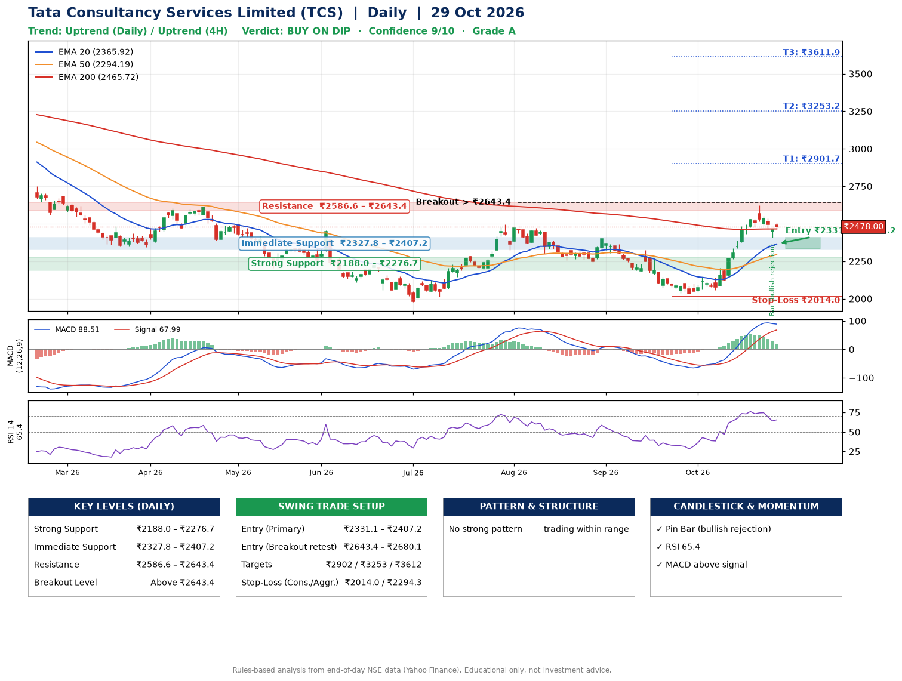

📌 **Tata Consultancy Services Limited (TCS) – Multi-Timeframe Technical Analysis (Daily + 4H Combined)**
_Data up to 29 Oct 2026 · Close ₹2478.00_

**📍 Daily Timeframe Trend**
- Trend: **Uptrend** (price above rising EMAs)
- Recent swing highs: ₹2495.0, ₹2399.3, ₹2323.0 · swing lows: ₹2258.3, ₹2243.9, ₹2032.4
- EMAs: EMA20 ₹2365.9, EMA50 ₹2294.2, EMA200 ₹2465.7; mixed / crossing; price above EMA20, EMA50, EMA200
- MACD 88.51 above signal 67.99 (above zero); histogram falling
- RSI(14) 65.4; no divergence on the last two swings

**📍 4-Hour Timeframe Trend**
- Structure: **Uptrend** (higher highs and higher lows)
- Pullback/support area: recent 4H swing lows ₹2060.0, ₹2408.2; EMA20 ₹2443.0
- EMA20/50: bullish stack (EMA20 > EMA50); price above EMA20, EMA50
- MACD 60.24 below signal 76.67 (above zero); histogram falling
- RSI(14) 62.5; Regular bearish divergence

**📍 Pattern Detection (Both Timeframes)**
- 4H: **Bull Flag** – 19% pole then a tight 6% flag; trigger above ₹2548.0

**📍 Candlestick Patterns (last 3 daily candles)**
- **Pin Bar (bullish rejection)** – 28 Oct: long lower wick shows dip-buying near ₹2408.2

**📍 Price Action Key Levels (Daily Structure)**

| Zone | Price Level (₹) | Context |
|------|-----------------|---------|
| Strong Support | ₹2188.0 – ₹2276.7 | Cluster of earlier swing lows (demand) |
| Immediate Support | ₹2327.8 – ₹2407.2 | Nearest swing-low / wick area |
| Resistance | ₹2586.6 – ₹2643.4 | Nearest swing-high supply |
| Breakout Level | Above ₹2643.4 | Swing continuation trigger (52-week high ₹3350.0) |

**📍 Swing Trade Setup**

🟢 **Entry Zone**
- Primary: ₹2331.1 – ₹2407.2 (daily support / EMA20 area; enter on a bullish 4H candle)
- Alternate: ₹2643.4 – ₹2680.1 (breakout retest)

🎯 **Profit Targets**
- T1: ₹2901.7
- T2: ₹3253.2
- T3: ₹3611.9

🛑 **Stop-Loss**
- Conservative: below daily swing low (₹2014.0)
- Aggressive: below 4H structure (₹2294.3)
- Risk per share ≈ ₹355.1; reward:risk to T1 ≈ 1.5

**📌 Strategy Notes**
- Higher timeframe: daily trend is uptrend; only take longs while price holds above ₹2188.0.
- Entry timing: wait for a bullish 4H candle (engulfing/hammer) inside ₹2331.1 – ₹2407.2 rather than buying mid-range.
- EMA stacking: mixed / crossing; price above EMA20, EMA50, EMA200.
- Breakout rule: a daily close above ₹2643.4 with volume above its 20-day average (≈6,008,342) opens T2/T3.
- Momentum: RSI 65 – elevated, prefer dips; no divergence on the last two swings.
- Exit discipline: move the stop to entry once T1 is hit; book partial profits at each target.

**STEP 2 — Marked Up Chart**

**✅ Trade Validation Checklist**
- Trend + momentum aligned: Yes · Price at entry zone: No
- Stop defined (₹2014.0) · Reward:risk ≥ 1.5 to T1: No

## 📌 Final Verdict

Recommendation: **🟡 BUY ON DIP**

Confidence: **9/10**

Trade Quality: **A**

Reason:
• Daily uptrend (price above rising EMAs)

Next Action:
• Wait for a pullback to ₹2331.1–₹2407.2, or a breakout above ₹2643.4

_Rules-based analysis from end-of-day data. Educational only, not investment advice. Never place orders without your own confirmation._