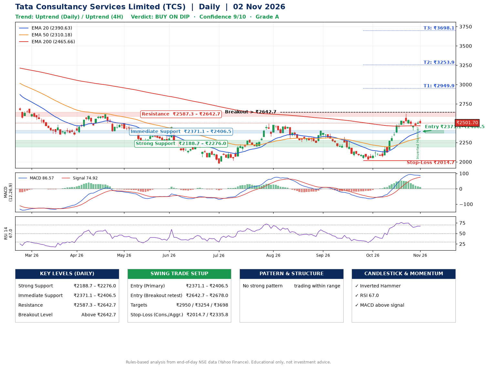

📌 **Tata Consultancy Services Limited (TCS) – Multi-Timeframe Technical Analysis (Daily + 4H Combined)**
_Data up to 02 Nov 2026 · Close ₹2501.70_

**📍 Daily Timeframe Trend**
- Trend: **Uptrend** (price above rising EMAs)
- Recent swing highs: ₹2399.3, ₹2323.0, ₹2625.0 · swing lows: ₹2258.3, ₹2243.9, ₹2032.4
- EMAs: EMA20 ₹2390.6, EMA50 ₹2310.2, EMA200 ₹2465.7; mixed / crossing; price above EMA20, EMA50, EMA200
- MACD 86.57 above signal 74.92 (above zero); histogram falling
- RSI(14) 67.0; no divergence on the last two swings

**📍 4-Hour Timeframe Trend**
- Structure: **Uptrend** (higher highs and higher lows)
- Pullback/support area: recent 4H swing lows ₹2060.0, ₹2408.2; EMA20 ₹2464.0
- EMA20/50: bullish stack (EMA20 > EMA50); price above EMA20, EMA50
- MACD 50.97 below signal 63.56 (above zero); histogram rising
- RSI(14) 63.2; Regular bearish divergence

**📍 Pattern Detection (Both Timeframes)**
- 4H: **Bull Flag** – 18% pole then a tight 6% flag; trigger above ₹2549.9

**📍 Candlestick Patterns (last 3 daily candles)**
- **Inverted Hammer** – 30 Oct: long upper wick shows selling near ₹2527.7

**📍 Price Action Key Levels (Daily Structure)**

| Zone | Price Level (₹) | Context |
|------|-----------------|---------|
| Strong Support | ₹2188.7 – ₹2276.0 | Cluster of earlier swing lows (demand) |
| Immediate Support | ₹2371.1 – ₹2406.5 | Nearest swing-low / wick area |
| Resistance | ₹2587.3 – ₹2642.7 | Nearest swing-high supply |
| Breakout Level | Above ₹2642.7 | Swing continuation trigger (52-week high ₹3350.0) |

**📍 Swing Trade Setup**

🟢 **Entry Zone**
- Primary: ₹2371.1 – ₹2406.5 (daily support / EMA20 area; enter on a bullish 4H candle)
- Alternate: ₹2642.7 – ₹2678.0 (breakout retest)

🎯 **Profit Targets**
- T1: ₹2949.9
- T2: ₹3253.9
- T3: ₹3698.1

🛑 **Stop-Loss**
- Conservative: below daily swing low (₹2014.7)
- Aggressive: below 4H structure (₹2335.8)
- Risk per share ≈ ₹374.1; reward:risk to T1 ≈ 1.5

**📌 Strategy Notes**
- Higher timeframe: daily trend is uptrend; only take longs while price holds above ₹2188.7.
- Entry timing: wait for a bullish 4H candle (engulfing/hammer) inside ₹2371.1 – ₹2406.5 rather than buying mid-range.
- EMA stacking: mixed / crossing; price above EMA20, EMA50, EMA200.
- Breakout rule: a daily close above ₹2642.7 with volume above its 20-day average (≈5,945,798) opens T2/T3.
- Momentum: RSI 67 – elevated, prefer dips; no divergence on the last two swings.
- Exit discipline: move the stop to entry once T1 is hit; book partial profits at each target.

**STEP 2 — Marked Up Chart**

**✅ Trade Validation Checklist**
- Trend + momentum aligned: Yes · Price at entry zone: No
- Stop defined (₹2014.7) · Reward:risk ≥ 1.5 to T1: No

## 📌 Final Verdict

Recommendation: **🟡 BUY ON DIP**

Confidence: **9/10**

Trade Quality: **A**

Reason:
• Daily uptrend (price above rising EMAs)

Next Action:
• Wait for a pullback to ₹2371.1–₹2406.5

_Rules-based analysis from end-of-day data. Educational only, not investment advice. Never place orders without your own confirmation._