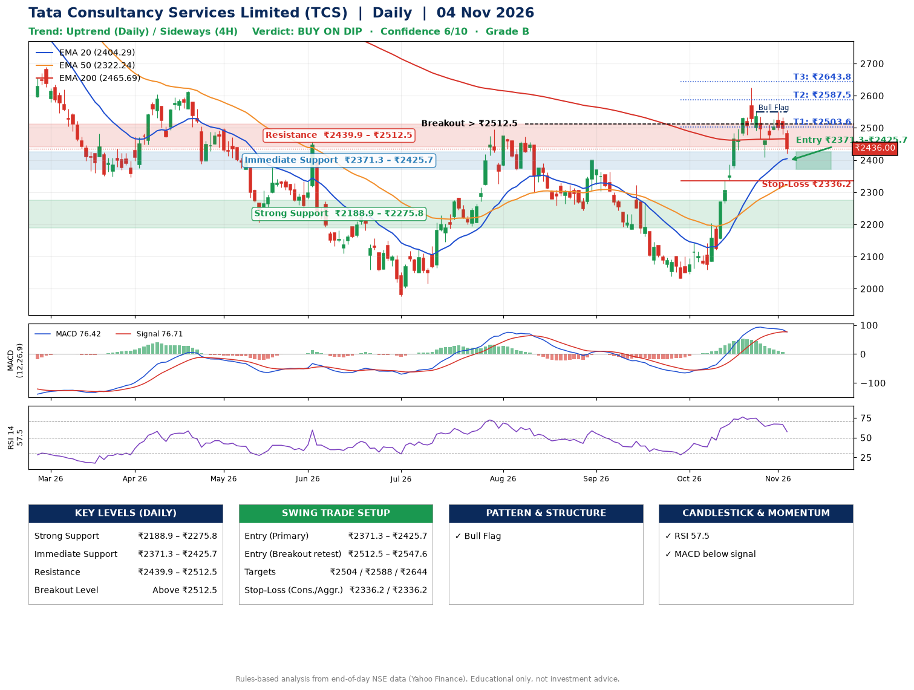

📌 **Tata Consultancy Services Limited (TCS) – Multi-Timeframe Technical Analysis (Daily + 4H Combined)**
_Data up to 04 Nov 2026 · Close ₹2436.00_

**📍 Daily Timeframe Trend**
- Trend: **Uptrend** (higher highs and higher lows)
- Recent swing highs: ₹2399.3, ₹2323.0, ₹2625.0 · swing lows: ₹2243.9, ₹2032.4, ₹2408.2
- EMAs: EMA20 ₹2404.3, EMA50 ₹2322.2, EMA200 ₹2465.7; mixed / crossing; price above EMA20, EMA50
- MACD 76.42 below signal 76.71 (above zero), fresh bearish crossover; histogram falling
- RSI(14) 57.5; no divergence on the last two swings

**📍 4-Hour Timeframe Trend**
- Structure: **Sideways** (mixed swing structure)
- Pullback/support area: recent 4H swing lows ₹2060.0, ₹2408.2; EMA20 ₹2462.9
- EMA20/50: bullish stack (EMA20 > EMA50); price above EMA50
- MACD 29.74 below signal 48.22 (above zero); histogram falling
- RSI(14) 48.8; no divergence

**📍 Pattern Detection (Both Timeframes)**
- Daily: **Bull Flag** – 17% pole then a tight 6% flag; trigger above ₹2549.9
- 4H: **Double Top** – tops near ₹2623.2/₹2549.9, neckline ₹2408.2, forming
- 4H: **Ascending Triangle** – converging swing highs and lows over the last ~60 sessions
- 4H: **Bull Flag** – 17% pole then a tight 5% flag; trigger above ₹2549.9

**📍 Candlestick Patterns (last 3 daily candles)**
- No notable candlestick signal in the last 3 sessions.

**📍 Price Action Key Levels (Daily Structure)**

| Zone | Price Level (₹) | Context |
|------|-----------------|---------|
| Strong Support | ₹2188.9 – ₹2275.8 | Cluster of earlier swing lows (demand) |
| Immediate Support | ₹2371.3 – ₹2425.7 | Nearest swing-low / wick area |
| Resistance | ₹2439.9 – ₹2512.5 | Nearest swing-high supply |
| Breakout Level | Above ₹2512.5 | Swing continuation trigger (52-week high ₹3350.0) |

**📍 Swing Trade Setup**

🟢 **Entry Zone**
- Primary: ₹2371.3 – ₹2425.7 (daily support / EMA20 area; enter on a bullish 4H candle)
- Alternate: ₹2512.5 – ₹2547.6 (breakout retest)

🎯 **Profit Targets**
- T1: ₹2503.6
- T2: ₹2587.5
- T3: ₹2643.8

🛑 **Stop-Loss**
- Conservative: below daily swing low (₹2336.2)
- Aggressive: below 4H structure (₹2336.2)
- Risk per share ≈ ₹70.1; reward:risk to T1 ≈ 1.5

**📌 Strategy Notes**
- Higher timeframe: daily trend is uptrend; only take longs while price holds above ₹2188.9.
- Entry timing: wait for a bullish 4H candle (engulfing/hammer) inside ₹2371.3 – ₹2425.7 rather than buying mid-range.
- EMA stacking: mixed / crossing; price above EMA20, EMA50.
- Breakout rule: a daily close above ₹2512.5 with volume above its 20-day average (≈5,894,621) opens T2/T3.
- Momentum: RSI 57 – room to run; no divergence on the last two swings.
- Exit discipline: move the stop to entry once T1 is hit; book partial profits at each target.

**STEP 2 — Marked Up Chart**

**✅ Trade Validation Checklist**
- Trend + momentum aligned: No · Price at entry zone: No
- Stop defined (₹2336.2) · Reward:risk ≥ 1.5 to T1: No

## 📌 Final Verdict

Recommendation: **🟡 BUY ON DIP**

Confidence: **6/10**

Trade Quality: **B**

Reason:
• Daily uptrend (higher highs and higher lows)
• Bull Flag: 17% pole then a tight 6% flag; trigger above ₹2549.9

Next Action:
• Wait for a pullback to ₹2371.3–₹2425.7, or a breakout above ₹2512.5

_Rules-based analysis from end-of-day data. Educational only, not investment advice. Never place orders without your own confirmation._