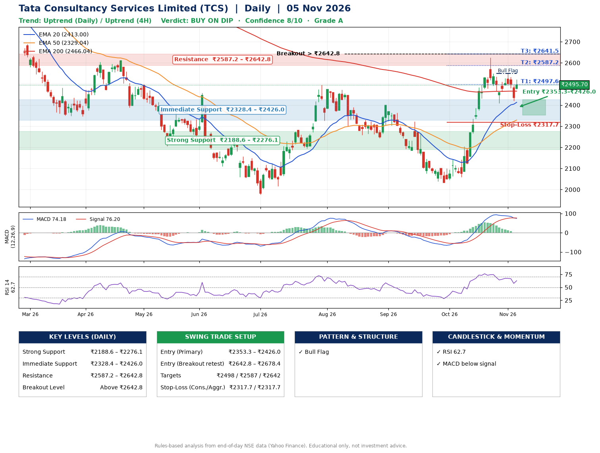

📌 **Tata Consultancy Services Limited (TCS) – Multi-Timeframe Technical Analysis (Daily + 4H Combined)**
_Data up to 05 Nov 2026 · Close ₹2495.70_

**📍 Daily Timeframe Trend**
- Trend: **Uptrend** (higher highs and higher lows)
- Recent swing highs: ₹2399.3, ₹2323.0, ₹2625.0 · swing lows: ₹2243.9, ₹2032.4, ₹2408.2
- EMAs: EMA20 ₹2413.0, EMA50 ₹2329.0, EMA200 ₹2466.0; mixed / crossing; price above EMA20, EMA50, EMA200
- MACD 74.18 below signal 76.20 (above zero), fresh bearish crossover; histogram falling
- RSI(14) 62.7; no divergence on the last two swings

**📍 4-Hour Timeframe Trend**
- Structure: **Uptrend** (price above rising EMAs)
- Pullback/support area: recent 4H swing lows ₹2408.2, ₹2420.1; EMA20 ₹2468.4
- EMA20/50: bullish stack (EMA20 > EMA50); price above EMA20, EMA50
- MACD 28.11 below signal 41.09 (above zero); histogram rising
- RSI(14) 58.2; Hidden bullish divergence

**📍 Pattern Detection (Both Timeframes)**
- Daily: **Bull Flag** – 19% pole then a tight 6% flag; trigger above ₹2549.9
- 4H: **Double Top** – tops near ₹2623.2/₹2549.9, neckline ₹2408.2, forming
- 4H: **Double Bottom** – bottoms near ₹2408.2/₹2420.1, neckline ₹2549.9, forming
- 4H: **Ascending Triangle** – converging swing highs and lows over the last ~60 sessions

**📍 Candlestick Patterns (last 3 daily candles)**
- No notable candlestick signal in the last 3 sessions.

**📍 Price Action Key Levels (Daily Structure)**

| Zone | Price Level (₹) | Context |
|------|-----------------|---------|
| Strong Support | ₹2188.6 – ₹2276.1 | Cluster of earlier swing lows (demand) |
| Immediate Support | ₹2328.4 – ₹2426.0 | Nearest swing-low / wick area |
| Resistance | ₹2587.2 – ₹2642.8 | Nearest swing-high supply |
| Breakout Level | Above ₹2642.8 | Swing continuation trigger (52-week high ₹3350.0) |

**📍 Swing Trade Setup**

🟢 **Entry Zone**
- Primary: ₹2353.3 – ₹2426.0 (daily support / EMA20 area; enter on a bullish 4H candle)
- Alternate: ₹2642.8 – ₹2678.4 (breakout retest)

🎯 **Profit Targets**
- T1: ₹2497.6
- T2: ₹2587.2
- T3: ₹2641.5

🛑 **Stop-Loss**
- Conservative: below daily swing low (₹2317.7)
- Aggressive: below 4H structure (₹2317.7)
- Risk per share ≈ ₹72.0; reward:risk to T1 ≈ 1.5

**📌 Strategy Notes**
- Higher timeframe: daily trend is uptrend; only take longs while price holds above ₹2188.6.
- Entry timing: wait for a bullish 4H candle (engulfing/hammer) inside ₹2353.3 – ₹2426.0 rather than buying mid-range.
- EMA stacking: mixed / crossing; price above EMA20, EMA50, EMA200.
- Breakout rule: a daily close above ₹2642.8 with volume above its 20-day average (≈6,165,583) opens T2/T3.
- Momentum: RSI 63 – room to run; no divergence on the last two swings.
- Exit discipline: move the stop to entry once T1 is hit; book partial profits at each target.

**STEP 2 — Marked Up Chart**

**✅ Trade Validation Checklist**
- Trend + momentum aligned: No · Price at entry zone: No
- Stop defined (₹2317.7) · Reward:risk ≥ 1.5 to T1: Yes

## 📌 Final Verdict

Recommendation: **🟡 BUY ON DIP**

Confidence: **8/10**

Trade Quality: **A**

Reason:
• Daily uptrend (higher highs and higher lows)
• Bull Flag: 19% pole then a tight 6% flag; trigger above ₹2549.9

Next Action:
• Wait for a pullback to ₹2353.3–₹2426.0, or a breakout above ₹2642.8

_Rules-based analysis from end-of-day data. Educational only, not investment advice. Never place orders without your own confirmation._