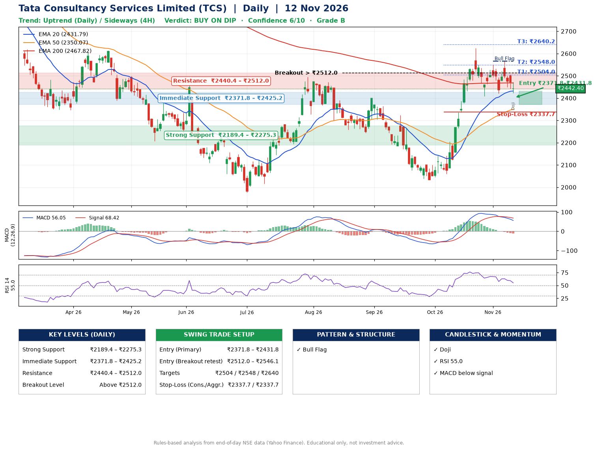

📌 **Tata Consultancy Services Limited (TCS) – Multi-Timeframe Technical Analysis (Daily + 4H Combined)**
_Data up to 12 Nov 2026 · Close ₹2442.40_

**📍 Daily Timeframe Trend**
- Trend: **Uptrend** (higher highs and higher lows)
- Recent swing highs: ₹2399.3, ₹2323.0, ₹2625.0 · swing lows: ₹2243.9, ₹2032.4, ₹2408.2
- EMAs: EMA20 ₹2431.8, EMA50 ₹2350.1, EMA200 ₹2467.8; mixed / crossing; price above EMA20, EMA50
- MACD 56.05 below signal 68.42 (above zero); histogram falling
- RSI(14) 55.0; no divergence on the last two swings

**📍 4-Hour Timeframe Trend**
- Structure: **Sideways** (mixed swing structure)
- Pullback/support area: recent 4H swing lows ₹2408.2, ₹2420.1; EMA20 ₹2465.2
- EMA20/50: bullish stack (EMA20 > EMA50); price above EMA50
- MACD 7.87 below signal 19.56 (above zero); histogram falling
- RSI(14) 47.5; Hidden bullish divergence

**📍 Pattern Detection (Both Timeframes)**
- Daily: **Bull Flag** – 18% pole then a tight 6% flag; trigger above ₹2565.0
- 4H: **Double Bottom** – bottoms near ₹2408.2/₹2420.1, neckline ₹2549.9, forming
- 4H: **Symmetrical Triangle** – converging swing highs and lows over the last ~60 sessions

**📍 Candlestick Patterns (last 3 daily candles)**
- **Doji** – 12 Nov: indecision; wait for the next candle to confirm direction

**📍 Price Action Key Levels (Daily Structure)**

| Zone | Price Level (₹) | Context |
|------|-----------------|---------|
| Strong Support | ₹2189.4 – ₹2275.3 | Cluster of earlier swing lows (demand) |
| Immediate Support | ₹2371.8 – ₹2425.2 | Nearest swing-low / wick area |
| Resistance | ₹2440.4 – ₹2512.0 | Nearest swing-high supply |
| Breakout Level | Above ₹2512.0 | Swing continuation trigger (52-week high ₹3350.0) |

**📍 Swing Trade Setup**

🟢 **Entry Zone**
- Primary: ₹2371.8 – ₹2431.8 (daily support / EMA20 area; enter on a bullish 4H candle)
- Alternate: ₹2512.0 – ₹2546.1 (breakout retest)

🎯 **Profit Targets**
- T1: ₹2504.0
- T2: ₹2548.0
- T3: ₹2640.2

🛑 **Stop-Loss**
- Conservative: below daily swing low (₹2337.7)
- Aggressive: below 4H structure (₹2337.7)
- Risk per share ≈ ₹68.1; reward:risk to T1 ≈ 1.5
- Time to T1: about 8 trading days (it rose this much within 60 trading days 53% of the time in the last 2 years)
- Time to T2: about 16 trading days (it rose this much within 60 trading days 37% of the time in the last 2 years)

**📌 Strategy Notes**
- Higher timeframe: daily trend is uptrend; only take longs while price holds above ₹2189.4.
- Entry timing: wait for a bullish 4H candle (engulfing/hammer) inside ₹2371.8 – ₹2431.8 rather than buying mid-range.
- EMA stacking: mixed / crossing; price above EMA20, EMA50.
- Breakout rule: a daily close above ₹2512.0 with volume above its 20-day average (≈5,335,599) opens T2/T3.
- Momentum: RSI 55 – room to run; no divergence on the last two swings.
- Exit discipline: move the stop to entry once T1 is hit; book partial profits at each target.

**STEP 2 — Marked Up Chart**

**✅ Trade Validation Checklist**
- Trend + momentum aligned: No · Price at entry zone: No
- Stop defined (₹2337.7) · Reward:risk ≥ 1.5 to T1: Yes

## 📌 Final Verdict

Recommendation: **🟡 BUY ON DIP**

Confidence: **6/10**

Trade Quality: **B**

Reason:
• Daily uptrend (higher highs and higher lows)
• Bull Flag: 18% pole then a tight 6% flag; trigger above ₹2565.0

Next Action:
• Wait for a pullback to ₹2371.8–₹2431.8, or a breakout above ₹2512.0

_Rules-based analysis from end-of-day data. Educational only, not investment advice. Never place orders without your own confirmation._