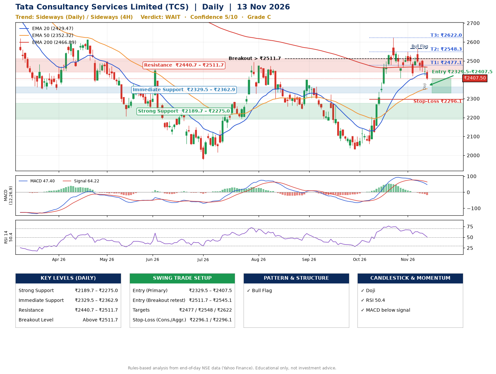

📌 **Tata Consultancy Services Limited (TCS) – Multi-Timeframe Technical Analysis (Daily + 4H Combined)**
_Data up to 13 Nov 2026 · Close ₹2407.50_

**📍 Daily Timeframe Trend**
- Trend: **Sideways** (mixed swing structure)
- Recent swing highs: ₹2399.3, ₹2323.0, ₹2625.0 · swing lows: ₹2243.9, ₹2032.4, ₹2408.2
- EMAs: EMA20 ₹2429.5, EMA50 ₹2352.3, EMA200 ₹2466.9; mixed / crossing; price above EMA50
- MACD 47.40 below signal 64.22 (above zero); histogram falling
- RSI(14) 50.4; no divergence on the last two swings

**📍 4-Hour Timeframe Trend**
- Structure: **Sideways** (mixed swing structure)
- Pullback/support area: recent 4H swing lows ₹2408.2, ₹2420.1; EMA20 ₹2454.9
- EMA20/50: bullish stack (EMA20 > EMA50); price below all EMAs
- MACD -1.25 below signal 12.73 (below zero); histogram falling
- RSI(14) 42.0; Hidden bullish divergence

**📍 Pattern Detection (Both Timeframes)**
- Daily: **Bull Flag** – 18% pole then a tight 7% flag; trigger above ₹2565.0
- 4H: **Symmetrical Triangle** – converging swing highs and lows over the last ~60 sessions

**📍 Candlestick Patterns (last 3 daily candles)**
- **Doji** – 12 Nov: indecision; wait for the next candle to confirm direction

**📍 Price Action Key Levels (Daily Structure)**

| Zone | Price Level (₹) | Context |
|------|-----------------|---------|
| Strong Support | ₹2189.7 – ₹2275.0 | Cluster of earlier swing lows (demand) |
| Immediate Support | ₹2329.5 – ₹2362.9 | Nearest swing-low / wick area |
| Resistance | ₹2440.7 – ₹2511.7 | Nearest swing-high supply |
| Breakout Level | Above ₹2511.7 | Swing continuation trigger (52-week high ₹3350.0) |

**📍 Swing Trade Setup**

🟢 **Entry Zone**
- Primary: ₹2329.5 – ₹2407.5 (daily support / EMA20 area; enter on a bullish 4H candle)
- Alternate: ₹2511.7 – ₹2545.1 (breakout retest)

🎯 **Profit Targets**
- T1: ₹2477.1
- T2: ₹2548.3
- T3: ₹2622.0

🛑 **Stop-Loss**
- Conservative: below daily swing low (₹2296.1)
- Aggressive: below 4H structure (₹2296.1)
- Risk per share ≈ ₹72.4; reward:risk to T1 ≈ 1.5
- Time to T1: about 10 trading days (it rose this much within 60 trading days 50% of the time in the last 2 years)
- Time to T2: about 23 trading days (it rose this much within 60 trading days 29% of the time in the last 2 years)

**📌 Strategy Notes**
- Higher timeframe: daily trend is sideways; only take longs while price holds above ₹2189.7.
- Entry timing: wait for a bullish 4H candle (engulfing/hammer) inside ₹2329.5 – ₹2407.5 rather than buying mid-range.
- EMA stacking: mixed / crossing; price above EMA50.
- Breakout rule: a daily close above ₹2511.7 with volume above its 20-day average (≈4,895,657) opens T2/T3.
- Momentum: RSI 50 – room to run; no divergence on the last two swings.
- Exit discipline: move the stop to entry once T1 is hit; book partial profits at each target.

**STEP 2 — Marked Up Chart**

**✅ Trade Validation Checklist**
- Trend + momentum aligned: No · Price at entry zone: Yes
- Stop defined (₹2296.1) · Reward:risk ≥ 1.5 to T1: No

## 📌 Final Verdict

Recommendation: **🟠 WAIT**

Confidence: **5/10**

Trade Quality: **C**

Reason:
• Bull Flag: 18% pole then a tight 7% flag; trigger above ₹2565.0

Next Action:
• Wait for a breakout above ₹2511.7

_Rules-based analysis from end-of-day data. Educational only, not investment advice. Never place orders without your own confirmation._