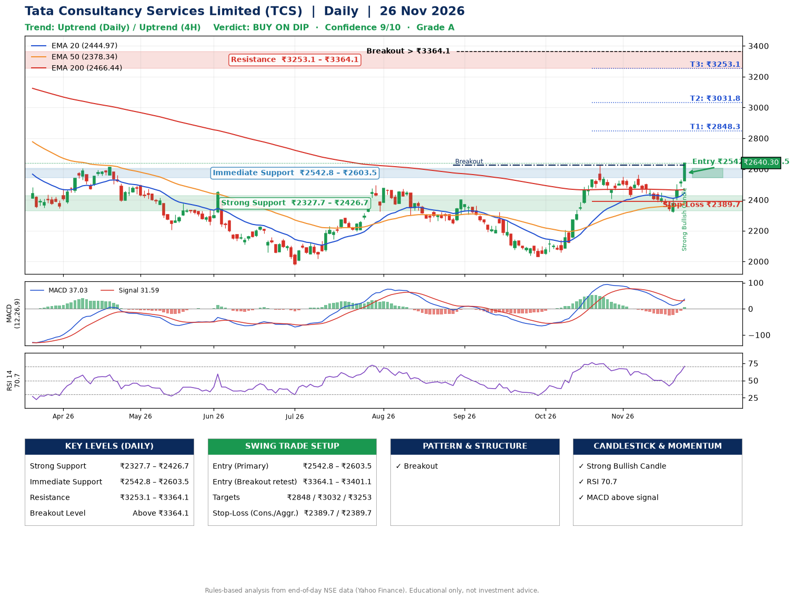

📌 **Tata Consultancy Services Limited (TCS) – Multi-Timeframe Technical Analysis (Daily + 4H Combined)**
_Data up to 26 Nov 2026 · Close ₹2640.30_

**📍 Daily Timeframe Trend**
- Trend: **Uptrend** (price above rising EMAs)
- Recent swing highs: ₹2323.0, ₹2625.0, ₹2565.0 · swing lows: ₹2243.9, ₹2032.4, ₹2408.2
- EMAs: EMA20 ₹2445.0, EMA50 ₹2378.3, EMA200 ₹2466.4; mixed / crossing; price above EMA20, EMA50, EMA200
- MACD 37.03 above signal 31.59 (above zero), fresh bullish crossover; histogram rising
- RSI(14) 70.7; no divergence on the last two swings

**📍 4-Hour Timeframe Trend**
- Structure: **Uptrend** (price above rising EMAs)
- Pullback/support area: recent 4H swing lows ₹2420.1, ₹2317.3; EMA20 ₹2463.0
- EMA20/50: bullish stack (EMA20 > EMA50); price above EMA20, EMA50
- MACD 28.09 above signal 2.90 (above zero); histogram rising
- RSI(14) 74.4; no divergence

**📍 Pattern Detection (Both Timeframes)**
- Daily: **Breakout** – closed above the 60-session high ₹2625.0 on strong volume

**📍 Candlestick Patterns (last 3 daily candles)**
- **Strong Bullish Candle** – 26 Nov: wide-range green candle, buyers in control

**📍 Price Action Key Levels (Daily Structure)**

| Zone | Price Level (₹) | Context |
|------|-----------------|---------|
| Strong Support | ₹2327.7 – ₹2426.7 | Cluster of earlier swing lows (demand) |
| Immediate Support | ₹2542.8 – ₹2603.5 | Nearest swing-low / wick area |
| Resistance | ₹3253.1 – ₹3364.1 | Nearest swing-high supply |
| Breakout Level | Above ₹3364.1 | Swing continuation trigger (52-week high ₹3350.0) |

**📍 Swing Trade Setup**

🟢 **Entry Zone**
- Primary: ₹2542.8 – ₹2603.5 (daily support / EMA20 area; enter on a bullish 4H candle)
- Alternate: ₹3364.1 – ₹3401.1 (breakout retest)

🎯 **Profit Targets**
- T1: ₹2848.3
- T2: ₹3031.8
- T3: ₹3253.1

🛑 **Stop-Loss**
- Conservative: below daily swing low (₹2389.7)
- Aggressive: below 4H structure (₹2389.7)
- Risk per share ≈ ₹183.5; reward:risk to T1 ≈ 1.5
- Time to T1: about 31 trading days (it rose this much within 60 trading days 17% of the time in the last 2 years)
- Time to T2: about 19 trading days (it rose this much within 60 trading days 3% of the time in the last 2 years)

**📌 Strategy Notes**
- Higher timeframe: daily trend is uptrend; only take longs while price holds above ₹2327.7.
- Entry timing: wait for a bullish 4H candle (engulfing/hammer) inside ₹2542.8 – ₹2603.5 rather than buying mid-range.
- EMA stacking: mixed / crossing; price above EMA20, EMA50, EMA200.
- Breakout rule: a daily close above ₹3364.1 with volume above its 20-day average (≈3,603,668) opens T2/T3.
- Momentum: RSI 71 – elevated, prefer dips; no divergence on the last two swings.
- Exit discipline: move the stop to entry once T1 is hit; book partial profits at each target.

**STEP 2 — Marked Up Chart**

**✅ Trade Validation Checklist**
- Trend + momentum aligned: Yes · Price at entry zone: No
- Stop defined (₹2389.7) · Reward:risk ≥ 1.5 to T1: No

## 📌 Final Verdict

Recommendation: **🟡 BUY ON DIP**

Confidence: **9/10**

Trade Quality: **A**

Reason:
• Daily uptrend (price above rising EMAs)
• Breakout: closed above the 60-session high ₹2625.0 on strong volume

Next Action:
• Wait for a pullback to ₹2542.8–₹2603.5, or a breakout above ₹3364.1

_Rules-based analysis from end-of-day data. Educational only, not investment advice. Never place orders without your own confirmation._