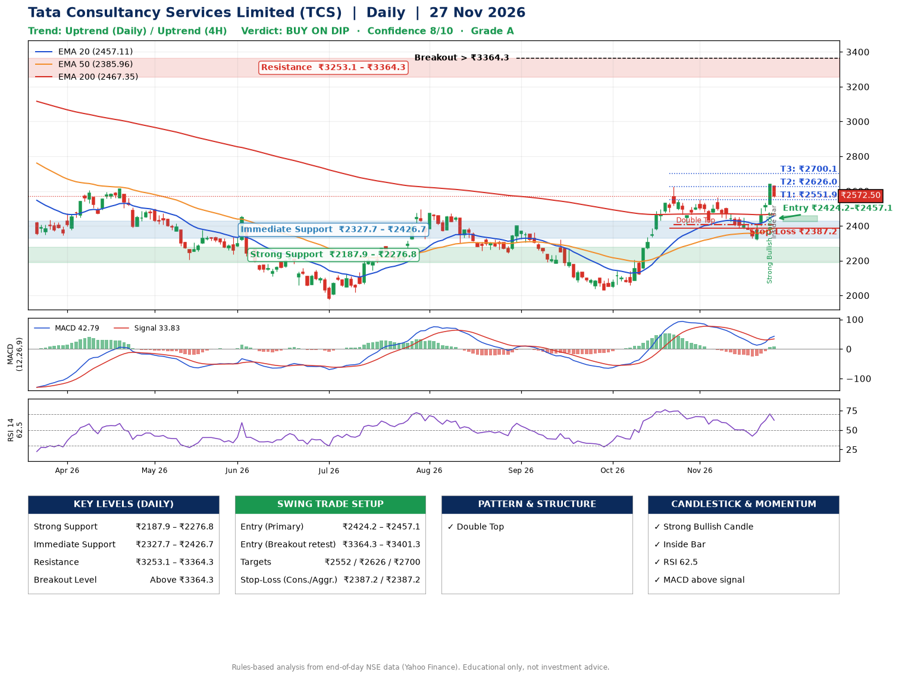

📌 **Tata Consultancy Services Limited (TCS) – Multi-Timeframe Technical Analysis (Daily + 4H Combined)**
_Data up to 27 Nov 2026 · Close ₹2572.50_

**📍 Daily Timeframe Trend**
- Trend: **Uptrend** (price above rising EMAs)
- Recent swing highs: ₹2323.0, ₹2625.0, ₹2565.0 · swing lows: ₹2243.9, ₹2032.4, ₹2408.2
- EMAs: EMA20 ₹2457.1, EMA50 ₹2386.0, EMA200 ₹2467.3; mixed / crossing; price above EMA20, EMA50, EMA200
- MACD 42.79 above signal 33.83 (above zero), fresh bullish crossover; histogram rising
- RSI(14) 62.5; no divergence on the last two swings

**📍 4-Hour Timeframe Trend**
- Structure: **Uptrend** (price above rising EMAs)
- Pullback/support area: recent 4H swing lows ₹2420.1, ₹2317.3; EMA20 ₹2484.5
- EMA20/50: bullish stack (EMA20 > EMA50); price above EMA20, EMA50
- MACD 37.78 above signal 14.95 (above zero); histogram falling
- RSI(14) 63.0; no divergence

**📍 Pattern Detection (Both Timeframes)**
- Daily: **Double Top** – tops near ₹2625.0/₹2565.0, neckline ₹2408.2, forming

**📍 Candlestick Patterns (last 3 daily candles)**
- **Strong Bullish Candle** – 26 Nov: wide-range green candle, buyers in control
- **Inside Bar** – 27 Nov: compression inside the prior range ₹2523.6–₹2640.3

**📍 Price Action Key Levels (Daily Structure)**

| Zone | Price Level (₹) | Context |
|------|-----------------|---------|
| Strong Support | ₹2187.9 – ₹2276.8 | Cluster of earlier swing lows (demand) |
| Immediate Support | ₹2327.7 – ₹2426.7 | Nearest swing-low / wick area |
| Resistance | ₹3253.1 – ₹3364.3 | Nearest swing-high supply |
| Breakout Level | Above ₹3364.3 | Swing continuation trigger (52-week high ₹3350.0) |

**📍 Swing Trade Setup**

🟢 **Entry Zone**
- Primary: ₹2424.2 – ₹2457.1 (daily support / EMA20 area; enter on a bullish 4H candle)
- Alternate: ₹3364.3 – ₹3401.3 (breakout retest)

🎯 **Profit Targets**
- T1: ₹2551.9
- T2: ₹2626.0
- T3: ₹2700.1

🛑 **Stop-Loss**
- Conservative: below daily swing low (₹2387.2)
- Aggressive: below 4H structure (₹2387.2)
- Risk per share ≈ ₹74.1; reward:risk to T1 ≈ 1.5
- Time to T1: about 10 trading days (it rose this much within 60 trading days 51% of the time in the last 2 years)
- Time to T2: about 27 trading days (it rose this much within 60 trading days 29% of the time in the last 2 years)

**📌 Strategy Notes**
- Higher timeframe: daily trend is uptrend; only take longs while price holds above ₹2187.9.
- Entry timing: wait for a bullish 4H candle (engulfing/hammer) inside ₹2424.2 – ₹2457.1 rather than buying mid-range.
- EMA stacking: mixed / crossing; price above EMA20, EMA50, EMA200.
- Breakout rule: a daily close above ₹3364.3 with volume above its 20-day average (≈3,585,487) opens T2/T3.
- Momentum: RSI 63 – room to run; no divergence on the last two swings.
- Exit discipline: move the stop to entry once T1 is hit; book partial profits at each target.

**STEP 2 — Marked Up Chart**

**✅ Trade Validation Checklist**
- Trend + momentum aligned: Yes · Price at entry zone: No
- Stop defined (₹2387.2) · Reward:risk ≥ 1.5 to T1: Yes

## 📌 Final Verdict

Recommendation: **🟡 BUY ON DIP**

Confidence: **8/10**

Trade Quality: **A**

Reason:
• Daily uptrend (price above rising EMAs)
• Double Top: tops near ₹2625.0/₹2565.0, neckline ₹2408.2, forming

Next Action:
• Wait for a pullback to ₹2424.2–₹2457.1

_Rules-based analysis from end-of-day data. Educational only, not investment advice. Never place orders without your own confirmation._