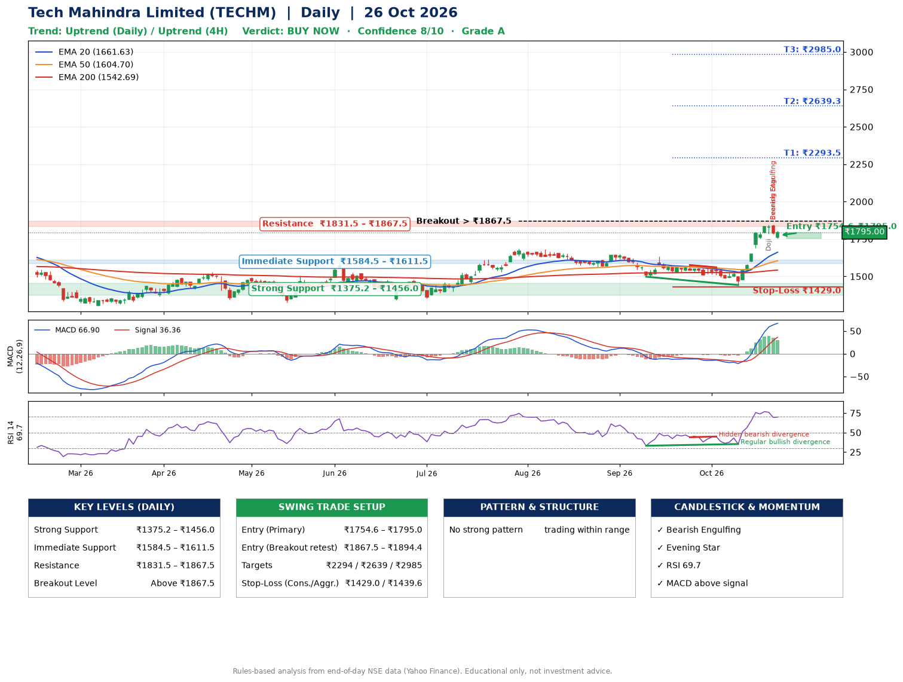

📌 **Tech Mahindra Limited (TECHM) – Multi-Timeframe Technical Analysis (Daily + 4H Combined)**
_Data up to 26 Oct 2026 · Close ₹1795.00_

**📍 Daily Timeframe Trend**
- Trend: **Uptrend** (price above rising EMAs)
- Recent swing highs: ₹1633.2, ₹1576.2, ₹1561.0 · swing lows: ₹1562.0, ₹1498.0, ₹1442.5
- EMAs: EMA20 ₹1661.6, EMA50 ₹1604.7, EMA200 ₹1542.7; bullish stack (EMA20 > EMA50 > EMA200); price above EMA20, EMA50, EMA200
- MACD 66.90 above signal 36.36 (above zero); histogram falling
- RSI(14) 69.7; Regular bullish divergence; Hidden bearish divergence

**📍 4-Hour Timeframe Trend**
- Structure: **Uptrend** (price above rising EMAs)
- Pullback/support area: recent 4H swing lows ₹1487.0, ₹1443.3; EMA20 ₹1720.8
- EMA20/50: bullish stack (EMA20 > EMA50); price above EMA20, EMA50
- MACD 68.53 above signal 65.92 (above zero); histogram falling
- RSI(14) 66.3; Regular bearish divergence

**📍 Pattern Detection (Both Timeframes)**
- 4H: **Bull Flag** – 16% pole then a tight 5% flag; trigger above ₹1844.0

**📍 Candlestick Patterns (last 3 daily candles)**
- **Doji** – 22 Oct: indecision; wait for the next candle to confirm direction
- **Bearish Engulfing** – 23 Oct: sellers fully reversed the prior green candle
- **Evening Star** – 23 Oct: three-candle bearish reversal

**📍 Price Action Key Levels (Daily Structure)**

| Zone | Price Level (₹) | Context |
|------|-----------------|---------|
| Strong Support | ₹1375.2 – ₹1456.0 | Cluster of earlier swing lows (demand) |
| Immediate Support | ₹1584.5 – ₹1611.5 | Nearest swing-low / wick area |
| Resistance | ₹1831.5 – ₹1867.5 | Nearest swing-high supply |
| Breakout Level | Above ₹1867.5 | Swing continuation trigger (52-week high ₹1854.0) |

**📍 Swing Trade Setup**

🟢 **Entry Zone**
- Primary: ₹1754.6 – ₹1795.0 (daily support / EMA20 area; enter on a bullish 4H candle)
- Alternate: ₹1867.5 – ₹1894.4 (breakout retest)

🎯 **Profit Targets**
- T1: ₹2293.5
- T2: ₹2639.3
- T3: ₹2985.0

🛑 **Stop-Loss**
- Conservative: below daily swing low (₹1429.0)
- Aggressive: below 4H structure (₹1439.6)
- Risk per share ≈ ₹345.8; reward:risk to T1 ≈ 1.5

**📌 Strategy Notes**
- Higher timeframe: daily trend is uptrend; only take longs while price holds above ₹1375.2.
- Entry timing: wait for a bullish 4H candle (engulfing/hammer) inside ₹1754.6 – ₹1795.0 rather than buying mid-range.
- EMA stacking: bullish stack (EMA20 > EMA50 > EMA200); price above EMA20, EMA50, EMA200.
- Breakout rule: a daily close above ₹1867.5 with volume above its 20-day average (≈4,153,432) opens T2/T3.
- Momentum: RSI 70 – elevated, prefer dips; Regular bullish divergence; Hidden bearish divergence.
- Exit discipline: move the stop to entry once T1 is hit; book partial profits at each target.

**STEP 2 — Marked Up Chart**

**✅ Trade Validation Checklist**
- Trend + momentum aligned: Yes · Price at entry zone: Yes
- Stop defined (₹1429.0) · Reward:risk ≥ 1.5 to T1: Yes

## 📌 Final Verdict

Recommendation: **🟢 BUY NOW**

Confidence: **8/10**

Trade Quality: **A**

Reason:
• Daily uptrend (price above rising EMAs)
• EMAs stacked bullishly

Next Action:
• Buy now within the entry zone, with the stop-loss in place

_Rules-based analysis from end-of-day data. Educational only, not investment advice. Never place orders without your own confirmation._