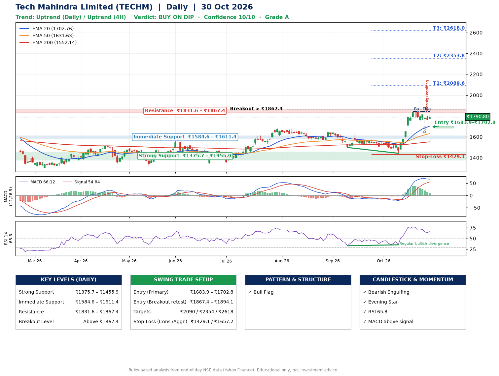

📌 **Tech Mahindra Limited (TECHM) – Multi-Timeframe Technical Analysis (Daily + 4H Combined)**
_Data up to 30 Oct 2026 · Close ₹1790.80_

**📍 Daily Timeframe Trend**
- Trend: **Uptrend** (price above rising EMAs)
- Recent swing highs: ₹1576.2, ₹1561.0, ₹1845.0 · swing lows: ₹1562.0, ₹1498.0, ₹1442.5
- EMAs: EMA20 ₹1702.8, EMA50 ₹1631.6, EMA200 ₹1552.1; bullish stack (EMA20 > EMA50 > EMA200); price above EMA20, EMA50, EMA200
- MACD 66.12 above signal 54.84 (above zero); histogram falling
- RSI(14) 65.8; Regular bullish divergence

**📍 4-Hour Timeframe Trend**
- Structure: **Uptrend** (price above rising EMAs)
- Pullback/support area: recent 4H swing lows ₹1760.1, ₹1734.9; EMA20 ₹1757.4
- EMA20/50: bullish stack (EMA20 > EMA50); price above EMA20, EMA50
- MACD 43.57 below signal 53.01 (above zero); histogram falling
- RSI(14) 60.3; no divergence

**📍 Pattern Detection (Both Timeframes)**
- Daily: **Bull Flag** – 18% pole then a tight 6% flag; trigger above ₹1845.0
- 4H: **Ascending Triangle** – converging swing highs and lows over the last ~60 sessions
- 4H: **Bull Flag** – 16% pole then a tight 4% flag; trigger above ₹1813.2

**📍 Candlestick Patterns (last 3 daily candles)**
- **Doji** – 28 Oct: indecision; wait for the next candle to confirm direction
- **Bearish Engulfing** – 29 Oct: sellers fully reversed the prior green candle
- **Evening Star** – 29 Oct: three-candle bearish reversal

**📍 Price Action Key Levels (Daily Structure)**

| Zone | Price Level (₹) | Context |
|------|-----------------|---------|
| Strong Support | ₹1375.7 – ₹1455.9 | Cluster of earlier swing lows (demand) |
| Immediate Support | ₹1584.6 – ₹1611.4 | Nearest swing-low / wick area |
| Resistance | ₹1831.6 – ₹1867.4 | Nearest swing-high supply |
| Breakout Level | Above ₹1867.4 | Swing continuation trigger (52-week high ₹1854.0) |

**📍 Swing Trade Setup**

🟢 **Entry Zone**
- Primary: ₹1683.9 – ₹1702.8 (daily support / EMA20 area; enter on a bullish 4H candle)
- Alternate: ₹1867.4 – ₹1894.1 (breakout retest)

🎯 **Profit Targets**
- T1: ₹2089.6
- T2: ₹2353.8
- T3: ₹2618.0

🛑 **Stop-Loss**
- Conservative: below daily swing low (₹1429.1)
- Aggressive: below 4H structure (₹1657.2)
- Risk per share ≈ ₹264.2; reward:risk to T1 ≈ 1.5

**📌 Strategy Notes**
- Higher timeframe: daily trend is uptrend; only take longs while price holds above ₹1375.7.
- Entry timing: wait for a bullish 4H candle (engulfing/hammer) inside ₹1683.9 – ₹1702.8 rather than buying mid-range.
- EMA stacking: bullish stack (EMA20 > EMA50 > EMA200); price above EMA20, EMA50, EMA200.
- Breakout rule: a daily close above ₹1867.4 with volume above its 20-day average (≈4,279,997) opens T2/T3.
- Momentum: RSI 66 – elevated, prefer dips; Regular bullish divergence.
- Exit discipline: move the stop to entry once T1 is hit; book partial profits at each target.

**STEP 2 — Marked Up Chart**

**✅ Trade Validation Checklist**
- Trend + momentum aligned: Yes · Price at entry zone: No
- Stop defined (₹1429.1) · Reward:risk ≥ 1.5 to T1: No

## 📌 Final Verdict

Recommendation: **🟡 BUY ON DIP**

Confidence: **10/10**

Trade Quality: **A**

Reason:
• Daily uptrend (price above rising EMAs)
• EMAs stacked bullishly

Next Action:
• Wait for a pullback to ₹1683.9–₹1702.8

_Rules-based analysis from end-of-day data. Educational only, not investment advice. Never place orders without your own confirmation._