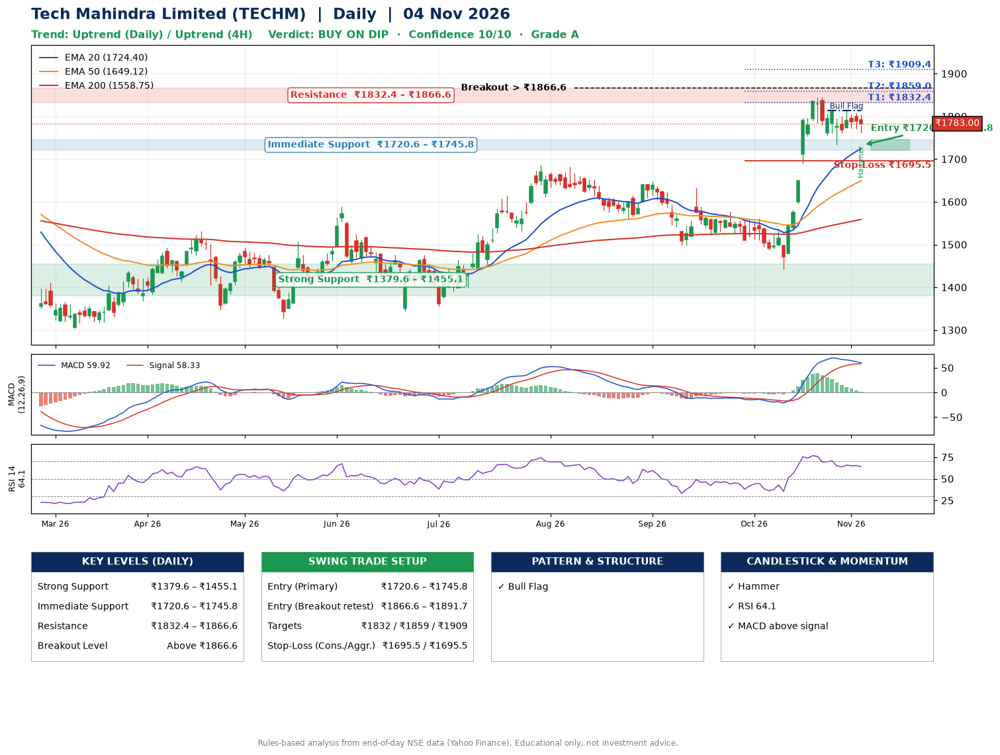

📌 **Tech Mahindra Limited (TECHM) – Multi-Timeframe Technical Analysis (Daily + 4H Combined)**
_Data up to 04 Nov 2026 · Close ₹1783.00_

**📍 Daily Timeframe Trend**
- Trend: **Uptrend** (higher highs and higher lows)
- Recent swing highs: ₹1576.2, ₹1561.0, ₹1845.0 · swing lows: ₹1498.0, ₹1442.5, ₹1733.2
- EMAs: EMA20 ₹1724.4, EMA50 ₹1649.1, EMA200 ₹1558.7; bullish stack (EMA20 > EMA50 > EMA200); price above EMA20, EMA50, EMA200
- MACD 59.92 above signal 58.33 (above zero); histogram falling
- RSI(14) 64.1; no divergence on the last two swings

**📍 4-Hour Timeframe Trend**
- Structure: **Uptrend** (price above rising EMAs)
- Pullback/support area: recent 4H swing lows ₹1760.1, ₹1734.9; EMA20 ₹1768.1
- EMA20/50: bullish stack (EMA20 > EMA50); price above EMA20, EMA50
- MACD 27.20 below signal 37.52 (above zero); histogram rising
- RSI(14) 56.9; Regular bearish divergence

**📍 Pattern Detection (Both Timeframes)**
- Daily: **Bull Flag** – 18% pole then a tight 4% flag; trigger above ₹1813.4
- 4H: **Symmetrical Triangle** – converging swing highs and lows over the last ~60 sessions
- 4H: **Bull Flag** – 15% pole then a tight 3% flag; trigger above ₹1813.2

**📍 Candlestick Patterns (last 3 daily candles)**
- **Hammer** – 04 Nov: long lower wick shows dip-buying near ₹1761.3

**📍 Price Action Key Levels (Daily Structure)**

| Zone | Price Level (₹) | Context |
|------|-----------------|---------|
| Strong Support | ₹1379.6 – ₹1455.1 | Cluster of earlier swing lows (demand) |
| Immediate Support | ₹1720.6 – ₹1745.8 | Nearest swing-low / wick area |
| Resistance | ₹1832.4 – ₹1866.6 | Nearest swing-high supply |
| Breakout Level | Above ₹1866.6 | Swing continuation trigger (52-week high ₹1854.0) |

**📍 Swing Trade Setup**

🟢 **Entry Zone**
- Primary: ₹1720.6 – ₹1745.8 (daily support / EMA20 area; enter on a bullish 4H candle)
- Alternate: ₹1866.6 – ₹1891.7 (breakout retest)

🎯 **Profit Targets**
- T1: ₹1832.4
- T2: ₹1859.0
- T3: ₹1909.4

🛑 **Stop-Loss**
- Conservative: below daily swing low (₹1695.5)
- Aggressive: below 4H structure (₹1695.5)
- Risk per share ≈ ₹50.3; reward:risk to T1 ≈ 2.0

**📌 Strategy Notes**
- Higher timeframe: daily trend is uptrend; only take longs while price holds above ₹1379.6.
- Entry timing: wait for a bullish 4H candle (engulfing/hammer) inside ₹1720.6 – ₹1745.8 rather than buying mid-range.
- EMA stacking: bullish stack (EMA20 > EMA50 > EMA200); price above EMA20, EMA50, EMA200.
- Breakout rule: a daily close above ₹1866.6 with volume above its 20-day average (≈4,154,937) opens T2/T3.
- Momentum: RSI 64 – room to run; no divergence on the last two swings.
- Exit discipline: move the stop to entry once T1 is hit; book partial profits at each target.

**STEP 2 — Marked Up Chart**

**✅ Trade Validation Checklist**
- Trend + momentum aligned: Yes · Price at entry zone: No
- Stop defined (₹1695.5) · Reward:risk ≥ 1.5 to T1: Yes

## 📌 Final Verdict

Recommendation: **🟡 BUY ON DIP**

Confidence: **10/10**

Trade Quality: **A**

Reason:
• Daily uptrend (higher highs and higher lows)
• EMAs stacked bullishly

Next Action:
• Wait for a pullback to ₹1720.6–₹1745.8, or a breakout above ₹1866.6

_Rules-based analysis from end-of-day data. Educational only, not investment advice. Never place orders without your own confirmation._