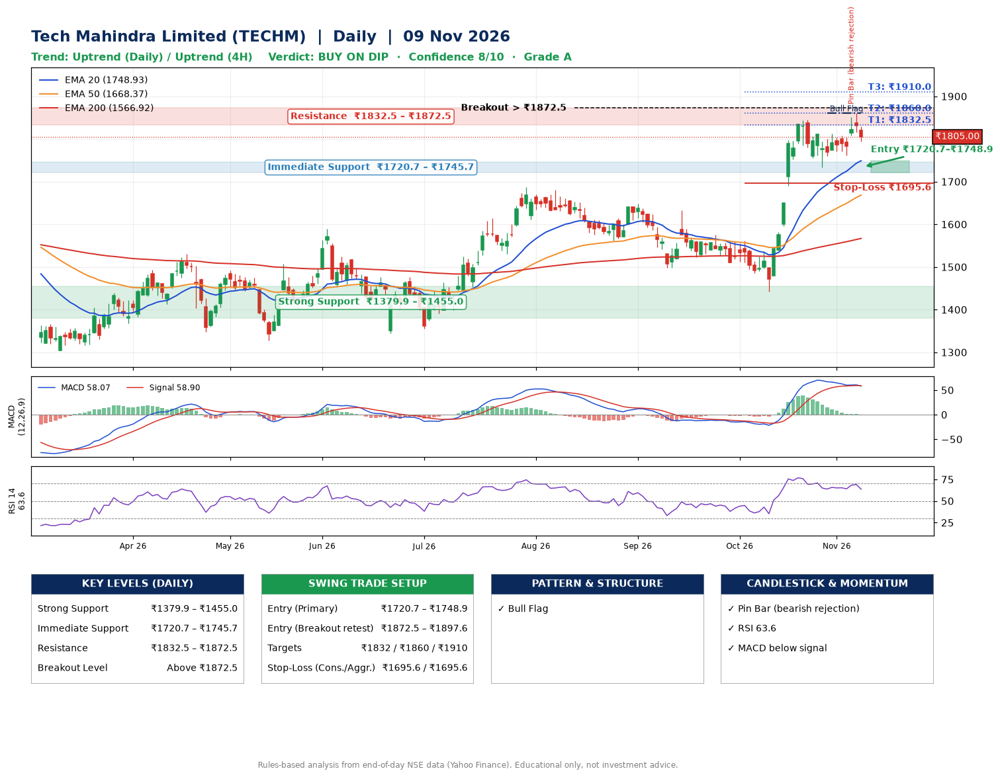

📌 **Tech Mahindra Limited (TECHM) – Multi-Timeframe Technical Analysis (Daily + 4H Combined)**
_Data up to 09 Nov 2026 · Close ₹1805.00_

**📍 Daily Timeframe Trend**
- Trend: **Uptrend** (higher highs and higher lows)
- Recent swing highs: ₹1576.2, ₹1561.0, ₹1845.0 · swing lows: ₹1498.0, ₹1442.5, ₹1733.2
- EMAs: EMA20 ₹1748.9, EMA50 ₹1668.4, EMA200 ₹1566.9; bullish stack (EMA20 > EMA50 > EMA200); price above EMA20, EMA50, EMA200
- MACD 58.07 below signal 58.90 (above zero), fresh bearish crossover; histogram falling
- RSI(14) 63.6; no divergence on the last two swings

**📍 4-Hour Timeframe Trend**
- Structure: **Uptrend** (higher highs and higher lows)
- Pullback/support area: recent 4H swing lows ₹1734.9, ₹1762.0; EMA20 ₹1789.9
- EMA20/50: bullish stack (EMA20 > EMA50); price above EMA20, EMA50
- MACD 25.74 below signal 30.61 (above zero); histogram falling
- RSI(14) 56.9; Hidden bullish divergence; Regular bearish divergence

**📍 Pattern Detection (Both Timeframes)**
- Daily: **Bull Flag** – 15% pole then a tight 6% flag; trigger above ₹1860.0
- 4H: **Double Top** – tops near ₹1813.2/₹1858.1, neckline ₹1762.0, forming
- 4H: **Double Bottom** – bottoms near ₹1734.9/₹1762.0, neckline ₹1813.2, forming

**📍 Candlestick Patterns (last 3 daily candles)**
- **Pin Bar (bearish rejection)** – 05 Nov: long upper wick shows selling near ₹1851.0

**📍 Price Action Key Levels (Daily Structure)**

| Zone | Price Level (₹) | Context |
|------|-----------------|---------|
| Strong Support | ₹1379.9 – ₹1455.0 | Cluster of earlier swing lows (demand) |
| Immediate Support | ₹1720.7 – ₹1745.7 | Nearest swing-low / wick area |
| Resistance | ₹1832.5 – ₹1872.5 | Nearest swing-high supply |
| Breakout Level | Above ₹1872.5 | Swing continuation trigger (52-week high ₹1860.0) |

**📍 Swing Trade Setup**

🟢 **Entry Zone**
- Primary: ₹1720.7 – ₹1748.9 (daily support / EMA20 area; enter on a bullish 4H candle)
- Alternate: ₹1872.5 – ₹1897.6 (breakout retest)

🎯 **Profit Targets**
- T1: ₹1832.5
- T2: ₹1860.0
- T3: ₹1910.0

🛑 **Stop-Loss**
- Conservative: below daily swing low (₹1695.6)
- Aggressive: below 4H structure (₹1695.6)
- Risk per share ≈ ₹50.1; reward:risk to T1 ≈ 2.0

**📌 Strategy Notes**
- Higher timeframe: daily trend is uptrend; only take longs while price holds above ₹1379.9.
- Entry timing: wait for a bullish 4H candle (engulfing/hammer) inside ₹1720.7 – ₹1748.9 rather than buying mid-range.
- EMA stacking: bullish stack (EMA20 > EMA50 > EMA200); price above EMA20, EMA50, EMA200.
- Breakout rule: a daily close above ₹1872.5 with volume above its 20-day average (≈4,313,642) opens T2/T3.
- Momentum: RSI 64 – room to run; no divergence on the last two swings.
- Exit discipline: move the stop to entry once T1 is hit; book partial profits at each target.

**STEP 2 — Marked Up Chart**

**✅ Trade Validation Checklist**
- Trend + momentum aligned: No · Price at entry zone: No
- Stop defined (₹1695.6) · Reward:risk ≥ 1.5 to T1: Yes

## 📌 Final Verdict

Recommendation: **🟡 BUY ON DIP**

Confidence: **8/10**

Trade Quality: **A**

Reason:
• Daily uptrend (higher highs and higher lows)
• EMAs stacked bullishly

Next Action:
• Wait for a pullback to ₹1720.7–₹1748.9

_Rules-based analysis from end-of-day data. Educational only, not investment advice. Never place orders without your own confirmation._