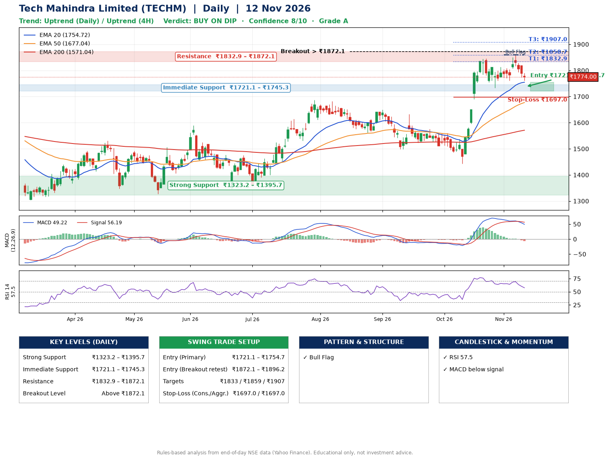

📌 **Tech Mahindra Limited (TECHM) – Multi-Timeframe Technical Analysis (Daily + 4H Combined)**
_Data up to 12 Nov 2026 · Close ₹1774.00_

**📍 Daily Timeframe Trend**
- Trend: **Uptrend** (higher highs and higher lows)
- Recent swing highs: ₹1576.2, ₹1561.0, ₹1845.0 · swing lows: ₹1498.0, ₹1442.5, ₹1733.2
- EMAs: EMA20 ₹1754.7, EMA50 ₹1677.0, EMA200 ₹1571.0; bullish stack (EMA20 > EMA50 > EMA200); price above EMA20, EMA50, EMA200
- MACD 49.22 below signal 56.19 (above zero), fresh bearish crossover; histogram falling
- RSI(14) 57.5; no divergence on the last two swings

**📍 4-Hour Timeframe Trend**
- Structure: **Uptrend** (higher highs and higher lows)
- Pullback/support area: recent 4H swing lows ₹1734.9, ₹1762.0; EMA20 ₹1786.4
- EMA20/50: bullish stack (EMA20 > EMA50); price above EMA50
- MACD 13.48 below signal 22.62 (above zero); histogram falling
- RSI(14) 49.5; Hidden bullish divergence; Regular bearish divergence

**📍 Pattern Detection (Both Timeframes)**
- Daily: **Bull Flag** – 16% pole then a tight 6% flag; trigger above ₹1860.0
- 4H: **Double Top** – tops near ₹1813.2/₹1858.1, neckline ₹1762.0, forming
- 4H: **Double Bottom** – bottoms near ₹1734.9/₹1762.0, neckline ₹1813.2, forming

**📍 Candlestick Patterns (last 3 daily candles)**
- No notable candlestick signal in the last 3 sessions.

**📍 Price Action Key Levels (Daily Structure)**

| Zone | Price Level (₹) | Context |
|------|-----------------|---------|
| Strong Support | ₹1323.2 – ₹1395.7 | Cluster of earlier swing lows (demand) |
| Immediate Support | ₹1721.1 – ₹1745.3 | Nearest swing-low / wick area |
| Resistance | ₹1832.9 – ₹1872.1 | Nearest swing-high supply |
| Breakout Level | Above ₹1872.1 | Swing continuation trigger (52-week high ₹1860.0) |

**📍 Swing Trade Setup**

🟢 **Entry Zone**
- Primary: ₹1721.1 – ₹1754.7 (daily support / EMA20 area; enter on a bullish 4H candle)
- Alternate: ₹1872.1 – ₹1896.2 (breakout retest)

🎯 **Profit Targets**
- T1: ₹1832.9
- T2: ₹1858.7
- T3: ₹1907.0

🛑 **Stop-Loss**
- Conservative: below daily swing low (₹1697.0)
- Aggressive: below 4H structure (₹1697.0)
- Risk per share ≈ ₹48.3; reward:risk to T1 ≈ 2.0
- Time to T1: about 13 trading days (it rose this much within 60 trading days 69% of the time in the last 2 years)
- Time to T2: about 16 trading days (it rose this much within 60 trading days 63% of the time in the last 2 years)

**📌 Strategy Notes**
- Higher timeframe: daily trend is uptrend; only take longs while price holds above ₹1323.2.
- Entry timing: wait for a bullish 4H candle (engulfing/hammer) inside ₹1721.1 – ₹1754.7 rather than buying mid-range.
- EMA stacking: bullish stack (EMA20 > EMA50 > EMA200); price above EMA20, EMA50, EMA200.
- Breakout rule: a daily close above ₹1872.1 with volume above its 20-day average (≈4,162,318) opens T2/T3.
- Momentum: RSI 57 – room to run; no divergence on the last two swings.
- Exit discipline: move the stop to entry once T1 is hit; book partial profits at each target.

**STEP 2 — Marked Up Chart**

**✅ Trade Validation Checklist**
- Trend + momentum aligned: No · Price at entry zone: No
- Stop defined (₹1697.0) · Reward:risk ≥ 1.5 to T1: Yes

## 📌 Final Verdict

Recommendation: **🟡 BUY ON DIP**

Confidence: **8/10**

Trade Quality: **A**

Reason:
• Daily uptrend (higher highs and higher lows)
• EMAs stacked bullishly

Next Action:
• Wait for a pullback to ₹1721.1–₹1754.7, or a breakout above ₹1872.1

_Rules-based analysis from end-of-day data. Educational only, not investment advice. Never place orders without your own confirmation._