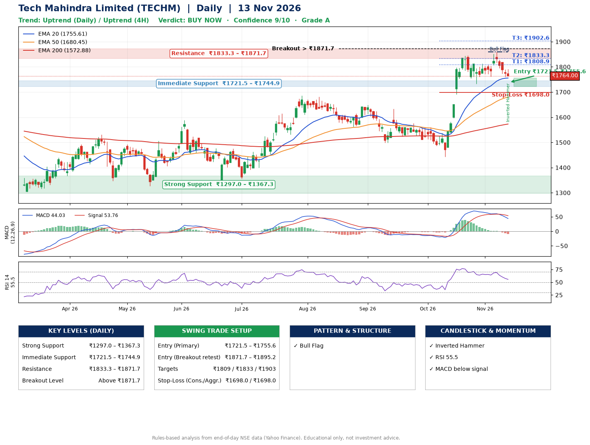

📌 **Tech Mahindra Limited (TECHM) – Multi-Timeframe Technical Analysis (Daily + 4H Combined)**
_Data up to 13 Nov 2026 · Close ₹1764.00_

**📍 Daily Timeframe Trend**
- Trend: **Uptrend** (higher highs and higher lows)
- Recent swing highs: ₹1576.2, ₹1561.0, ₹1845.0 · swing lows: ₹1498.0, ₹1442.5, ₹1733.2
- EMAs: EMA20 ₹1755.6, EMA50 ₹1680.4, EMA200 ₹1572.9; bullish stack (EMA20 > EMA50 > EMA200); price above EMA20, EMA50, EMA200
- MACD 44.03 below signal 53.76 (above zero), fresh bearish crossover; histogram falling
- RSI(14) 55.5; no divergence on the last two swings

**📍 4-Hour Timeframe Trend**
- Structure: **Uptrend** (higher highs and higher lows)
- Pullback/support area: recent 4H swing lows ₹1762.0, ₹1762.2; EMA20 ₹1783.1
- EMA20/50: bullish stack (EMA20 > EMA50); price above EMA50
- MACD 8.27 below signal 17.90 (above zero); histogram falling
- RSI(14) 47.0; Hidden bullish divergence; Regular bearish divergence

**📍 Pattern Detection (Both Timeframes)**
- Daily: **Bull Flag** – 16% pole then a tight 6% flag; trigger above ₹1860.0
- 4H: **Double Top** – tops near ₹1813.2/₹1858.1, neckline ₹1762.0, forming
- 4H: **Double Bottom** – bottoms near ₹1762.0/₹1762.2, neckline ₹1858.1, forming

**📍 Candlestick Patterns (last 3 daily candles)**
- **Inverted Hammer** – 13 Nov: long upper wick shows selling near ₹1791.5

**📍 Price Action Key Levels (Daily Structure)**

| Zone | Price Level (₹) | Context |
|------|-----------------|---------|
| Strong Support | ₹1297.0 – ₹1367.3 | Cluster of earlier swing lows (demand) |
| Immediate Support | ₹1721.5 – ₹1744.9 | Nearest swing-low / wick area |
| Resistance | ₹1833.3 – ₹1871.7 | Nearest swing-high supply |
| Breakout Level | Above ₹1871.7 | Swing continuation trigger (52-week high ₹1860.0) |

**📍 Swing Trade Setup**

🟢 **Entry Zone**
- Primary: ₹1721.5 – ₹1755.6 (daily support / EMA20 area; enter on a bullish 4H candle)
- Alternate: ₹1871.7 – ₹1895.2 (breakout retest)

🎯 **Profit Targets**
- T1: ₹1808.9
- T2: ₹1833.3
- T3: ₹1902.6

🛑 **Stop-Loss**
- Conservative: below daily swing low (₹1698.0)
- Aggressive: below 4H structure (₹1698.0)
- Risk per share ≈ ₹46.9; reward:risk to T1 ≈ 1.5
- Time to T1: about 8 trading days (it rose this much within 60 trading days 75% of the time in the last 2 years)
- Time to T2: about 13 trading days (it rose this much within 60 trading days 69% of the time in the last 2 years)

**📌 Strategy Notes**
- Higher timeframe: daily trend is uptrend; only take longs while price holds above ₹1297.0.
- Entry timing: wait for a bullish 4H candle (engulfing/hammer) inside ₹1721.5 – ₹1755.6 rather than buying mid-range.
- EMA stacking: bullish stack (EMA20 > EMA50 > EMA200); price above EMA20, EMA50, EMA200.
- Breakout rule: a daily close above ₹1871.7 with volume above its 20-day average (≈4,046,317) opens T2/T3.
- Momentum: RSI 56 – room to run; no divergence on the last two swings.
- Exit discipline: move the stop to entry once T1 is hit; book partial profits at each target.

**STEP 2 — Marked Up Chart**

**✅ Trade Validation Checklist**
- Trend + momentum aligned: No · Price at entry zone: No
- Stop defined (₹1698.0) · Reward:risk ≥ 1.5 to T1: Yes

## 📌 Final Verdict

Recommendation: **🟢 BUY NOW**

Confidence: **9/10**

Trade Quality: **A**

Reason:
• Daily uptrend (higher highs and higher lows)
• EMAs stacked bullishly

Next Action:
• Buy now within the entry zone, with the stop-loss in place

_Rules-based analysis from end-of-day data. Educational only, not investment advice. Never place orders without your own confirmation._