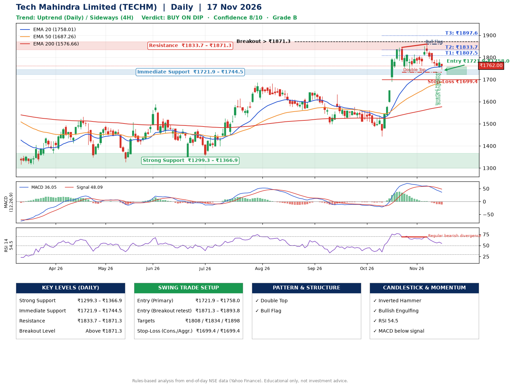

📌 **Tech Mahindra Limited (TECHM) – Multi-Timeframe Technical Analysis (Daily + 4H Combined)**
_Data up to 17 Nov 2026 · Close ₹1762.00_

**📍 Daily Timeframe Trend**
- Trend: **Uptrend** (higher highs and higher lows)
- Recent swing highs: ₹1561.0, ₹1845.0, ₹1860.0 · swing lows: ₹1498.0, ₹1442.5, ₹1733.2
- EMAs: EMA20 ₹1758.0, EMA50 ₹1687.3, EMA200 ₹1576.7; bullish stack (EMA20 > EMA50 > EMA200); price above EMA20, EMA50, EMA200
- MACD 36.05 below signal 48.09 (above zero); histogram falling
- RSI(14) 54.5; Regular bearish divergence

**📍 4-Hour Timeframe Trend**
- Structure: **Sideways** (mixed swing structure)
- Pullback/support area: recent 4H swing lows ₹1762.0, ₹1762.2; EMA20 ₹1776.7
- EMA20/50: bullish stack (EMA20 > EMA50); price above EMA50
- MACD 1.31 below signal 9.26 (above zero); histogram rising
- RSI(14) 47.1; Hidden bullish divergence

**📍 Pattern Detection (Both Timeframes)**
- Daily: **Double Top** – tops near ₹1845.0/₹1860.0, neckline ₹1733.2, forming
- Daily: **Bull Flag** – 16% pole then a tight 6% flag; trigger above ₹1860.0
- 4H: **Symmetrical Triangle** – converging swing highs and lows over the last ~60 sessions

**📍 Candlestick Patterns (last 3 daily candles)**
- **Inverted Hammer** – 13 Nov: long upper wick shows selling near ₹1791.5
- **Bullish Engulfing** – 16 Nov: buyers fully reversed the prior red candle

**📍 Price Action Key Levels (Daily Structure)**

| Zone | Price Level (₹) | Context |
|------|-----------------|---------|
| Strong Support | ₹1299.3 – ₹1366.9 | Cluster of earlier swing lows (demand) |
| Immediate Support | ₹1721.9 – ₹1744.5 | Nearest swing-low / wick area |
| Resistance | ₹1833.7 – ₹1871.3 | Nearest swing-high supply |
| Breakout Level | Above ₹1871.3 | Swing continuation trigger (52-week high ₹1860.0) |

**📍 Swing Trade Setup**

🟢 **Entry Zone**
- Primary: ₹1721.9 – ₹1758.0 (daily support / EMA20 area; enter on a bullish 4H candle)
- Alternate: ₹1871.3 – ₹1893.8 (breakout retest)

🎯 **Profit Targets**
- T1: ₹1807.5
- T2: ₹1833.7
- T3: ₹1897.6

🛑 **Stop-Loss**
- Conservative: below daily swing low (₹1699.4)
- Aggressive: below 4H structure (₹1699.4)
- Risk per share ≈ ₹45.0; reward:risk to T1 ≈ 1.5
- Time to T1: about 8 trading days (it rose this much within 60 trading days 76% of the time in the last 2 years)
- Time to T2: about 13 trading days (it rose this much within 60 trading days 69% of the time in the last 2 years)

**📌 Strategy Notes**
- Higher timeframe: daily trend is uptrend; only take longs while price holds above ₹1299.3.
- Entry timing: wait for a bullish 4H candle (engulfing/hammer) inside ₹1721.9 – ₹1758.0 rather than buying mid-range.
- EMA stacking: bullish stack (EMA20 > EMA50 > EMA200); price above EMA20, EMA50, EMA200.
- Breakout rule: a daily close above ₹1871.3 with volume above its 20-day average (≈2,736,445) opens T2/T3.
- Momentum: RSI 55 – room to run; Regular bearish divergence.
- Exit discipline: move the stop to entry once T1 is hit; book partial profits at each target.

**STEP 2 — Marked Up Chart**

**✅ Trade Validation Checklist**
- Trend + momentum aligned: No · Price at entry zone: No
- Stop defined (₹1699.4) · Reward:risk ≥ 1.5 to T1: No

## 📌 Final Verdict

Recommendation: **🟡 BUY ON DIP**

Confidence: **8/10**

Trade Quality: **B**

Reason:
• Daily uptrend (higher highs and higher lows)
• EMAs stacked bullishly

Next Action:
• Wait for a pullback to ₹1721.9–₹1758.0, or a breakout above ₹1871.3

_Rules-based analysis from end-of-day data. Educational only, not investment advice. Never place orders without your own confirmation._