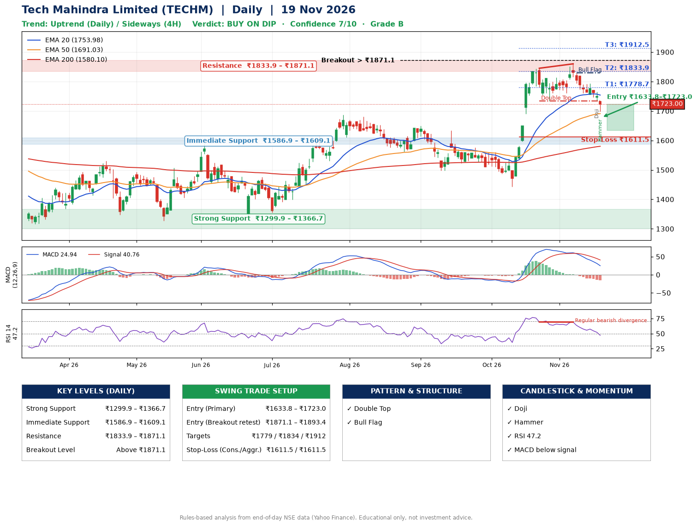

📌 **Tech Mahindra Limited (TECHM) – Multi-Timeframe Technical Analysis (Daily + 4H Combined)**
_Data up to 19 Nov 2026 · Close ₹1723.00_

**📍 Daily Timeframe Trend**
- Trend: **Uptrend** (higher highs and higher lows)
- Recent swing highs: ₹1561.0, ₹1845.0, ₹1860.0 · swing lows: ₹1498.0, ₹1442.5, ₹1733.2
- EMAs: EMA20 ₹1754.0, EMA50 ₹1691.0, EMA200 ₹1580.1; bullish stack (EMA20 > EMA50 > EMA200); price above EMA50, EMA200
- MACD 24.94 below signal 40.76 (above zero); histogram falling
- RSI(14) 47.2; Regular bearish divergence

**📍 4-Hour Timeframe Trend**
- Structure: **Sideways** (mixed swing structure)
- Pullback/support area: recent 4H swing lows ₹1762.0, ₹1762.2; EMA20 ₹1761.5
- EMA20/50: bullish stack (EMA20 > EMA50); price below all EMAs
- MACD -9.21 below signal 0.37 (below zero); histogram rising
- RSI(14) 39.9; Hidden bullish divergence

**📍 Pattern Detection (Both Timeframes)**
- Daily: **Double Top** – tops near ₹1845.0/₹1860.0, neckline ₹1733.2, confirmed (closed below neckline)
- Daily: **Bull Flag** – 16% pole then a tight 7% flag; trigger above ₹1829.0
- 4H: **Symmetrical Triangle** – converging swing highs and lows over the last ~60 sessions

**📍 Candlestick Patterns (last 3 daily candles)**
- **Doji** – 18 Nov: indecision; wait for the next candle to confirm direction
- **Hammer** – 19 Nov: long lower wick shows dip-buying near ₹1698.6

**📍 Price Action Key Levels (Daily Structure)**

| Zone | Price Level (₹) | Context |
|------|-----------------|---------|
| Strong Support | ₹1299.9 – ₹1366.7 | Cluster of earlier swing lows (demand) |
| Immediate Support | ₹1586.9 – ₹1609.1 | Nearest swing-low / wick area |
| Resistance | ₹1833.9 – ₹1871.1 | Nearest swing-high supply |
| Breakout Level | Above ₹1871.1 | Swing continuation trigger (52-week high ₹1860.0) |

**📍 Swing Trade Setup**

🟢 **Entry Zone**
- Primary: ₹1633.8 – ₹1723.0 (daily support / EMA20 area; enter on a bullish 4H candle)
- Alternate: ₹1871.1 – ₹1893.4 (breakout retest)

🎯 **Profit Targets**
- T1: ₹1778.7
- T2: ₹1833.9
- T3: ₹1912.5

🛑 **Stop-Loss**
- Conservative: below daily swing low (₹1611.5)
- Aggressive: below 4H structure (₹1611.5)
- Risk per share ≈ ₹66.9; reward:risk to T1 ≈ 1.5
- Time to T1: about 14 trading days (it rose this much within 60 trading days 66% of the time in the last 2 years)
- Time to T2: about 23 trading days (it rose this much within 60 trading days 57% of the time in the last 2 years)

**📌 Strategy Notes**
- Higher timeframe: daily trend is uptrend; only take longs while price holds above ₹1299.9.
- Entry timing: wait for a bullish 4H candle (engulfing/hammer) inside ₹1633.8 – ₹1723.0 rather than buying mid-range.
- EMA stacking: bullish stack (EMA20 > EMA50 > EMA200); price above EMA50, EMA200.
- Breakout rule: a daily close above ₹1871.1 with volume above its 20-day average (≈2,390,738) opens T2/T3.
- Momentum: RSI 47 – room to run; Regular bearish divergence.
- Exit discipline: move the stop to entry once T1 is hit; book partial profits at each target.

**STEP 2 — Marked Up Chart**

**✅ Trade Validation Checklist**
- Trend + momentum aligned: No · Price at entry zone: Yes
- Stop defined (₹1611.5) · Reward:risk ≥ 1.5 to T1: No

## 📌 Final Verdict

Recommendation: **🟡 BUY ON DIP**

Confidence: **7/10**

Trade Quality: **B**

Reason:
• Daily uptrend (higher highs and higher lows)
• EMAs stacked bullishly

Next Action:
• Wait for a pullback to ₹1633.8–₹1723.0, or a breakout above ₹1871.1

_Rules-based analysis from end-of-day data. Educational only, not investment advice. Never place orders without your own confirmation._