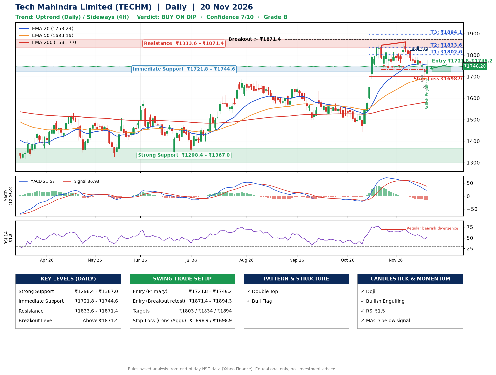

📌 **Tech Mahindra Limited (TECHM) – Multi-Timeframe Technical Analysis (Daily + 4H Combined)**
_Data up to 20 Nov 2026 · Close ₹1746.20_

**📍 Daily Timeframe Trend**
- Trend: **Uptrend** (higher highs and higher lows)
- Recent swing highs: ₹1561.0, ₹1845.0, ₹1860.0 · swing lows: ₹1498.0, ₹1442.5, ₹1733.2
- EMAs: EMA20 ₹1753.2, EMA50 ₹1693.2, EMA200 ₹1581.8; bullish stack (EMA20 > EMA50 > EMA200); price above EMA50, EMA200
- MACD 21.58 below signal 36.93 (above zero); histogram rising
- RSI(14) 51.5; Regular bearish divergence

**📍 4-Hour Timeframe Trend**
- Structure: **Sideways** (mixed swing structure)
- Pullback/support area: recent 4H swing lows ₹1762.2, ₹1698.6; EMA20 ₹1758.7
- EMA20/50: bullish stack (EMA20 > EMA50); price above EMA50
- MACD -8.79 below signal -2.96 (below zero); histogram rising
- RSI(14) 46.4; no divergence

**📍 Pattern Detection (Both Timeframes)**
- Daily: **Double Top** – tops near ₹1845.0/₹1860.0, neckline ₹1733.2, forming
- Daily: **Bull Flag** – 17% pole then a tight 7% flag; trigger above ₹1819.6

**📍 Candlestick Patterns (last 3 daily candles)**
- **Doji** – 18 Nov: indecision; wait for the next candle to confirm direction
- **Doji** – 19 Nov: indecision; wait for the next candle to confirm direction
- **Bullish Engulfing** – 20 Nov: buyers fully reversed the prior red candle

**📍 Price Action Key Levels (Daily Structure)**

| Zone | Price Level (₹) | Context |
|------|-----------------|---------|
| Strong Support | ₹1298.4 – ₹1367.0 | Cluster of earlier swing lows (demand) |
| Immediate Support | ₹1721.8 – ₹1744.6 | Nearest swing-low / wick area |
| Resistance | ₹1833.6 – ₹1871.4 | Nearest swing-high supply |
| Breakout Level | Above ₹1871.4 | Swing continuation trigger (52-week high ₹1860.0) |

**📍 Swing Trade Setup**

🟢 **Entry Zone**
- Primary: ₹1721.8 – ₹1746.2 (daily support / EMA20 area; enter on a bullish 4H candle)
- Alternate: ₹1871.4 – ₹1894.3 (breakout retest)

🎯 **Profit Targets**
- T1: ₹1802.6
- T2: ₹1833.6
- T3: ₹1894.1

🛑 **Stop-Loss**
- Conservative: below daily swing low (₹1698.9)
- Aggressive: below 4H structure (₹1698.9)
- Risk per share ≈ ₹45.8; reward:risk to T1 ≈ 1.5
- Time to T1: about 8 trading days (it rose this much within 60 trading days 76% of the time in the last 2 years)
- Time to T2: about 14 trading days (it rose this much within 60 trading days 67% of the time in the last 2 years)

**📌 Strategy Notes**
- Higher timeframe: daily trend is uptrend; only take longs while price holds above ₹1298.4.
- Entry timing: wait for a bullish 4H candle (engulfing/hammer) inside ₹1721.8 – ₹1746.2 rather than buying mid-range.
- EMA stacking: bullish stack (EMA20 > EMA50 > EMA200); price above EMA50, EMA200.
- Breakout rule: a daily close above ₹1871.4 with volume above its 20-day average (≈2,312,464) opens T2/T3.
- Momentum: RSI 51 – room to run; Regular bearish divergence.
- Exit discipline: move the stop to entry once T1 is hit; book partial profits at each target.

**STEP 2 — Marked Up Chart**

**✅ Trade Validation Checklist**
- Trend + momentum aligned: No · Price at entry zone: Yes
- Stop defined (₹1698.9) · Reward:risk ≥ 1.5 to T1: No

## 📌 Final Verdict

Recommendation: **🟡 BUY ON DIP**

Confidence: **7/10**

Trade Quality: **B**

Reason:
• Daily uptrend (higher highs and higher lows)
• EMAs stacked bullishly

Next Action:
• Wait for a pullback to ₹1721.8–₹1746.2, or a breakout above ₹1871.4

_Rules-based analysis from end-of-day data. Educational only, not investment advice. Never place orders without your own confirmation._