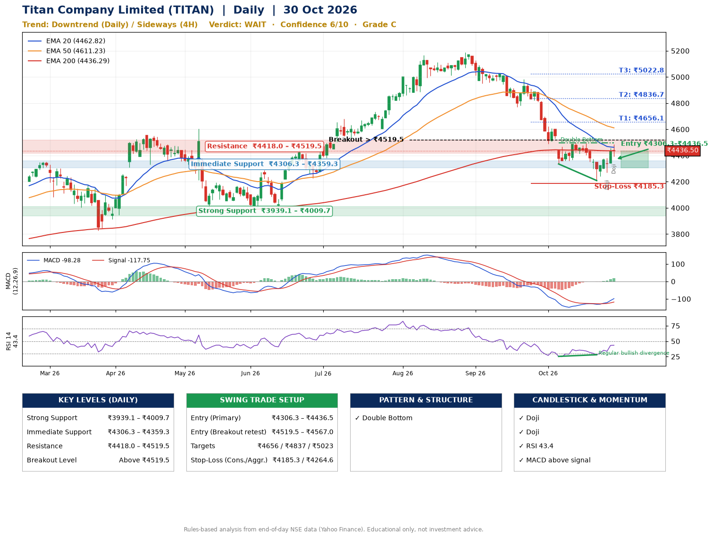

📌 **Titan Company Limited (TITAN) – Multi-Timeframe Technical Analysis (Daily + 4H Combined)**
_Data up to 30 Oct 2026 · Close ₹4436.50_

**📍 Daily Timeframe Trend**
- Trend: **Downtrend** (lower highs and lower lows)
- Recent swing highs: ₹5168.0, ₹5186.7, ₹4495.8 · swing lows: ₹4772.0, ₹4335.6, ₹4209.0
- EMAs: EMA20 ₹4462.8, EMA50 ₹4611.2, EMA200 ₹4436.3; mixed / crossing; price above EMA200
- MACD -98.28 above signal -117.75 (below zero), fresh bullish crossover; histogram rising
- RSI(14) 43.4; Regular bullish divergence

**📍 4-Hour Timeframe Trend**
- Structure: **Sideways** (mixed swing structure)
- Pullback/support area: recent 4H swing lows ₹4209.9, ₹4270.6; EMA20 ₹4409.8
- EMA20/50: bearish stack (EMA20 < EMA50); price above EMA20
- MACD -4.82 above signal -28.37 (below zero); histogram rising
- RSI(14) 56.7; Hidden bearish divergence

**📍 Pattern Detection (Both Timeframes)**
- Daily: **Double Bottom** – bottoms near ₹4335.6/₹4209.0, neckline ₹4495.8, forming

**📍 Candlestick Patterns (last 3 daily candles)**
- **Doji** – 28 Oct: indecision; wait for the next candle to confirm direction
- **Doji** – 30 Oct: indecision; wait for the next candle to confirm direction

**📍 Price Action Key Levels (Daily Structure)**

| Zone | Price Level (₹) | Context |
|------|-----------------|---------|
| Strong Support | ₹3939.1 – ₹4009.7 | Cluster of earlier swing lows (demand) |
| Immediate Support | ₹4306.3 – ₹4359.3 | Nearest swing-low / wick area |
| Resistance | ₹4418.0 – ₹4519.5 | Nearest swing-high supply |
| Breakout Level | Above ₹4519.5 | Swing continuation trigger (52-week high ₹5186.7) |

**📍 Swing Trade Setup**

🟢 **Entry Zone**
- Primary: ₹4306.3 – ₹4436.5 (daily support / EMA20 area; enter on a bullish 4H candle)
- Alternate: ₹4519.5 – ₹4567.0 (breakout retest)

🎯 **Profit Targets**
- T1: ₹4656.1
- T2: ₹4836.7
- T3: ₹5022.8

🛑 **Stop-Loss**
- Conservative: below daily swing low (₹4185.3)
- Aggressive: below 4H structure (₹4264.6)
- Risk per share ≈ ₹186.1; reward:risk to T1 ≈ 1.5

**📌 Strategy Notes**
- Higher timeframe: daily trend is downtrend; only take longs while price holds above ₹3939.1.
- Entry timing: wait for a bullish 4H candle (engulfing/hammer) inside ₹4306.3 – ₹4436.5 rather than buying mid-range.
- EMA stacking: mixed / crossing; price above EMA200.
- Breakout rule: a daily close above ₹4519.5 with volume above its 20-day average (≈805,955) opens T2/T3.
- Momentum: RSI 43 – room to run; Regular bullish divergence.
- Exit discipline: move the stop to entry once T1 is hit; book partial profits at each target.

**STEP 2 — Marked Up Chart**

**✅ Trade Validation Checklist**
- Trend + momentum aligned: No · Price at entry zone: Yes
- Stop defined (₹4185.3) · Reward:risk ≥ 1.5 to T1: Yes

## 📌 Final Verdict

Recommendation: **🟠 WAIT**

Confidence: **6/10**

Trade Quality: **C**

Reason:
• Daily downtrend (lower highs and lower lows)
• Double Bottom: bottoms near ₹4335.6/₹4209.0, neckline ₹4495.8, forming

Next Action:
• Wait for a breakout above ₹4519.5

_Rules-based analysis from end-of-day data. Educational only, not investment advice. Never place orders without your own confirmation._