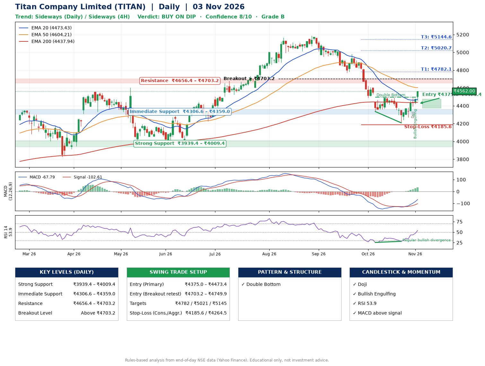

📌 **Titan Company Limited (TITAN) – Multi-Timeframe Technical Analysis (Daily + 4H Combined)**
_Data up to 03 Nov 2026 · Close ₹4562.00_

**📍 Daily Timeframe Trend**
- Trend: **Sideways** (mixed swing structure)
- Recent swing highs: ₹5168.0, ₹5186.7, ₹4495.8 · swing lows: ₹4772.0, ₹4335.6, ₹4209.0
- EMAs: EMA20 ₹4473.4, EMA50 ₹4604.2, EMA200 ₹4437.9; mixed / crossing; price above EMA20, EMA200
- MACD -67.79 above signal -102.61 (below zero); histogram rising
- RSI(14) 53.9; Regular bullish divergence

**📍 4-Hour Timeframe Trend**
- Structure: **Sideways** (mixed swing structure)
- Pullback/support area: recent 4H swing lows ₹4209.9, ₹4270.6; EMA20 ₹4431.8
- EMA20/50: bearish stack (EMA20 < EMA50); price above EMA20, EMA50
- MACD 12.69 above signal -15.28 (above zero); histogram rising
- RSI(14) 64.7; Hidden bearish divergence

**📍 Pattern Detection (Both Timeframes)**
- Daily: **Double Bottom** – bottoms near ₹4335.6/₹4209.0, neckline ₹4495.8, confirmed (closed above neckline)

**📍 Candlestick Patterns (last 3 daily candles)**
- **Doji** – 30 Oct: indecision; wait for the next candle to confirm direction
- **Bullish Engulfing** – 02 Nov: buyers fully reversed the prior red candle

**📍 Price Action Key Levels (Daily Structure)**

| Zone | Price Level (₹) | Context |
|------|-----------------|---------|
| Strong Support | ₹3939.4 – ₹4009.4 | Cluster of earlier swing lows (demand) |
| Immediate Support | ₹4306.6 – ₹4359.0 | Nearest swing-low / wick area |
| Resistance | ₹4656.4 – ₹4703.2 | Nearest swing-high supply |
| Breakout Level | Above ₹4703.2 | Swing continuation trigger (52-week high ₹5186.7) |

**📍 Swing Trade Setup**

🟢 **Entry Zone**
- Primary: ₹4375.0 – ₹4473.4 (daily support / EMA20 area; enter on a bullish 4H candle)
- Alternate: ₹4703.2 – ₹4749.9 (breakout retest)

🎯 **Profit Targets**
- T1: ₹4782.1
- T2: ₹5020.7
- T3: ₹5144.6

🛑 **Stop-Loss**
- Conservative: below daily swing low (₹4185.6)
- Aggressive: below 4H structure (₹4264.5)
- Risk per share ≈ ₹238.6; reward:risk to T1 ≈ 1.5

**📌 Strategy Notes**
- Higher timeframe: daily trend is sideways; only take longs while price holds above ₹3939.4.
- Entry timing: wait for a bullish 4H candle (engulfing/hammer) inside ₹4375.0 – ₹4473.4 rather than buying mid-range.
- EMA stacking: mixed / crossing; price above EMA20, EMA200.
- Breakout rule: a daily close above ₹4703.2 with volume above its 20-day average (≈803,468) opens T2/T3.
- Momentum: RSI 54 – room to run; Regular bullish divergence.
- Exit discipline: move the stop to entry once T1 is hit; book partial profits at each target.

**STEP 2 — Marked Up Chart**

**✅ Trade Validation Checklist**
- Trend + momentum aligned: No · Price at entry zone: No
- Stop defined (₹4185.6) · Reward:risk ≥ 1.5 to T1: Yes

## 📌 Final Verdict

Recommendation: **🟡 BUY ON DIP**

Confidence: **8/10**

Trade Quality: **B**

Reason:
• Double Bottom: bottoms near ₹4335.6/₹4209.0, neckline ₹4495.8, confirmed (closed above neckline)

Next Action:
• Wait for a pullback to ₹4375.0–₹4473.4, or a breakout above ₹4703.2

_Rules-based analysis from end-of-day data. Educational only, not investment advice. Never place orders without your own confirmation._