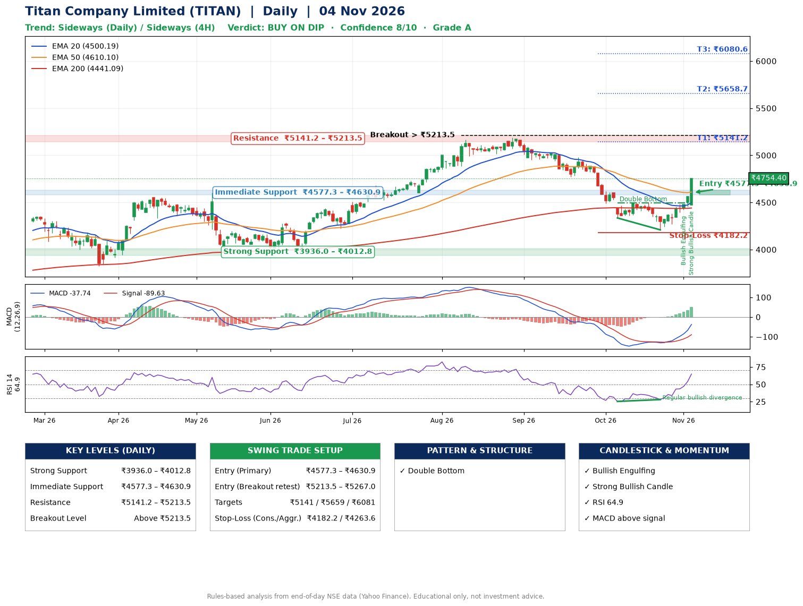

📌 **Titan Company Limited (TITAN) – Multi-Timeframe Technical Analysis (Daily + 4H Combined)**
_Data up to 04 Nov 2026 · Close ₹4754.40_

**📍 Daily Timeframe Trend**
- Trend: **Sideways** (mixed swing structure)
- Recent swing highs: ₹5168.0, ₹5186.7, ₹4495.8 · swing lows: ₹4772.0, ₹4335.6, ₹4209.0
- EMAs: EMA20 ₹4500.2, EMA50 ₹4610.1, EMA200 ₹4441.1; mixed / crossing; price above EMA20, EMA50, EMA200
- MACD -37.74 above signal -89.63 (below zero); histogram rising
- RSI(14) 64.9; Regular bullish divergence

**📍 4-Hour Timeframe Trend**
- Structure: **Sideways** (mixed swing structure)
- Pullback/support area: recent 4H swing lows ₹4209.9, ₹4270.6; EMA20 ₹4482.8
- EMA20/50: bearish stack (EMA20 < EMA50); price above EMA20, EMA50
- MACD 48.81 above signal 4.65 (above zero); histogram rising
- RSI(14) 75.9; Hidden bearish divergence

**📍 Pattern Detection (Both Timeframes)**
- Daily: **Double Bottom** – bottoms near ₹4335.6/₹4209.0, neckline ₹4495.8, confirmed (closed above neckline)

**📍 Candlestick Patterns (last 3 daily candles)**
- **Bullish Engulfing** – 02 Nov: buyers fully reversed the prior red candle
- **Strong Bullish Candle** – 04 Nov: wide-range green candle, buyers in control

**📍 Price Action Key Levels (Daily Structure)**

| Zone | Price Level (₹) | Context |
|------|-----------------|---------|
| Strong Support | ₹3936.0 – ₹4012.8 | Cluster of earlier swing lows (demand) |
| Immediate Support | ₹4577.3 – ₹4630.9 | Nearest swing-low / wick area |
| Resistance | ₹5141.2 – ₹5213.5 | Nearest swing-high supply |
| Breakout Level | Above ₹5213.5 | Swing continuation trigger (52-week high ₹5186.7) |

**📍 Swing Trade Setup**

🟢 **Entry Zone**
- Primary: ₹4577.3 – ₹4630.9 (daily support / EMA20 area; enter on a bullish 4H candle)
- Alternate: ₹5213.5 – ₹5267.0 (breakout retest)

🎯 **Profit Targets**
- T1: ₹5141.2
- T2: ₹5658.7
- T3: ₹6080.6

🛑 **Stop-Loss**
- Conservative: below daily swing low (₹4182.2)
- Aggressive: below 4H structure (₹4263.6)
- Risk per share ≈ ₹421.9; reward:risk to T1 ≈ 1.3

**📌 Strategy Notes**
- Higher timeframe: daily trend is sideways; only take longs while price holds above ₹3936.0.
- Entry timing: wait for a bullish 4H candle (engulfing/hammer) inside ₹4577.3 – ₹4630.9 rather than buying mid-range.
- EMA stacking: mixed / crossing; price above EMA20, EMA50, EMA200.
- Breakout rule: a daily close above ₹5213.5 with volume above its 20-day average (≈829,685) opens T2/T3.
- Momentum: RSI 65 – room to run; Regular bullish divergence.
- Exit discipline: move the stop to entry once T1 is hit; book partial profits at each target.

**STEP 2 — Marked Up Chart**

**✅ Trade Validation Checklist**
- Trend + momentum aligned: No · Price at entry zone: No
- Stop defined (₹4182.2) · Reward:risk ≥ 1.5 to T1: No

## 📌 Final Verdict

Recommendation: **🟡 BUY ON DIP**

Confidence: **8/10**

Trade Quality: **A**

Reason:
• Double Bottom: bottoms near ₹4335.6/₹4209.0, neckline ₹4495.8, confirmed (closed above neckline)

Next Action:
• Wait for a pullback to ₹4577.3–₹4630.9, or a breakout above ₹5213.5

_Rules-based analysis from end-of-day data. Educational only, not investment advice. Never place orders without your own confirmation._