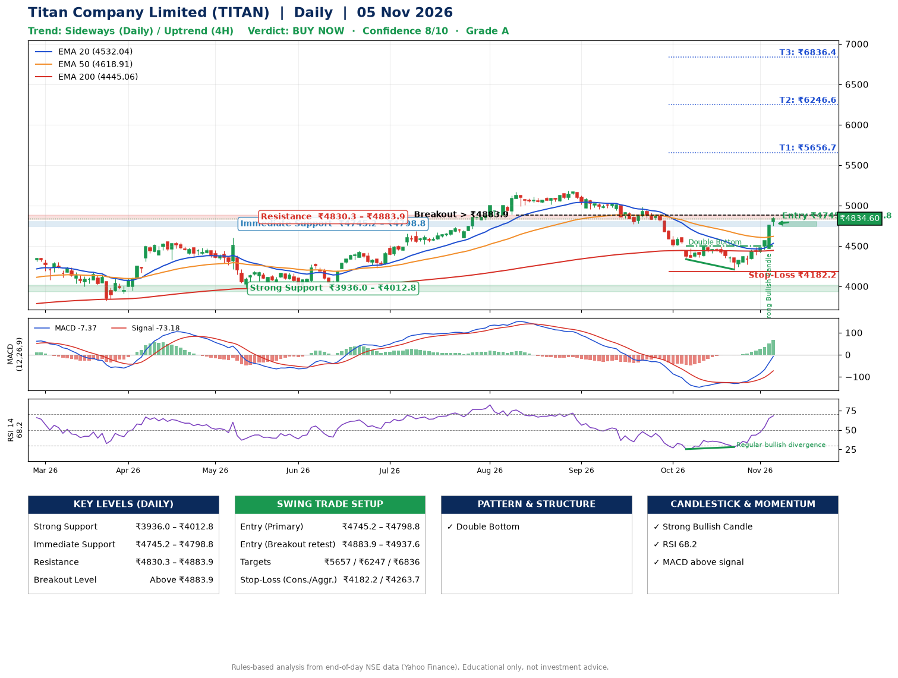

📌 **Titan Company Limited (TITAN) – Multi-Timeframe Technical Analysis (Daily + 4H Combined)**
_Data up to 05 Nov 2026 · Close ₹4834.60_

**📍 Daily Timeframe Trend**
- Trend: **Sideways** (mixed swing structure)
- Recent swing highs: ₹5168.0, ₹5186.7, ₹4495.8 · swing lows: ₹4772.0, ₹4335.6, ₹4209.0
- EMAs: EMA20 ₹4532.0, EMA50 ₹4618.9, EMA200 ₹4445.1; mixed / crossing; price above EMA20, EMA50, EMA200
- MACD -7.37 above signal -73.18 (below zero); histogram rising
- RSI(14) 68.2; Regular bullish divergence

**📍 4-Hour Timeframe Trend**
- Structure: **Uptrend** (price above rising EMAs)
- Pullback/support area: recent 4H swing lows ₹4209.9, ₹4270.6; EMA20 ₹4546.0
- EMA20/50: bullish stack (EMA20 > EMA50); price above EMA20, EMA50
- MACD 85.38 above signal 31.15 (above zero); histogram rising
- RSI(14) 79.0; Hidden bearish divergence

**📍 Pattern Detection (Both Timeframes)**
- Daily: **Double Bottom** – bottoms near ₹4335.6/₹4209.0, neckline ₹4495.8, confirmed (closed above neckline)

**📍 Candlestick Patterns (last 3 daily candles)**
- **Strong Bullish Candle** – 04 Nov: wide-range green candle, buyers in control

**📍 Price Action Key Levels (Daily Structure)**

| Zone | Price Level (₹) | Context |
|------|-----------------|---------|
| Strong Support | ₹3936.0 – ₹4012.8 | Cluster of earlier swing lows (demand) |
| Immediate Support | ₹4745.2 – ₹4798.8 | Nearest swing-low / wick area |
| Resistance | ₹4830.3 – ₹4883.9 | Nearest swing-high supply |
| Breakout Level | Above ₹4883.9 | Swing continuation trigger (52-week high ₹5186.7) |

**📍 Swing Trade Setup**

🟢 **Entry Zone**
- Primary: ₹4745.2 – ₹4798.8 (daily support / EMA20 area; enter on a bullish 4H candle)
- Alternate: ₹4883.9 – ₹4937.6 (breakout retest)

🎯 **Profit Targets**
- T1: ₹5656.7
- T2: ₹6246.6
- T3: ₹6836.4

🛑 **Stop-Loss**
- Conservative: below daily swing low (₹4182.2)
- Aggressive: below 4H structure (₹4263.7)
- Risk per share ≈ ₹589.8; reward:risk to T1 ≈ 1.5

**📌 Strategy Notes**
- Higher timeframe: daily trend is sideways; only take longs while price holds above ₹3936.0.
- Entry timing: wait for a bullish 4H candle (engulfing/hammer) inside ₹4745.2 – ₹4798.8 rather than buying mid-range.
- EMA stacking: mixed / crossing; price above EMA20, EMA50, EMA200.
- Breakout rule: a daily close above ₹4883.9 with volume above its 20-day average (≈744,245) opens T2/T3.
- Momentum: RSI 68 – elevated, prefer dips; Regular bullish divergence.
- Exit discipline: move the stop to entry once T1 is hit; book partial profits at each target.

**STEP 2 — Marked Up Chart**

**✅ Trade Validation Checklist**
- Trend + momentum aligned: No · Price at entry zone: No
- Stop defined (₹4182.2) · Reward:risk ≥ 1.5 to T1: No

## 📌 Final Verdict

Recommendation: **🟢 BUY NOW**

Confidence: **8/10**

Trade Quality: **A**

Reason:
• Double Bottom: bottoms near ₹4335.6/₹4209.0, neckline ₹4495.8, confirmed (closed above neckline)

Next Action:
• Buy now within the entry zone, with the stop-loss in place

_Rules-based analysis from end-of-day data. Educational only, not investment advice. Never place orders without your own confirmation._