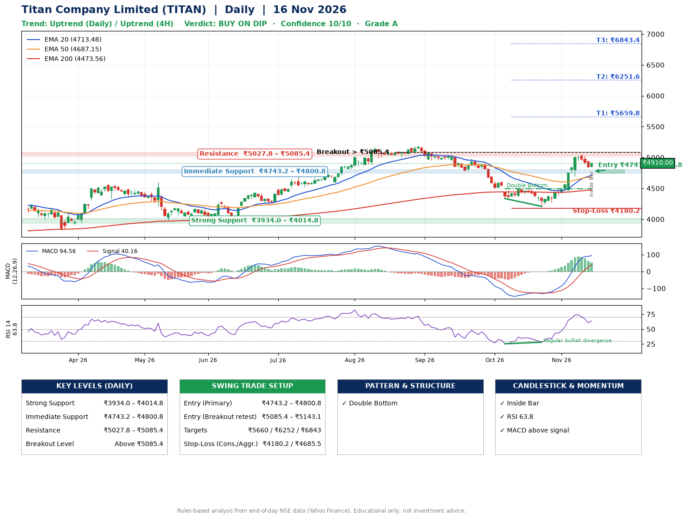

📌 **Titan Company Limited (TITAN) – Multi-Timeframe Technical Analysis (Daily + 4H Combined)**
_Data up to 16 Nov 2026 · Close ₹4910.00_

**📍 Daily Timeframe Trend**
- Trend: **Uptrend** (price above rising EMAs)
- Recent swing highs: ₹5168.0, ₹5186.7, ₹4495.8 · swing lows: ₹4772.0, ₹4335.6, ₹4209.0
- EMAs: EMA20 ₹4713.5, EMA50 ₹4687.2, EMA200 ₹4473.6; bullish stack (EMA20 > EMA50 > EMA200); price above EMA20, EMA50, EMA200
- MACD 94.56 above signal 40.16 (above zero); histogram falling
- RSI(14) 63.8; Regular bullish divergence

**📍 4-Hour Timeframe Trend**
- Structure: **Uptrend** (higher highs and higher lows)
- Pullback/support area: recent 4H swing lows ₹4270.6, ₹4837.1; EMA20 ₹4825.1
- EMA20/50: bullish stack (EMA20 > EMA50); price above EMA20, EMA50
- MACD 95.41 below signal 110.30 (above zero), fresh bearish crossover; histogram falling
- RSI(14) 64.5; no divergence

**📍 Pattern Detection (Both Timeframes)**
- Daily: **Double Bottom** – bottoms near ₹4335.6/₹4209.0, neckline ₹4495.8, confirmed (closed above neckline)
- 4H: **Bull Flag** – 15% pole then a tight 4% flag; trigger above ₹5029.9

**📍 Candlestick Patterns (last 3 daily candles)**
- **Inside Bar** – 16 Nov: compression inside the prior range ₹4837.1–₹4947.8

**📍 Price Action Key Levels (Daily Structure)**

| Zone | Price Level (₹) | Context |
|------|-----------------|---------|
| Strong Support | ₹3934.0 – ₹4014.8 | Cluster of earlier swing lows (demand) |
| Immediate Support | ₹4743.2 – ₹4800.8 | Nearest swing-low / wick area |
| Resistance | ₹5027.8 – ₹5085.4 | Nearest swing-high supply |
| Breakout Level | Above ₹5085.4 | Swing continuation trigger (52-week high ₹5186.7) |

**📍 Swing Trade Setup**

🟢 **Entry Zone**
- Primary: ₹4743.2 – ₹4800.8 (daily support / EMA20 area; enter on a bullish 4H candle)
- Alternate: ₹5085.4 – ₹5143.1 (breakout retest)

🎯 **Profit Targets**
- T1: ₹5659.8
- T2: ₹6251.6
- T3: ₹6843.4

🛑 **Stop-Loss**
- Conservative: below daily swing low (₹4180.2)
- Aggressive: below 4H structure (₹4685.5)
- Risk per share ≈ ₹591.8; reward:risk to T1 ≈ 1.5
- Time to T1: about 41 trading days (it rose this much within 60 trading days 15% of the time in the last 2 years)
- Time to T2: it never rose this much within 60 trading days in the price history

**📌 Strategy Notes**
- Higher timeframe: daily trend is uptrend; only take longs while price holds above ₹3934.0.
- Entry timing: wait for a bullish 4H candle (engulfing/hammer) inside ₹4743.2 – ₹4800.8 rather than buying mid-range.
- EMA stacking: bullish stack (EMA20 > EMA50 > EMA200); price above EMA20, EMA50, EMA200.
- Breakout rule: a daily close above ₹5085.4 with volume above its 20-day average (≈970,068) opens T2/T3.
- Momentum: RSI 64 – room to run; Regular bullish divergence.
- Exit discipline: move the stop to entry once T1 is hit; book partial profits at each target.

**STEP 2 — Marked Up Chart**

**✅ Trade Validation Checklist**
- Trend + momentum aligned: Yes · Price at entry zone: No
- Stop defined (₹4180.2) · Reward:risk ≥ 1.5 to T1: Yes

## 📌 Final Verdict

Recommendation: **🟡 BUY ON DIP**

Confidence: **10/10**

Trade Quality: **A**

Reason:
• Daily uptrend (price above rising EMAs)
• EMAs stacked bullishly

Next Action:
• Wait for a pullback to ₹4743.2–₹4800.8, or a breakout above ₹5085.4

_Rules-based analysis from end-of-day data. Educational only, not investment advice. Never place orders without your own confirmation._