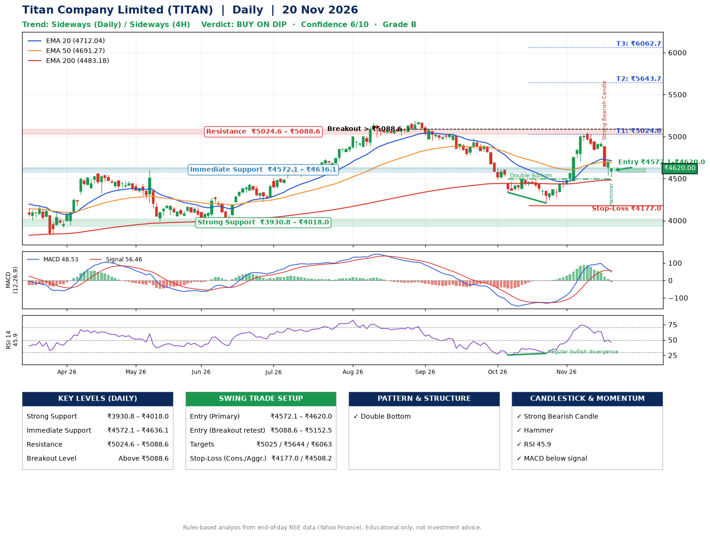

📌 **Titan Company Limited (TITAN) – Multi-Timeframe Technical Analysis (Daily + 4H Combined)**
_Data up to 20 Nov 2026 · Close ₹4620.00_

**📍 Daily Timeframe Trend**
- Trend: **Sideways** (mixed swing structure)
- Recent swing highs: ₹5186.7, ₹4495.8, ₹5056.6 · swing lows: ₹4772.0, ₹4335.6, ₹4209.0
- EMAs: EMA20 ₹4712.0, EMA50 ₹4691.3, EMA200 ₹4483.2; bullish stack (EMA20 > EMA50 > EMA200); price above EMA200
- MACD 48.53 below signal 56.46 (above zero), fresh bearish crossover; histogram falling
- RSI(14) 45.9; Regular bullish divergence

**📍 4-Hour Timeframe Trend**
- Structure: **Sideways** (mixed swing structure)
- Pullback/support area: recent 4H swing lows ₹4270.6, ₹4837.1; EMA20 ₹4745.7
- EMA20/50: bullish stack (EMA20 > EMA50); price below all EMAs
- MACD -2.77 below signal 45.51 (below zero); histogram rising
- RSI(14) 40.6; no divergence

**📍 Pattern Detection (Both Timeframes)**
- Daily: **Double Bottom** – bottoms near ₹4335.6/₹4209.0, neckline ₹4495.8, confirmed (closed above neckline)

**📍 Candlestick Patterns (last 3 daily candles)**
- **Strong Bearish Candle** – 18 Nov: wide-range red candle, sellers in control
- **Hammer** – 20 Nov: long lower wick shows dip-buying near ₹4524.0

**📍 Price Action Key Levels (Daily Structure)**

| Zone | Price Level (₹) | Context |
|------|-----------------|---------|
| Strong Support | ₹3930.8 – ₹4018.0 | Cluster of earlier swing lows (demand) |
| Immediate Support | ₹4572.1 – ₹4636.1 | Nearest swing-low / wick area |
| Resistance | ₹5024.6 – ₹5088.6 | Nearest swing-high supply |
| Breakout Level | Above ₹5088.6 | Swing continuation trigger (52-week high ₹5186.7) |

**📍 Swing Trade Setup**

🟢 **Entry Zone**
- Primary: ₹4572.1 – ₹4620.0 (daily support / EMA20 area; enter on a bullish 4H candle)
- Alternate: ₹5088.6 – ₹5152.5 (breakout retest)

🎯 **Profit Targets**
- T1: ₹5024.6
- T2: ₹5643.7
- T3: ₹6062.7

🛑 **Stop-Loss**
- Conservative: below daily swing low (₹4177.0)
- Aggressive: below 4H structure (₹4508.2)
- Risk per share ≈ ₹419.0; reward:risk to T1 ≈ 1.0
- Time to T1: about 24 trading days (it rose this much within 60 trading days 61% of the time in the last 2 years)
- Time to T2: about 52 trading days (it rose this much within 60 trading days 5% of the time in the last 2 years)

**📌 Strategy Notes**
- Higher timeframe: daily trend is sideways; only take longs while price holds above ₹3930.8.
- Entry timing: wait for a bullish 4H candle (engulfing/hammer) inside ₹4572.1 – ₹4620.0 rather than buying mid-range.
- EMA stacking: bullish stack (EMA20 > EMA50 > EMA200); price above EMA200.
- Breakout rule: a daily close above ₹5088.6 with volume above its 20-day average (≈1,052,894) opens T2/T3.
- Momentum: RSI 46 – room to run; Regular bullish divergence.
- Exit discipline: move the stop to entry once T1 is hit; book partial profits at each target.

**STEP 2 — Marked Up Chart**

**✅ Trade Validation Checklist**
- Trend + momentum aligned: No · Price at entry zone: Yes
- Stop defined (₹4177.0) · Reward:risk ≥ 1.5 to T1: No

## 📌 Final Verdict

Recommendation: **🟡 BUY ON DIP**

Confidence: **6/10**

Trade Quality: **B**

Reason:
• EMAs stacked bullishly
• Double Bottom: bottoms near ₹4335.6/₹4209.0, neckline ₹4495.8, confirmed (closed above neckline)

Next Action:
• Wait for a pullback to ₹4572.1–₹4620.0, or a breakout above ₹5088.6

_Rules-based analysis from end-of-day data. Educational only, not investment advice. Never place orders without your own confirmation._