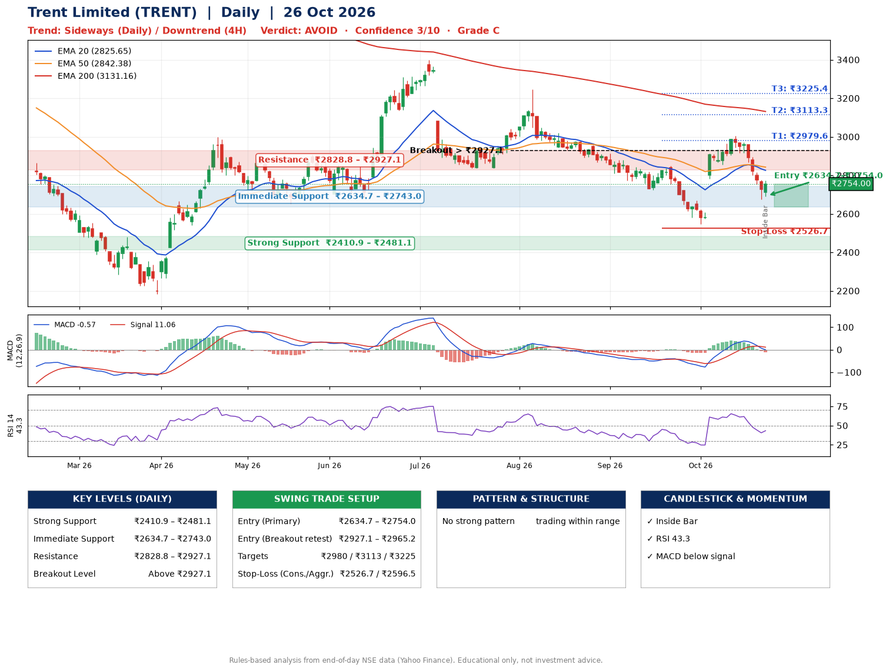

📌 **Trent Limited (TRENT) – Multi-Timeframe Technical Analysis (Daily + 4H Combined)**
_Data up to 26 Oct 2026 · Close ₹2754.00_

**📍 Daily Timeframe Trend**
- Trend: **Sideways** (mixed swing structure)
- Recent swing highs: ₹3244.5, ₹2847.9, ₹3004.7 · swing lows: ₹2836.0, ₹2723.9, ₹2545.8
- EMAs: EMA20 ₹2825.6, EMA50 ₹2842.4, EMA200 ₹3131.2; bearish stack (EMA20 < EMA50 < EMA200); price below all EMAs
- MACD -0.57 below signal 11.06 (below zero), fresh bearish crossover; histogram falling
- RSI(14) 43.3; no divergence on the last two swings

**📍 4-Hour Timeframe Trend**
- Structure: **Downtrend** (price below falling EMAs)
- Pullback/support area: recent 4H swing lows ₹2546.0, ₹2855.0; EMA20 ₹2816.3
- EMA20/50: bearish stack (EMA20 < EMA50); price below all EMAs
- MACD -23.96 below signal 0.09 (below zero); histogram rising
- RSI(14) 42.2; Regular bearish divergence

**📍 Pattern Detection (Both Timeframes)**
- No strong pattern detected. Trading within range.

**📍 Candlestick Patterns (last 3 daily candles)**
- **Inside Bar** – 26 Oct: compression inside the prior range ₹2676.2–₹2775.2

**📍 Price Action Key Levels (Daily Structure)**

| Zone | Price Level (₹) | Context |
|------|-----------------|---------|
| Strong Support | ₹2410.9 – ₹2481.1 | Cluster of earlier swing lows (demand) |
| Immediate Support | ₹2634.7 – ₹2743.0 | Nearest swing-low / wick area |
| Resistance | ₹2828.8 – ₹2927.1 | Nearest swing-high supply |
| Breakout Level | Above ₹2927.1 | Swing continuation trigger (52-week high ₹4866.5) |

**📍 Swing Trade Setup**

🟢 **Entry Zone**
- Primary: ₹2634.7 – ₹2754.0 (daily support / EMA20 area; enter on a bullish 4H candle)
- Alternate: ₹2927.1 – ₹2965.2 (breakout retest)

🎯 **Profit Targets**
- T1: ₹2979.6
- T2: ₹3113.3
- T3: ₹3225.4

🛑 **Stop-Loss**
- Conservative: below daily swing low (₹2526.7)
- Aggressive: below 4H structure (₹2596.5)
- Risk per share ≈ ₹167.6; reward:risk to T1 ≈ 1.7

**📌 Strategy Notes**
- Higher timeframe: daily trend is sideways; only take longs while price holds above ₹2410.9.
- Entry timing: wait for a bullish 4H candle (engulfing/hammer) inside ₹2634.7 – ₹2754.0 rather than buying mid-range.
- EMA stacking: bearish stack (EMA20 < EMA50 < EMA200); price below all EMAs.
- Breakout rule: a daily close above ₹2927.1 with volume above its 20-day average (≈1,201,521) opens T2/T3.
- Momentum: RSI 43 – room to run; no divergence on the last two swings.
- Exit discipline: move the stop to entry once T1 is hit; book partial profits at each target.

**STEP 2 — Marked Up Chart**

**✅ Trade Validation Checklist**
- Trend + momentum aligned: No · Price at entry zone: Yes
- Stop defined (₹2526.7) · Reward:risk ≥ 1.5 to T1: Yes

## 📌 Final Verdict

Recommendation: **🔴 AVOID**

Confidence: **3/10**

Trade Quality: **C**

Reason:
• No strong edge from trend, momentum or patterns

Next Action:
• Avoid until the trend changes (reclaim EMA50 and a higher low)

_Rules-based analysis from end-of-day data. Educational only, not investment advice. Never place orders without your own confirmation._