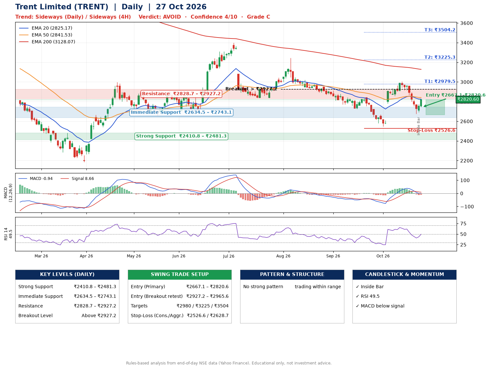

📌 **Trent Limited (TRENT) – Multi-Timeframe Technical Analysis (Daily + 4H Combined)**
_Data up to 27 Oct 2026 · Close ₹2820.60_

**📍 Daily Timeframe Trend**
- Trend: **Sideways** (mixed swing structure)
- Recent swing highs: ₹3244.5, ₹2847.9, ₹3004.7 · swing lows: ₹2836.0, ₹2723.9, ₹2545.8
- EMAs: EMA20 ₹2825.2, EMA50 ₹2841.5, EMA200 ₹3128.1; bearish stack (EMA20 < EMA50 < EMA200); price below all EMAs
- MACD -0.94 below signal 8.66 (below zero), fresh bearish crossover; histogram rising
- RSI(14) 49.5; no divergence on the last two swings

**📍 4-Hour Timeframe Trend**
- Structure: **Sideways** (mixed swing structure)
- Pullback/support area: recent 4H swing lows ₹2855.0, ₹2676.8; EMA20 ₹2815.8
- EMA20/50: bearish stack (EMA20 < EMA50); price above EMA20
- MACD -17.95 below signal -6.96 (below zero); histogram rising
- RSI(14) 50.2; Regular bearish divergence

**📍 Pattern Detection (Both Timeframes)**
- No strong pattern detected. Trading within range.

**📍 Candlestick Patterns (last 3 daily candles)**
- **Inside Bar** – 26 Oct: compression inside the prior range ₹2676.2–₹2775.2

**📍 Price Action Key Levels (Daily Structure)**

| Zone | Price Level (₹) | Context |
|------|-----------------|---------|
| Strong Support | ₹2410.8 – ₹2481.3 | Cluster of earlier swing lows (demand) |
| Immediate Support | ₹2634.5 – ₹2743.1 | Nearest swing-low / wick area |
| Resistance | ₹2828.7 – ₹2927.2 | Nearest swing-high supply |
| Breakout Level | Above ₹2927.2 | Swing continuation trigger (52-week high ₹4866.5) |

**📍 Swing Trade Setup**

🟢 **Entry Zone**
- Primary: ₹2667.1 – ₹2820.6 (daily support / EMA20 area; enter on a bullish 4H candle)
- Alternate: ₹2927.2 – ₹2965.6 (breakout retest)

🎯 **Profit Targets**
- T1: ₹2979.5
- T2: ₹3225.3
- T3: ₹3504.2

🛑 **Stop-Loss**
- Conservative: below daily swing low (₹2526.6)
- Aggressive: below 4H structure (₹2628.7)
- Risk per share ≈ ₹217.2; reward:risk to T1 ≈ 1.1

**📌 Strategy Notes**
- Higher timeframe: daily trend is sideways; only take longs while price holds above ₹2410.8.
- Entry timing: wait for a bullish 4H candle (engulfing/hammer) inside ₹2667.1 – ₹2820.6 rather than buying mid-range.
- EMA stacking: bearish stack (EMA20 < EMA50 < EMA200); price below all EMAs.
- Breakout rule: a daily close above ₹2927.2 with volume above its 20-day average (≈1,175,954) opens T2/T3.
- Momentum: RSI 49 – room to run; no divergence on the last two swings.
- Exit discipline: move the stop to entry once T1 is hit; book partial profits at each target.

**STEP 2 — Marked Up Chart**

**✅ Trade Validation Checklist**
- Trend + momentum aligned: No · Price at entry zone: Yes
- Stop defined (₹2526.6) · Reward:risk ≥ 1.5 to T1: No

## 📌 Final Verdict

Recommendation: **🔴 AVOID**

Confidence: **4/10**

Trade Quality: **C**

Reason:
• No strong edge from trend, momentum or patterns

Next Action:
• Avoid until the trend changes (reclaim EMA50 and a higher low)

_Rules-based analysis from end-of-day data. Educational only, not investment advice. Never place orders without your own confirmation._